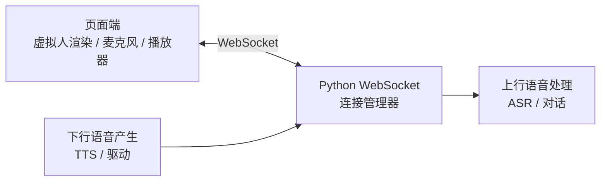
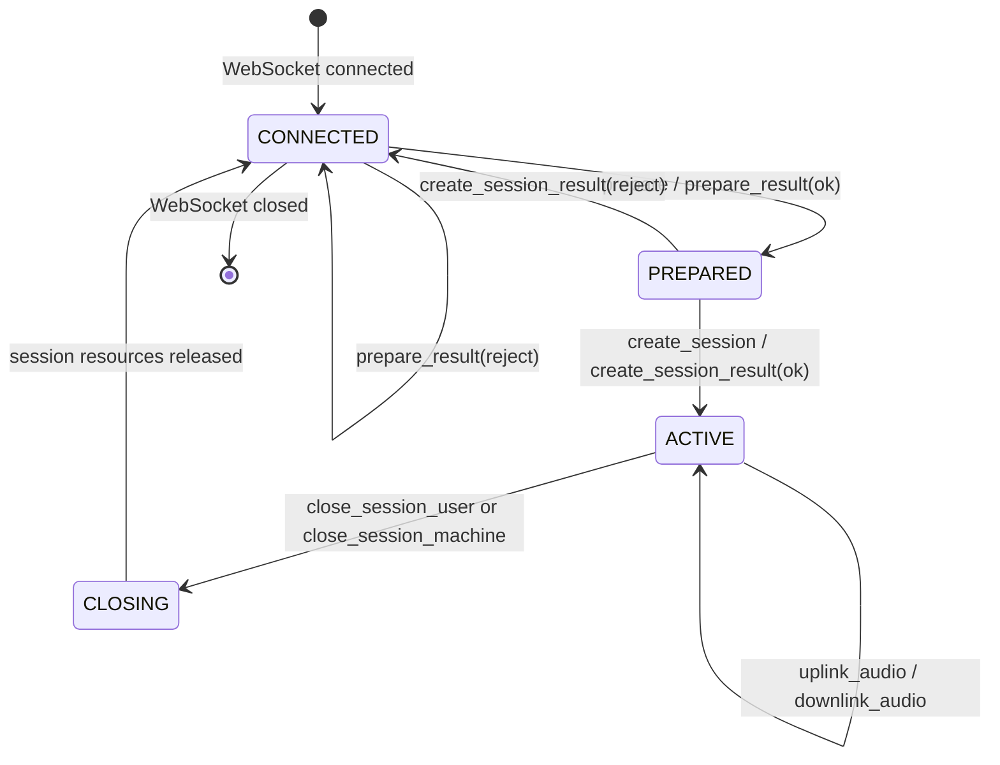
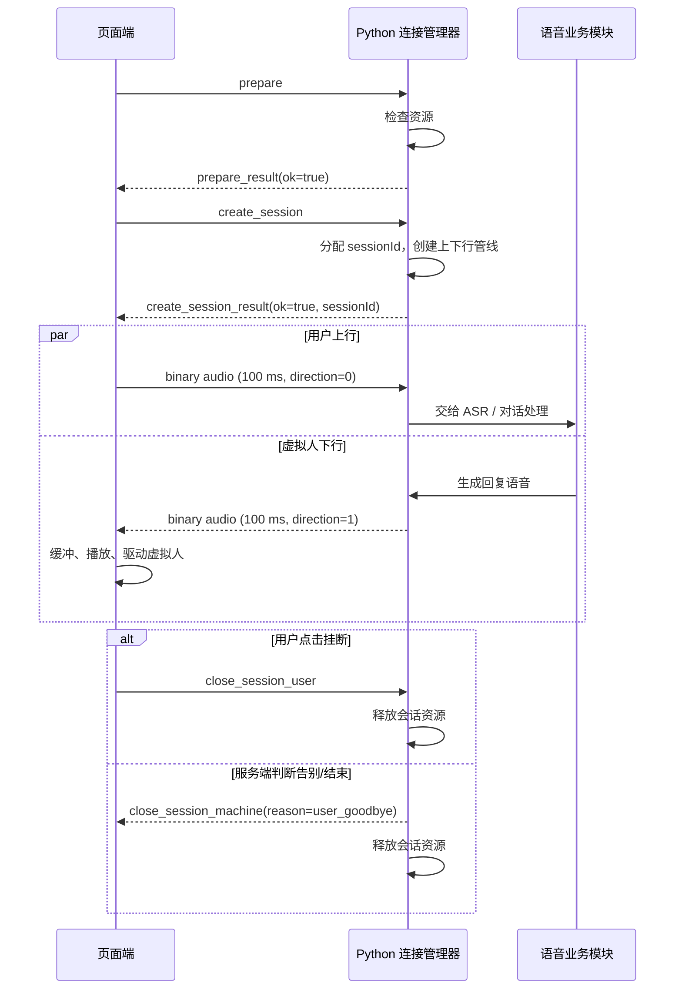
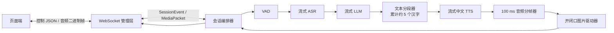
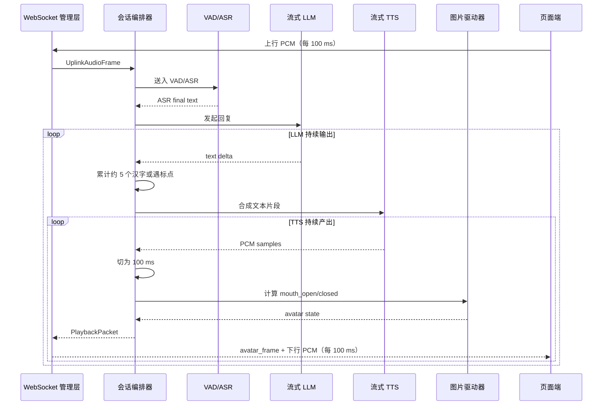

# 本地实时语音虚拟人设计文档

## 1. 目标与范围

实现一个运行在同一台电脑上的实时语音虚拟人页面。页面展示虚拟人形象，用户通过麦克风与其双向语音对话；后端使用 Python，主要职责是管理 WebSocket 连接与会话，并向语音/虚拟人业务模块转发上下行音频。

本期只定义 WebSocket 控制信令和上下行语音流，不包含文本消息、视频流、鉴权、跨设备网络优化或具体 ASR/LLM/TTS/驱动实现。音频以 **100 ms** 为一个传输包。

## 2. 架构与职责



| 组件 | 职责 |
| --- | --- |
| 页面端 | 发起资源探测和会话；采集麦克风；每 100 ms 发送上行音频；播放下行音频；根据语音驱动虚拟人；提供挂断按钮。 |
| Python WebSocket 连接管理器 | 维护连接、会话状态和资源占用；校验消息顺序；将音频分发给业务管线；将下行音频及服务端挂断事件推送给页面。 |
| 语音业务模块 | 消费用户音频并产生虚拟人回复音频；该模块可替换，不属于协议本身。 |

服务仅面向 `localhost` 监听，例如 `ws://127.0.0.1:8765/ws`。本地运行通常无需处理公网抖动，但仍需限制包大小、设置超时和状态校验，防止页面异常导致资源泄漏。

## 3. 会话状态机



约束：

- 每个 WebSocket 同时只能有一个 `ACTIVE` 会话。
- `prepare` 成功仅表示当前可接入，不是资源永久预留；建议页面在 5 秒内发送 `create_session`，否则服务端释放预检占用。
- 只有收到成功的 `create_session_result` 后，页面才可发送上行音频；服务端也只向 `ACTIVE` 会话发送下行音频。
- 任一端断开 WebSocket 时，服务端必须回收对应会话资源；无需再发送关闭事件。

## 4. WebSocket 协议

### 4.1 通用约定

- 一个 WebSocket 连接承载一个页面实例；使用 TLS 时可改为 `wss://`，协议字段不变。
- **控制包使用 UTF-8 JSON 文本帧**；**音频包使用二进制帧**。
- JSON 使用小驼峰字段名，时间使用 Unix 毫秒时间戳。
- `requestId` 由页面生成，用于匹配一次控制请求及其结果；`sessionId` 由服务端在建会成功时生成。
- 协议版本固定为 `1`，不兼容修改时递增版本。

控制包公共字段：

```json
{
  "type": "prepare",
  "version": 1,
  "requestId": "uuid"
}
```

结果公共字段：

```json
{
  "type": "*_result",
  "version": 1,
  "requestId": "uuid",
  "ok": true,
  "code": "OK",
  "message": ""
}
```

失败时 `ok` 为 `false`，客户端不可进入下一状态。建议错误码：`NO_RESOURCE`、`INVALID_STATE`、`INVALID_MESSAGE`、`UNSUPPORTED_AUDIO_FORMAT`、`SESSION_NOT_FOUND`、`INTERNAL_ERROR`。

### 4.2 控制消息

| 方向 | `type` | 说明 |
| --- | --- | --- |
| 页面 → 服务端 | `prepare` | 询问当前是否有可用虚拟人/推理资源，相当于拨号前探测。可带期望音频参数。 |
| 服务端 → 页面 | `prepare_result` | 返回资源是否可用。成功后页面可请求建立会话。 |
| 页面 → 服务端 | `create_session` | 请求打开会话，携带最终采用的音频参数。 |
| 服务端 → 页面 | `create_session_result` | 建会成功或拒绝；成功时返回 `sessionId`。相当于电话接通。 |
| 页面 → 服务端 | `close_session_user` | 用户点击挂断，请求关闭会话。 |
| 服务端 → 页面 | `close_session_machine` | 服务端因用户口头告别、超时、资源策略或内部结束而主动挂断。 |

`prepare` 示例：

```json
{
  "type": "prepare",
  "version": 1,
  "requestId": "e0c55a47-6ad9-4eae-9d4e-2d1ec7b3e8f3",
  "audio": {"codec": "pcm_s16le", "sampleRate": 16000, "channels": 1, "frameDurationMs": 100}
}
```

成功的 `prepare_result` 示例：

```json
{
  "type": "prepare_result",
  "version": 1,
  "requestId": "e0c55a47-6ad9-4eae-9d4e-2d1ec7b3e8f3",
  "ok": true,
  "code": "OK",
  "message": "resource available"
}
```

`create_session` 示例：

```json
{
  "type": "create_session",
  "version": 1,
  "requestId": "079b2a9e-9935-48cf-8f4e-709ae65a38ad",
  "audio": {"codec": "pcm_s16le", "sampleRate": 16000, "channels": 1, "frameDurationMs": 100}
}
```

成功的 `create_session_result` 示例：

```json
{
  "type": "create_session_result",
  "version": 1,
  "requestId": "079b2a9e-9935-48cf-8f4e-709ae65a38ad",
  "ok": true,
  "code": "OK",
  "sessionId": "sess_01J...",
  "audio": {"codec": "pcm_s16le", "sampleRate": 16000, "channels": 1, "frameDurationMs": 100}
}
```

用户挂断：

```json
{"type":"close_session_user","version":1,"requestId":"uuid","sessionId":"sess_01J..."}
```

服务端主动挂断：

```json
{
  "type": "close_session_machine",
  "version": 1,
  "sessionId": "sess_01J...",
  "reason": "user_goodbye",
  "message": "用户已告别"
}
```

`reason` 可取 `user_goodbye`、`idle_timeout`、`resource_reclaimed`、`service_error`。页面收到任一关闭消息后必须立即停止采集与发送、停止播放队列、重置 UI 到可重新 `prepare` 的状态。

### 4.3 音频二进制帧

二进制帧由固定 24 字节头部和 PCM 载荷组成，采用网络字节序（big-endian）。同一格式用于上行和下行，通过 `direction` 区分。

| 字节偏移 | 长度 | 字段 | 说明 |
| --- | ---: | --- | --- |
| 0 | 2 | `magic` | 固定 `0x5652`（ASCII `VR`） |
| 2 | 1 | `version` | 固定 `1` |
| 3 | 1 | `direction` | `0`：页面→服务端；`1`：服务端→页面 |
| 4 | 8 | `sessionIdHash` | `sessionId` 的前 8 字节 SHA-256，用于快速校验归属 |
| 12 | 4 | `sequence` | 从 0 递增的帧序号；每个方向独立计数 |
| 16 | 8 | `timestampMs` | 采集（上行）或生成（下行）的 Unix 毫秒时间 |
| 24 | N | `payload` | 原始 PCM 音频数据 |

首期固定音频格式为 `pcm_s16le`、16 kHz、单声道、16 bit。每 100 ms 的 payload 长度应为 `16000 × 0.1 × 1 × 2 = 3200` 字节，单个二进制帧总长为 3224 字节。收到格式、方向、会话哈希、长度或序号不合法的帧时，服务端丢弃该帧并记录告警；连续异常可主动关闭会话。

页面应使用 `AudioWorklet` 采集和重采样，而非依赖 `MediaRecorder` 的压缩分片；将采集样本累计为精确 100 ms 后发送。播放端按 `sequence` 排序并使用小型缓冲（建议 200–300 ms）平滑调度；本地环境仍可在发现间断时插入静音以保持时间轴连续。

## 5. 主流程时序



## 6. Python 连接管理器设计

建议按“连接上下文 + 会话注册表 + 音频队列”组织：

- `ConnectionContext`：一个 WebSocket 对应一个上下文，保存状态、预检过期时间、当前 `sessionId`、发送锁和两个帧序号。
- `SessionRegistry`：集中进行资源检查、会话创建、关闭和幂等回收；应避免两个 `prepare/create_session` 并发抢占同一资源。
- `AudioPipeline`：上行帧投入有界队列供语音处理消费；下行帧从业务模块读取后封装为二进制帧。队列满时优先丢弃最旧的实时音频，不能无限积压造成延迟扩大。
- 每个连接由独立协程接收；所有对同一 WebSocket 的发送必须串行化，避免控制包和音频帧交叉写入。
- 提供心跳：页面每 10 秒发送 WebSocket ping，服务端连续 30 秒未收到活动则关闭会话并回收资源。

## 7. 页面端交互与异常处理

初始页显示虚拟人和“开始通话”。点击后依次执行 `prepare`、`create_session`；失败时显示服务端的 `message` 并回到可重试状态。通话中显示“挂断”，点击即停止本地采集、发送 `close_session_user`，并在收到确认或连接关闭后清理播放器。

若 `create_session_result` 被拒绝，页面不得启动麦克风流发送。若收到 `close_session_machine`，页面提示结束原因（可简化为“通话已结束”），停止所有音频任务。WebSocket 非正常断开时，页面同样清理本地状态，并允许用户重新开始。

## 8. 验收标准

1. 资源可用时，页面可按 `prepare → create_session` 建立会话；资源不可用或建会拒绝时不会启动音频传输。
2. 建会成功后，页面每 100 ms 发送一个 3200 字节 PCM payload 的上行音频帧，并可连续播放服务端下行帧。
3. 上、下行音频能够并行进行，任意一方发送音频均不阻塞另一方向。
4. 点击挂断会停止页面采集、关闭服务端会话并释放资源；服务端主动挂断会使页面进入相同的已结束状态。
5. 非法状态调用、错误音频格式、连接中断和超时均不会遗留活跃会话或无界音频缓存。

## 9. 后端总体架构

后端拆为两个逻辑部分，彼此通过明确的内部事件接口连接。WebSocket 管理层不理解 ASR、LLM、TTS 或图片生成细节；数字人业务层不直接操作网络连接。



### 9.1 WebSocket 管理层

该层只负责连接和媒体传输，具体职责如下：

- 按第 3、4 节处理 `prepare`、`create_session`、关闭信令、心跳与协议校验。
- 创建 `SessionRuntime`，把上行 100 ms 音频帧投递到该会话的业务输入队列。
- 从业务输出队列读取已生成的播放包，并按产生顺序写回对应 WebSocket。
- 负责资源配额、断连回收、发送串行化和背压；不等待模型推理完成，避免一个会话阻塞其他连接。

建议一个会话对应三条有界异步队列：`uplinkAudioQueue`（页面音频）、`playbackQueue`（业务生成的播放包）及内部业务队列。实时数据队列必须设置最大时长而非无限长度；建议上行最大 1 秒、下行最大 2 秒。队列满时丢弃**最旧**的实时媒体包，并记录会话指标，避免“越积压、延迟越高”。

### 9.2 数字人业务层

业务层以 `SessionRuntime` 为会话边界，编排 VAD、ASR、LLM、TTS 和图片驱动管线。模型实例可由进程级 `ModelPool` 复用；每个会话仅持有各模型的流式上下文和取消令牌，不能共享会话状态。

| 子模块 | 输入 | 输出 | 职责 |
| --- | --- | --- | --- |
| VAD | 100 ms 用户 PCM | 语音起止事件、透传音频 | 检测用户开始/结束说话，过滤长静音，并为 ASR 切分 utterance。 |
| 流式 ASR | 用户语音片段 | 中间/最终中文文本 | 使用支持增量识别的开源中文模型；最终文本提交给 LLM。 |
| 流式 LLM | ASR 最终文本与会话上下文 | token/文本增量 | 持续输出回复，不必等待整句完成。 |
| 文本分段器 | LLM 文本增量 | 可合成文本片段 | 按约 5 个汉字累计，遇到标点可提前切分；处理半个 UTF-8 字符与数字/英文。 |
| 流式 TTS | 文本片段 | PCM 样本流 | 使用可流式合成、可输出中文的开源模型；首期使用默认音色，不提供音色克隆或选择。 |
| 音频分帧器 | TTS PCM 样本流 | 精确 100 ms 音频帧 | 统一采样率、单声道、16-bit PCM，最后不足 100 ms 的尾帧补静音。 |
| 图片驱动器 | 100 ms 下行音频帧 | 图片状态/播放包 | 依据音量能量决定张嘴或闭嘴，不做表情、头部动作或精确唇形。 |

## 10. 流式回复与图片播放包

### 10.1 低延迟文本分段策略

LLM 每输出一个文本增量即交给 `TextChunker`。分段器累计可朗读字符；累计至少 5 个汉字（中文标点不计数）就提交 TTS。若先遇到 `，。！？；` 等自然边界，则允许在 2–5 个汉字间提前提交；若一直没有边界，最长累计 12 个汉字必须提交，防止首包等待过久。末尾残留文本在 LLM 完成时立即提交。

示例：LLM 依次输出“你好，”“很高兴”“认识你”。分段器可先提交“你好，”（标点边界），再在累计到“很高兴认识”后提交，最后在结束时提交“你”。实现时应保留未完整输出的 Unicode 字符，不能按字节截断。

TTS 必须是流式接口：文本片段一旦被接受即可逐步产出 PCM，而不等待整段或整个 LLM 回复完成。TTS 输出顺序由 `replyId` 和 `ttsSegmentIndex` 标识；即使不同片段的推理任务并发，写入播放队列前仍必须按索引重排，保证听到的内容与 LLM 原文一致。

### 10.2 开闭口驱动规则

对每个 100 ms 下行 PCM 帧计算 RMS 能量，并以滞回阈值消除抖动：

- 连续帧 RMS 大于 `openThreshold` 时，状态为 `mouth_open`。
- 连续帧 RMS 小于 `closeThreshold` 时，状态为 `mouth_closed`；其中 `closeThreshold < openThreshold`。
- 对极短静音可保持上一帧状态，连续 200 ms 静音后强制闭嘴。

首期数字人资源只需要两张同尺寸、同背景、同对齐的图片：`mouth_closed`（默认）和 `mouth_open`。每个下行音频帧映射一张图片，因此播放端每 100 ms 同步切换图片和播放音频；不需要视频编码。为后续升级保留 `avatarState` 字段，之后可扩展为更多口型或表情。

### 10.3 业务播放包（内部对象）

业务层向 WebSocket 管理层输出以下内部对象；它不是页面直接发送的 JSON，而是管理层对其进行 WebSocket 封装。

```json
{
  "sessionId": "sess_01J...",
  "replyId": 3,
  "sequence": 42,
  "timestampMs": 1760000000000,
  "audio": "3200 bytes pcm_s16le",
  "avatarState": "mouth_open",
  "isFinal": false
}
```

为保证音频与图片原子同步，管理层将其编码为第 4.3 节的**下行二进制音频帧**加一个紧邻的 `avatar_frame` JSON 控制帧：

```json
{
  "type": "avatar_frame",
  "version": 1,
  "sessionId": "sess_01J...",
  "sequence": 42,
  "avatarState": "mouth_open"
}
```

两帧使用相同的 `sequence`，页面以音频帧为时钟：缓存到对应 `avatar_frame` 后，在开始播放该音频帧时切换图片。页面应允许 `avatar_frame` 先到或后到；若到播放时仍缺失，则使用上一张图片。若希望进一步降低协议帧数，后续可将 `avatarState` 合并进音频二进制头部的预留字节，但首期采用 JSON 更易调试。

## 11. 业务会话时序与打断



用户说话时需支持“打断”（barge-in）：VAD 检测到稳定人声后，编排器取消当前未完成的 LLM/TTS 任务，清空尚未播放的下行队列，向页面发送 `playback_interrupt`，页面停止未播放音频并切到闭嘴图片。随后继续处理新的用户话语。该行为能避免用户开口后仍长时间听到旧回复。

```json
{
  "type": "playback_interrupt",
  "version": 1,
  "sessionId": "sess_01J...",
  "replyId": 3,
  "reason": "barge_in"
}
```

## 12. 后端实现边界与验收补充

- Python 服务采用 `asyncio`；WebSocket I/O 和队列编排运行在事件循环中，阻塞型模型推理放入进程池、专用推理线程或外部推理服务，不能阻塞 WebSocket 接收。
- 模型适配层定义统一的异步流式接口（如 `async for` 产出 ASR 文本、LLM 文本、TTS PCM），使具体开源模型可替换。
- 业务层识别到“再见”“拜拜”等结束意图后，应先取消生成任务、清空播放队列，再由管理层下发 `close_session_machine(reason=user_goodbye)` 并回收资源。
- 端到端首包指标从“ASR 判定一句结束”开始计时，到页面收到首个下行 100 ms 音频帧为止；应分别记录 ASR、LLM 首 token、文本分段、TTS 首样本、排队和 WebSocket 发送耗时。
- 验收时验证：LLM 未结束前已能合成并播放前 5 个汉字左右的内容；每个下行音频包都有同序号的开/闭口状态；用户打断后旧语音在合理缓冲时间内停止。
