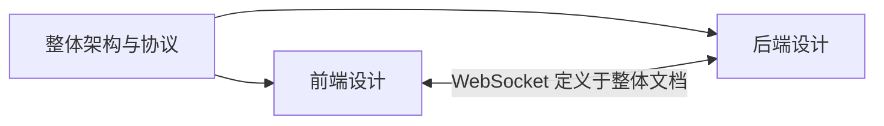

# 实时语音虚拟人设计文档

本项目的设计文档按职责拆分，协议以整体文档为唯一事实来源：

1. [整体架构与 WebSocket 协议](docs/01-architecture-and-protocol.md)
2. [前端设计](docs/02-frontend-design.md)
3. [后端设计](docs/03-backend-design.md)
4. [双工对话模块设计](docs/04-duplex-dialogue-design.md)

## 文档关系

所有消息类型、状态转换与二进制帧格式均以“整体架构与 WebSocket 协议”为准；前端和后端文档只描述各自的实现职责。
