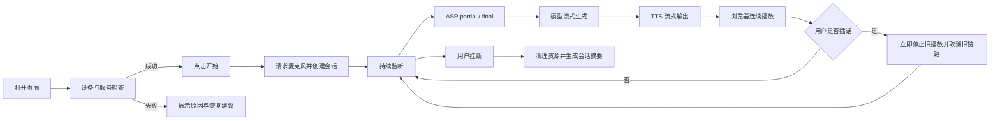

# 实时全双工语音 Agent 演示系统 PRD

> 产品方向已于 2026-10-20 转为初中生英语口语与听力练习微信小程序。后续学生产品需求以 [猫猫英语微信小程序产品需求](09-student-english-miniprogram-prd.md) 为准，技术迁移及发布条件见 [迁移调研](10-wechat-miniprogram-migration-research.md)。本文保留为原技术演示系统的设计依据。

| 项目 | 内容 |
| --- | --- |
| 产品名称 | Real-time Voice Agent Console |
| 文档版本 | v1.0 |
| 文档状态 | Draft / 可进入开发 |
| 更新日期 | 2026-09-07 |
| 产品定位 | 面向技术客户与招聘方的实时语音对话能力作品集 |
| 首期形态 | 本地单用户 Web 应用，浏览器 + Python 后端 |

## 1. 产品概述

本产品是一套可运行、可打断、可观测的实时全双工语音 Agent 演示系统。用户在浏览器中持续说话，系统实时完成语音识别、模型生成和语音合成；机器人播放回复期间，用户可以随时插话，系统必须立即停止旧回复并进入新一轮识别。页面同步展示对话内容、系统状态和端到端事件时间线。

该产品的核心价值不是展示某种编程语言，也不是简单串联 ASR、LLM、TTS 三个模型，而是证明开发者具备实时音频链路、双工状态管理、并发取消、延迟优化、异常恢复和可观测性方面的工程经验。

一句话体验：

> 浏览器稳定说话 → 实时识别 → 模型回复 → 流式播放 → 可以立即打断 → 页面展示完整时间线。

## 2. 背景与问题

现有项目已经具备浏览器采音、WebSocket 会话、ASR、Agent、TTS、播放和简单虚拟形象等基础模块，但仍属于技术验证性质的半成品：

- 用户无法从页面直观看到 ASR、LLM、TTS 和播放分别耗时多久。
- 打断涉及播放器、生成任务、TTS 任务和在途旧数据，当前链路尚未形成可证明的端到端取消语义。
- 队列、乱序、尾包、断线和慢模块等实时系统问题缺少明确的产品验收标准。
- 当前页面更像功能 Demo，不能充分体现实时语音工程经验。
- 设计文档描述的能力部分领先于实现，缺少统一的 MVP 范围和完成定义。

因此需要先将项目收敛为一条稳定、可解释、可量化的核心链路，再扩展业务场景。

## 3. 产品目标

### 3.1 核心目标

1. 用户可以在桌面浏览器中完成连续、多轮、低延迟的中文语音对话。
2. 用户在机器人生成或播放期间开口，旧回复能够被端到端取消，且不会再次播放或写入正常对话历史。
3. 页面能够实时展示识别文本、回复文本、会话状态、关键事件和各阶段延迟。
4. 系统在参考环境中连续运行 30 分钟，不出现崩溃、明显音频积压、队列无限增长或跨轮串话。
5. 系统具备可重复演示和测试能力；没有本地模型时，也能通过 Stub/Demo 后端验证完整交互。
6. 项目通过代码、指标、演示视频和技术说明，清晰表达开发者的实时语音系统能力。

### 3.2 成功信号

- 第一次体验的用户无需阅读说明即可完成拨通、对话、打断和挂断。
- 技术评审者可以从页面时间线定位一次慢响应发生在 ASR、LLM、TTS 还是播放阶段。
- 连续执行正常对话、连续插话、慢模型和异常恢复场景时，系统行为可预测、可复现。
- 打断后不存在“旧声音又冒出来”、旧文本继续增长或旧回复污染下一轮上下文的问题。

### 3.3 非目标

首期不包含：

- 电话线路、SIP、呼叫中心或 PSTN 接入。
- 多租户、计费、企业权限和完整运营后台。
- RAG、知识库、复杂工具调用和多 Agent 编排。
- 音色克隆、精确唇形、视频数字人和 3D 虚拟人。
- 分布式部署、Kafka、Kubernetes 和大规模并发压测。
- 以 Java、Python 或前端框架数量作为交付目标。
- 追求通用聊天产品的丰富功能；首期只证明实时语音主链路。

## 4. 目标用户与使用场景

### 4.1 目标用户

| 用户 | 核心诉求 |
| --- | --- |
| 技术客户 | 判断开发者能否处理实时语音 Agent、延迟、打断和稳定性问题。 |
| 招聘方 / 技术面试官 | 快速识别项目不是模型 API 拼装，而是有完整实时系统设计。 |
| 项目开发者 | 本地调试每轮语音事件，快速定位延迟、串话、积压和取消失败。 |
| 普通体验者 | 不理解底层技术也能自然对话、插话并获得明确反馈。 |

### 4.2 核心演示场景

1. **正常多轮对话**：用户连续完成至少 5 轮问答，字幕和语音顺序一致。
2. **播放期间打断**：机器人正在说话时用户插话，旧音频立即停止，新一轮正常开始。
3. **生成期间打断**：LLM 或 TTS 尚未开始播放时用户插话，旧任务取消且不产生后续音频。
4. **连续打断**：用户在多轮中连续插话，系统不串轮、不恢复旧回复。
5. **慢模块演示**：人为增加 LLM/TTS 延迟，页面明确显示瓶颈位置，系统不无限积压。
6. **异常恢复**：麦克风拒绝、模型不可用或 WebSocket 中断时，页面给出明确状态并可重新发起会话。

## 5. 产品原则

1. **实时性优先**：交互延迟高时，优先丢弃过期上行数据或取消旧任务，不能通过无限缓存维持表面完整。
2. **控制优先于媒体**：打断、挂断和错误等控制事件不得排在旧媒体数据之后等待。
3. **旧结果默认无效**：每轮异步结果必须经过 `sessionId + turnId + replyId + generationEpoch` 校验。
4. **播放事实优先**：机器人“说了什么”以实际播放或明确完成的内容为准，不能把已取消回复作为正常历史。
5. **先可观测，再优化**：所有延迟优化必须能通过事件时间线和指标验证。
6. **实现技术中立**：语言和框架服务于实时链路；产品验收只看行为、指标、稳定性和工程质量。

## 6. 产品范围与优先级

### 6.1 P0：作品集 MVP

- 浏览器麦克风采集和实时上行。
- 流式 ASR，展示 partial 和 final 文本。
- LLM 流式生成，展示回复增量文本。
- TTS 音频尽早输出并连续播放。
- 生成中和播放中的完整打断链路。
- 明确的会话、用户、机器人状态展示。
- 会话级事件时间线和关键延迟指标。
- 有界队列、序列校验、过期结果隔离和资源清理。
- Stub/Demo 模式以及核心自动化测试。
- 本地一键启动说明和 2～3 分钟演示脚本。

### 6.2 P1：增强能力

- 指标面板、延迟分布和会话 JSON 导出。
- 网络抖动、模型慢响应和错误注入开关。
- 自动重连和会话失败后的快速恢复。
- 中英文切换或可替换模型适配器。
- 更完整的历史回放和单轮详情。
- Docker 化或可分享的远程演示环境。

### 6.3 P2：商业化探索

- SIP / 电话线路接入。
- 外呼业务工作流、意图和工具调用。
- 多会话并发、租户、权限和成本统计。
- 会话检索、质检、录音和合规能力。
- 独立控制面；如确有业务需要，可使用 Spring Boot 承载账号、配置、历史和运营能力，Python 继续承担音频与模型运行时。

## 7. 核心用户流程



## 8. 页面与交互需求

### 8.1 页面布局

桌面端采用三栏或上下组合的控制台布局：

```text
┌──────────────── 顶部状态栏 ────────────────┐
│ 连接状态  会话时长  当前轮次  开始/挂断  设置 │
├────────────┬────────────────┬──────────────┤
│ 实时状态    │ 对话与实时字幕  │ 关键指标      │
│ 音量/VAD    │ 用户 partial    │ ASR 延迟      │
│ Agent 状态  │ 用户 final      │ LLM 首 Token  │
│ 播放缓冲    │ 助手 delta      │ TTS 首音频    │
│ 虚拟形象    │ 打断/取消标记    │ 打断延迟      │
├────────────┴────────────────┴──────────────┤
│ 事件时间线：可按 turn / component / level 过滤 │
└────────────────────────────────────────────┘
```

移动端只保证基本对话能力，不作为 P0 的重点验收平台。

### 8.2 状态展示

页面必须明确展示以下状态：

- 会话：`Idle`、`Connecting`、`Ready`、`Active`、`Reconnecting`、`Closing`、`Closed`、`Error`。
- 用户：`Silent`、`SpeechStarted`、`Speaking`、`SpeechEnded`。
- 机器人：`Idle`、`Thinking`、`Synthesizing`、`Speaking`、`Cancelling`。
- 连接：WebSocket 状态、最近一次消息时间、重连次数。
- 音频：麦克风输入音量、播放状态、播放缓冲时长。

状态变化必须来源于真实系统事件，不能仅通过固定计时器模拟。

### 8.3 对话区

- 用户 ASR partial 文本使用弱化样式实时更新，final 后固化为一条消息。
- 助手流式文本在同一 `replyId` 下增量更新。
- 被打断回复保留可视化记录，但标记为“已打断”，默认不进入下一轮 LLM 正常历史。
- 每条消息可展开查看 `turnId`、`replyId`、开始时间、结束时间和阶段延迟。
- 同一轮用户文本与机器人回复必须通过 `turnId` 关联。

### 8.4 打断反馈

当检测到用户在机器人生成或播放期间开口：

1. 页面立即将机器人状态切换为 `Cancelling`。
2. 浏览器停止已调度的旧音频并清空旧播放缓冲。
3. 当前助手消息标记为“已打断”。
4. 时间线写入打断检测、停止播放、服务端取消完成三个事件。
5. 页面继续展示用户的新一轮 partial 识别，不要求重新点击开始。

### 8.5 错误与恢复

错误提示至少区分：麦克风权限拒绝、设备不可用、WebSocket 失败、协议不兼容、ASR 不可用、LLM 不可用、TTS 不可用和内部错误。

每个错误应包含：面向用户的说明、是否可恢复和下一步操作。不得直接向普通体验者展示堆栈信息；技术详情写入时间线和结构化日志。

## 9. 功能需求

### 9.1 会话与设备

| 编号 | 需求 | 优先级 | 验收摘要 |
| --- | --- | --- | --- |
| FR-001 | 页面进入时检查浏览器音频能力和后端可用性。 | P0 | 不请求权限也能显示服务检查结果。 |
| FR-002 | 用户主动点击后才请求麦克风并创建会话。 | P0 | 建会失败不启动上行音频。 |
| FR-003 | 用户可主动挂断，断连或异常结束时释放采集、播放和模型资源。 | P0 | 结束后无活跃任务和持续增长队列。 |
| FR-004 | 会话具备唯一 `sessionId`，每个用户轮次具备唯一 `turnId`。 | P0 | 日志、页面和导出数据可关联。 |

### 9.2 实时采集与识别

| 编号 | 需求 | 优先级 | 验收摘要 |
| --- | --- | --- | --- |
| FR-101 | 使用浏览器音频工作线程持续采集，统一转换为后端要求的 PCM 格式。 | P0 | 30 分钟采集不中断且无明显时间漂移。 |
| FR-102 | 上行媒体包有单调递增序号，并检测重复、倒退和缺口。 | P0 | 异常被记录且不会导致跨轮污染。 |
| FR-103 | ASR 输出 partial 和 final，页面实时展示。 | P0 | final 固化后 partial 不再覆盖该轮。 |
| FR-104 | VAD 或端点检测输出用户开始和结束说话事件。 | P0 | 静音、短停顿和正常句尾行为可预测。 |
| FR-105 | 上行队列必须有界；处理跟不上时优先保障实时性。 | P0 | 不出现无限内存增长或越来越长的滞后。 |

### 9.3 回复生成与语音播放

| 编号 | 需求 | 优先级 | 验收摘要 |
| --- | --- | --- | --- |
| FR-201 | ASR final 后创建一个绑定当前 `turnId` 的新回复。 | P0 | 并发回调不能绑定到错误轮次。 |
| FR-202 | LLM 增量文本实时展示，并尽早送入文本切分和 TTS。 | P0 | 不等待完整回复才开始 TTS。 |
| FR-203 | TTS 以流或短片段形式输出，播放器连续调度。 | P0 | 无明显句间爆音、重叠或尾包缺失。 |
| FR-204 | 播放数据带 `replyId`、`generationEpoch` 和连续序号。 | P0 | 过期回复音频被客户端和服务端双重过滤。 |
| FR-205 | 最后一段不足完整帧的音频也必须被调度播放。 | P0 | 短句和句尾不丢字。 |
| FR-206 | 模型在首个会话前完成可见的加载或预热。 | P0 | 首轮不因隐式初始化表现为无响应。 |

### 9.4 端到端打断

| 编号 | 需求 | 优先级 | 验收摘要 |
| --- | --- | --- | --- |
| FR-301 | 用户在 `Thinking`、`Synthesizing` 或 `Speaking` 阶段开口均可触发打断。 | P0 | 三种阶段分别具备测试用例。 |
| FR-302 | 打断控制事件使用独立高优先级通道，不等待媒体 FIFO。 | P0 | 媒体队列接近上限时仍能及时停止播放。 |
| FR-303 | 打断按顺序使旧 epoch 失效、停止客户端播放、取消 LLM/TTS、清理旧缓存。 | P0 | 取消后旧回调不能恢复旧回复。 |
| FR-304 | 打断不停止上行采集与 ASR，新一轮语音持续处理。 | P0 | 用户无需等待机器人完全取消即可继续说话。 |
| FR-305 | 被打断回复不作为正常机器人消息进入下一轮模型上下文。 | P0 | History 转换结果不包含该回复。 |

### 9.5 时间线与指标

| 编号 | 需求 | 优先级 | 验收摘要 |
| --- | --- | --- | --- |
| FR-401 | 服务端和前端产生统一结构的会话事件。 | P0 | 事件均可关联 session/turn/reply。 |
| FR-402 | 页面按时间顺序展示关键事件，支持按组件、轮次和级别过滤。 | P0 | 默认不展示每个高频音频包。 |
| FR-403 | 每轮展示 ASR、LLM、TTS、播放和打断的关键延迟。 | P0 | 指标从事件时间计算，不使用模拟值。 |
| FR-404 | 会话结束后可导出脱敏 JSON。 | P1 | 导出内容足以复盘且不包含原始音频。 |
| FR-405 | 页面展示当前队列深度、播放缓冲和异常计数。 | P0 | 慢模块演示中可看到积压趋势和保护动作。 |

### 9.6 演示与测试模式

| 编号 | 需求 | 优先级 | 验收摘要 |
| --- | --- | --- | --- |
| FR-501 | ASR、LLM、TTS 均提供可配置的真实实现和 Stub/Demo 实现。 | P0 | 自动测试不依赖模型、网络和本机环境。 |
| FR-502 | Stub 支持固定延迟、分片输出、错误和取消行为。 | P0 | 可稳定复现慢 LLM、慢 TTS 和取消竞态。 |
| FR-503 | 提供一条明确的本地启动命令和环境检查。 | P0 | 新环境按 README 可启动 Demo 模式。 |
| FR-504 | 提供演示场景说明或一键场景配置。 | P1 | 2～3 分钟内覆盖正常对话、打断、时间线。 |

## 10. 统一事件模型

时间线事件建议使用以下公共字段：

```json
{
  "eventId": "evt_01...",
  "eventType": "barge_in_detected",
  "component": "duplex",
  "level": "info",
  "sessionId": "sess_01...",
  "turnId": "turn_12",
  "replyId": "reply_12",
  "generationEpoch": 12,
  "sequence": null,
  "timestampMs": 1788750000123,
  "monotonicMs": 32640.4,
  "attributes": {
    "robotState": "speaking",
    "playbackBufferMs": 240
  }
}
```

### 10.1 P0 事件清单

| 阶段 | 事件 |
| --- | --- |
| 会话 | `connection_opened`、`session_created`、`session_ready`、`session_closing`、`session_closed` |
| 上行 | `mic_started`、`uplink_gap`、`speech_started`、`speech_ended` |
| ASR | `asr_partial`、`asr_final`、`asr_error` |
| LLM | `reply_created`、`llm_request_started`、`llm_first_token`、`llm_completed`、`llm_cancelled` |
| TTS | `tts_segment_started`、`tts_first_audio`、`tts_segment_completed`、`tts_cancelled` |
| 播放 | `playback_enqueued`、`playback_started`、`playback_completed`、`playback_buffer_underrun` |
| 打断 | `barge_in_detected`、`reply_invalidated`、`playback_stopped`、`reply_cancelled` |
| 异常 | `component_error`、`queue_overflow`、`protocol_error`、`connection_lost`、`reconnected` |

高频音频帧不逐条显示在默认时间线中，只聚合为序号缺口、队列深度、吞吐和异常事件，避免页面被噪声淹没。

## 11. 指标定义与性能目标

所有性能数据必须注明测试日期、机器配置、浏览器、模型、后端配置和样本数量。首期指标是参考环境目标，不宣称适用于所有硬件。

### 11.1 核心延迟定义

| 指标 | 起点 | 终点 |
| --- | --- | --- |
| ASR 首字延迟 | `speech_started` | 首个非空 `asr_partial` |
| 句尾识别延迟 | `speech_ended` | `asr_final` |
| LLM 首 Token 延迟 | `llm_request_started` | `llm_first_token` |
| TTS 首音频延迟 | 首个可合成文本片段就绪 | `tts_first_audio` |
| 端到端首声音延迟 | `speech_ended` | `playback_started` |
| 客户端打断延迟 | `barge_in_detected` | `playback_stopped` |
| 服务端取消延迟 | `barge_in_detected` | `reply_cancelled` |

### 11.2 P0 目标值

| 指标 | 目标 |
| --- | --- |
| 客户端打断延迟 | P95 ≤ 200 ms |
| 打断后旧音频泄漏 | P95 ≤ 200 ms，且不得出现取消后的旧音频恢复 |
| 服务端取消延迟 | P95 ≤ 500 ms；不支持硬取消的模型回调必须被 epoch 栅栏丢弃 |
| ASR 首字延迟 | P95 ≤ 800 ms |
| 句尾识别延迟 | P95 ≤ 1,000 ms |
| 端到端首声音延迟 | 参考环境 P50 ≤ 2,000 ms，P95 ≤ 3,500 ms |
| 连续运行 | 30 分钟无崩溃、无串轮、无无界队列增长 |
| 播放尾包 | 100% 被调度或被明确取消，不得静默滞留 |
| 自动化测试 | Stub 模式重复运行结果稳定，不隐式加载真实模型 |

如果参考硬件无法达到某项延迟目标，版本仍可进入作品集，但必须在 README 中公布实测数据、瓶颈和下一步方案，不能隐藏或伪造指标。

## 12. 非功能需求

### 12.1 稳定性

- 所有上行、下行和内部事件队列必须设置容量和溢出策略。
- WebSocket 断开、页面关闭和主动挂断均必须取消后台任务并释放模型会话资源。
- 同一连接不得存在两个活跃 session；同一 session 同时只能有一个有效 generation epoch。
- 模型初始化失败应使健康状态明确失败，不应等到用户首轮说话才无提示卡住。

### 12.2 实时性

- 音频传输和调度粒度以满足延迟指标为准，建议从现有 100 ms 逐步降低到约 20 ms；ASR 可以在内部聚合为模型需要的较大 chunk。
- 控制事件与媒体事件必须逻辑隔离，打断和挂断可抢占普通媒体处理。
- 时间测量使用单调时钟计算耗时，Unix 时间仅用于跨组件对齐和展示。

### 12.3 可测试性

- 单元测试、协议测试和核心竞态测试默认使用 Stub，不读取本地模型权重。
- 至少覆盖正常完成、生成中打断、播放中打断、尾包、序号缺口、队列满和断连清理。
- 真实模型测试独立标记，允许按环境选择执行。

### 12.4 安全与隐私

- P0 默认只监听 `127.0.0.1`，不对公网开放。
- 默认不持久化原始麦克风音频。
- 导出事件和日志时隐藏提示词、密钥、文件路径等敏感数据。
- 如果后续远程部署，必须增加 TLS、Origin 校验、鉴权、并发限制和请求大小限制。

### 12.5 兼容性

- P0 主要支持最新版桌面 Chrome 或 Edge。
- 页面必须识别 AudioWorklet、麦克风权限和音频播放限制，并给出可操作提示。
- 模型能力通过适配器隔离，替换 ASR、LLM 或 TTS 不改变双工控制语义。

## 13. 关键验收场景

### AC-01 正常五轮对话

1. 用户成功创建会话。
2. 连续完成五轮问题和回答。
3. 每轮均存在正确关联的 `turnId` 和 `replyId`。
4. ASR final、LLM 文本和实际播放顺序一致。
5. 页面展示每轮阶段耗时，无错误和串轮。

### AC-02 播放期间插话

1. 机器人进入 `Speaking`。
2. 播放缓冲中至少存在 500 ms 旧音频。
3. 用户开始说话。
4. P95 200 ms 内浏览器停止旧播放并清空旧缓冲。
5. 旧 generation 后续到达的音频被丢弃，不能再次播放。
6. 新一轮用户语音正常识别并触发新回复。

### AC-03 生成期间插话

1. LLM 已开始生成但 TTS 尚未播放。
2. 用户开始说话。
3. 当前 epoch 立即失效，LLM/TTS 收到取消。
4. 即使旧回调稍后返回，也不更新页面、历史和媒体缓存。

### AC-04 尾包与短句

1. TTS 生成不足一个标准播放帧的短音频。
2. 没有新的下行包到达。
3. 最后音频仍被主动调度并完整播放。
4. 回复正确进入完成状态，不永久停留在 `Speaking`。

### AC-05 慢消费者与队列保护

1. 人为使 ASR、LLM、TTS 或浏览器播放变慢。
2. 页面能观察到队列或缓冲增长。
3. 队列到达上限后执行约定的背压、暂停或丢弃策略。
4. 内存不持续增长，控制事件仍可及时执行。

### AC-06 断连与恢复

1. 活跃会话期间关闭 WebSocket 或刷新页面。
2. 服务端释放该会话的所有任务、缓存和引用。
3. 页面可以重新建立新会话。
4. 新会话不收到旧会话音频和事件。

### AC-07 可重复测试

1. 未安装真实模型或模型不可访问。
2. 使用 Stub/Demo 配置运行完整测试。
3. 测试不会隐式加载或下载真实模型，不会无限等待。
4. 连续运行三次结果一致。

## 14. 里程碑与交付顺序

### M1：实时链路正确性

- 修复播放尾包调度。
- 打断改为高优先级控制路径。
- 完成 `turnId/replyId/generationEpoch/sequence` 全链路关联。
- 增加有界队列、序号校验和旧结果栅栏。
- 增加显式模型加载、预热、超时和清理。
- 建立确定性的 Stub 测试。

完成标准：AC-02、AC-03、AC-04、AC-05、AC-07 通过。

### M2：可观测控制台

- 重构页面布局和状态展示。
- 展示实时字幕、回复增量、播放缓冲和错误。
- 接入统一事件模型和时间线。
- 计算并展示单轮延迟指标。

完成标准：不查看后端日志，也能从页面解释一轮对话和一次打断发生了什么。

### M3：稳定性与作品集包装

- 完成 30 分钟稳定性测试及性能基线。
- 完成异常恢复和真实模型 E2E 测试。
- 整理 README、架构图、时序图和限制说明。
- 录制正常对话、连续打断和慢模块诊断演示。

完成标准：陌生技术评审者可在 5 分钟内理解价值，并按文档运行 Demo 模式。

## 15. 风险与应对

| 风险 | 影响 | 应对 |
| --- | --- | --- |
| 本地 CPU 模型导致首轮和长回复延迟大 | 演示体验不稳定 | 显式预热；公布参考环境；Stub 用于可重复演示；允许替换远程模型。 |
| TTS 名义上“流式”，实际等待整句生成 | 首声音延迟高 | 短文本切分；记录首段就绪和首音频指标；后续替换真流式 TTS。 |
| 控制与媒体共用阻塞队列 | 打断失效 | 独立高优先级控制通道，客户端同时本地止播。 |
| 异步取消不能立即停止底层推理 | 旧数据污染 | generation epoch 栅栏；任何旧回调不得进入状态、历史或媒体队列。 |
| 前端音频调度依赖新包到达 | 尾包滞留 | 使用独立调度循环或明确 flush/final 事件。 |
| 设计范围继续膨胀 | 核心链路长期未完成 | P0 冻结业务功能，完成七个验收场景后再进入 P1。 |
| 模型权重和第三方仓库体积过大 | 项目难以复现 | 权重不入库；提供下载脚本、版本、校验值和最小依赖说明。 |

## 16. 项目完成定义（Definition of Done）

同时满足以下条件，P0 才视为完成：

1. FR-001 至 FR-503 中所有 P0 条目均实现并有验证记录。
2. AC-01 至 AC-07 全部通过。
3. 参考环境完成 30 分钟稳定运行，无无界队列增长、串轮和资源泄漏。
4. 页面完整展示状态、字幕、时间线和关键延迟，而不仅是虚拟形象。
5. Demo 测试不依赖真实模型；真实模型 E2E 测试与普通单测隔离。
6. README 包含一键启动、参考环境、实测指标、已知限制和演示路径。
7. 代码库不提交模型权重、虚拟环境、密钥和无关第三方仓库。
8. 至少提供一段 2～3 分钟演示视频或等价的现场演示脚本。

## 17. 文档关系

本 PRD 定义“为什么做、为谁做、首期做什么以及如何验收”。具体实现由以下技术文档承接：

- `docs/01-architecture-and-protocol.md`：整体架构与 WebSocket 协议。
- `docs/02-frontend-design.md`：浏览器采集、播放和交互设计。
- `docs/03-backend-design.md`：ASR、Agent、TTS 等后端原子能力。
- `docs/04-duplex-dialogue-design.md`：双工状态、策略、取消和媒体缓存。

若技术文档与本 PRD 的用户体验、优先级或验收标准冲突，以本 PRD 为产品决策依据，并通过后续技术设计更新解决；不得仅修改页面展示来绕过端到端行为要求。
