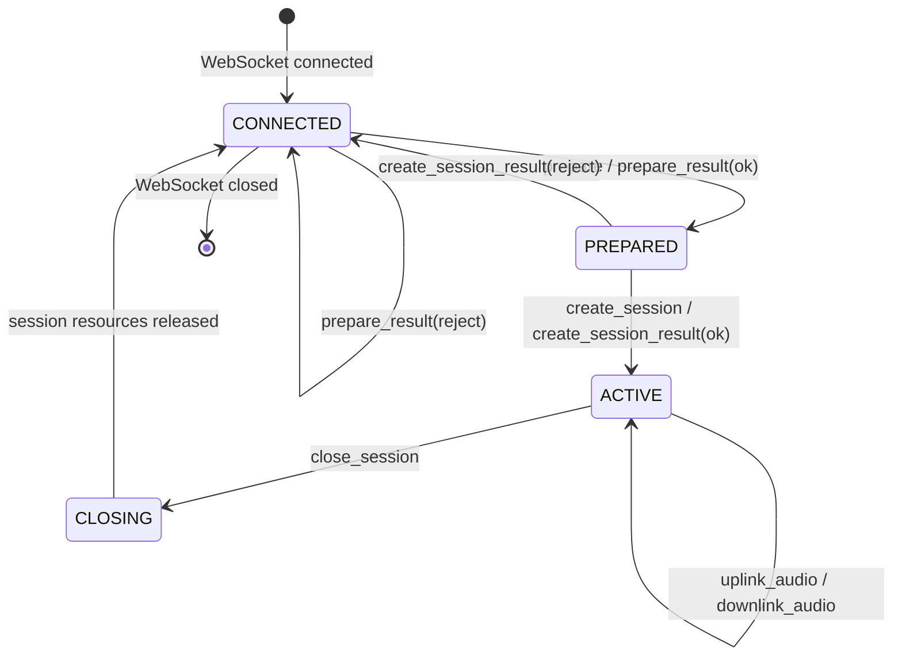
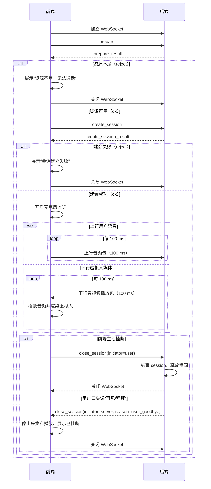

# 实时语音虚拟人：整体架构与 WebSocket 协议

## 1. 目标与范围

页面展示由图片驱动的虚拟人，用户与其进行实时双向语音对话。前端与 Python 后端运行在同一台电脑，通过 WebSocket 通信。首期虚拟人仅支持开口、闭口两种状态，不做表情、头部动作或精确口型。

范围包含：资源探测、会话管理、上下行语音流、开闭口图片状态与主动/用户挂断。范围不包含：文本聊天、视频流、鉴权、跨设备网络优化、音色克隆或具体模型实现。音频以 **100 ms** 为一个传输包。

## 2. 系统架构

系统只有两个对外组件：前端和后端。二者在同一台电脑上，通过一条 WebSocket 连接传输控制消息与双向 100 ms 媒体包；后端内部的连接管理和数字人推理均属于后端实现，不构成第三个系统组件。


| 组件 | 主要职责 |
| --- | --- |
| 前端 | 主动建立 WebSocket；资源探测和建会；建会成功后采集麦克风，每 100 ms 上送音频；接收后端每 100 ms 下发的音视频播放包并渲染虚拟人；发起或响应挂断。 |
| 后端 | 响应资源探测和建会；维护 WebSocket 与会话；消费上行音频并完成数字人处理；每 100 ms 生成、下发音视频播放包；识别用户告别并主动结束会话。 |

服务仅面向 `localhost` 监听，例如 `ws://127.0.0.1:8765/ws`。本地运行不需要公网弱网策略，但仍应限制包大小、校验状态并设置超时，避免异常页面占用资源。

## 3. 会话状态机



- 每个 WebSocket 同时只能有一个活跃会话。
- `prepare` 成功仅代表当前可接入；建议在 5 秒内发送 `create_session`，否则服务端释放预检占用。
- 页面只有收到成功的 `create_session_result` 后才发送上行音频；服务端只向 `ACTIVE` 会话发送下行音频。
- WebSocket 断开时服务端必须回收该连接的会话资源。

## 4. 协议通用约定

- 控制消息使用 UTF-8 JSON 文本帧；音频使用二进制帧。
- JSON 使用小驼峰字段名；时间为 Unix 毫秒时间戳。
- `requestId` 由前端生成，用于匹配控制请求和结果；`sessionId` 由服务端在建会成功时生成。
- 协议版本固定为 `1`；不兼容修改时递增版本。
- 结果消息的 `ok: false` 表示请求失败，页面不得进入下一状态。
- 二进制帧不传输会话相对 `speechTime`；接收方根据每个方向从 `0` 开始的 `sequence` 推导：`speechTime = (sequence + 1) × 100 ms`。`timestampMs` 仅用于传输诊断，不能作为会话时间轴。

控制请求公共格式：

```json
{"type":"prepare","version":1,"requestId":"uuid"}
```

控制结果公共格式：

```json
{"type":"*_result","version":1,"requestId":"uuid","ok":true,"code":"OK","message":""}
```

推荐错误码：`NO_RESOURCE`、`INVALID_STATE`、`INVALID_MESSAGE`、`UNSUPPORTED_AUDIO_FORMAT`、`SESSION_NOT_FOUND`、`INTERNAL_ERROR`。

## 5. 控制消息

| 方向 | `type` | 说明 |
| --- | --- | --- |
| 前端 → 后端 | `prepare` | 询问是否有可用资源。 |
| 后端 → 前端 | `prepare_result` | 返回资源是否可用。 |
| 前端 → 后端 | `create_session` | 请求创建会话，携带最终音频参数。 |
| 后端 → 前端 | `create_session_result` | 返回建会成功或拒绝；成功时返回 `sessionId`。 |
| 前端 → 后端 | `close_session` | 用户点击挂断，请求后端结束会话并关闭 WebSocket。 |
| 后端 → 前端 | `close_session` | 后端因用户告别、超时、资源策略或内部错误而主动通知前端挂断。 |
| 后端 → 前端 | `avatar_frame` | 与下行音频同序号的虚拟人开/闭口状态。 |
| 后端 → 前端 | `playback_interrupt` | 用户打断时，要求前端停止尚未播放的旧回复。 |

`prepare` 与成功结果示例：

```json
{"type":"prepare","version":1,"requestId":"uuid","audio":{"codec":"pcm_s16le","sampleRate":16000,"channels":1,"frameDurationMs":100}}
```

```json
{"type":"prepare_result","version":1,"requestId":"uuid","ok":true,"code":"OK","message":"resource available"}
```

建会请求与成功结果：

```json
{"type":"create_session","version":1,"requestId":"uuid","audio":{"codec":"pcm_s16le","sampleRate":16000,"channels":1,"frameDurationMs":100}}
```

```json
{"type":"create_session_result","version":1,"requestId":"uuid","ok":true,"code":"OK","sessionId":"sess_01J...","audio":{"codec":"pcm_s16le","sampleRate":16000,"channels":1,"frameDurationMs":100}}
```

关闭消息：

前端主动挂断：

```json
{"type":"close_session","version":1,"requestId":"uuid","sessionId":"sess_01J...","initiator":"user"}
```

后端主动挂断：

```json
{"type":"close_session","version":1,"sessionId":"sess_01J...","initiator":"server","reason":"user_goodbye","message":"用户已告别"}
```

`reason` 可为 `user_goodbye`、`idle_timeout`、`resource_reclaimed`、`service_error`。收到服务端 `close_session` 后，前端必须停止采集与发送、停止播放队列、关闭 WebSocket 并回到可重新 `prepare` 的状态。收到前端 `close_session` 后，后端必须结束会话、释放资源并关闭 WebSocket。

图片状态消息：

```json
{"type":"avatar_frame","version":1,"sessionId":"sess_01J...","sequence":42,"avatarState":"mouth_open"}
```

打断消息：

```json
{"type":"playback_interrupt","version":1,"sessionId":"sess_01J...","replyId":3,"reason":"barge_in"}
```

## 6. 音频二进制帧

每个二进制帧由固定 24 字节头部和 PCM 载荷组成，采用网络字节序（big-endian）。同一格式用于上行和下行，通过 `direction` 区分。

| 偏移 | 长度 | 字段 | 说明 |
| --- | ---: | --- | --- |
| 0 | 2 | `magic` | 固定 `0x5652`（ASCII `VR`） |
| 2 | 1 | `version` | 固定 `1` |
| 3 | 1 | `direction` | `0`：前端→后端；`1`：后端→前端 |
| 4 | 8 | `sessionIdHash` | `sessionId` 的前 8 字节 SHA-256，用于快速校验归属 |
| 12 | 4 | `sequence` | 从 0 递增的帧序号；每个方向独立计数 |
| 16 | 8 | `timestampMs` | 采集（上行）或生成（下行）的 Unix 毫秒时间 |
| 24 | N | `payload` | 原始 PCM 音频数据 |

首期音频格式固定为 `pcm_s16le`、16 kHz、单声道、16 bit。每 100 ms payload 大小为 `16000 × 0.1 × 1 × 2 = 3200` 字节，帧总长为 3224 字节。非法格式、方向、会话哈希、长度或序号的帧应被丢弃并记录；持续异常可关闭会话。

`avatar_frame.sequence` 与下行音频帧的 `sequence` 一致。WebSocket 保证单连接内帧的顺序；前端仍应容忍两帧短暂不同步：播放时若尚未收到对应状态，就使用上一张图片。

## 7. 前后端交互时序



## 8. WebSocket 管理器与双工模块边界

WebSocket 管理器拥有连接、资源检查和建会流程；双工模块只在建会成功后处理实时音频与对话。这样 `prepare_result`、`create_session_result` 始终是后端输出，不会被误当成双工模块的网络输入。

| 阶段 | 所有者 | Session 状态 | 说明 |
| --- | --- | --- | --- |
| 收到 `prepare` 至资源结果 | WebSocket 管理器 | `Prepare` | 检查资源，直接下发 `prepare_result`。拒绝时清理并关闭连接。 |
| 收到 `create_session` 至建会结果 | WebSocket 管理器 | `PickUp` | 创建 Session；直接下发 `create_session_result`。拒绝时清理并关闭连接。 |
| 建会成功后的实时对话 | `DuplexDialogue` | `On_Service` | 持续处理上行音频、策略、生成、媒体缓存与打断。 |
| 任一方挂断或服务结束 | WebSocket 管理器 + `DuplexDialogue` | `PRE_HangUP → HangUp` | 双工模块取消任务和清空媒体；管理器直接下发关闭指令并关闭 WebSocket。 |

## 9. 全局验收标准

1. 前端必须按 `prepare → create_session` 的顺序建会，任何拒绝都不启动音频传输。
2. 活跃会话中可同时连续上送和下发 100 ms 音频帧。
3. 每个下行音频帧都有同序号的开/闭口状态，页面按音频播放时刻同步切图。
4. 用户挂断、服务端主动挂断、异常断连均不会遗留活跃会话或无界音频缓存。
