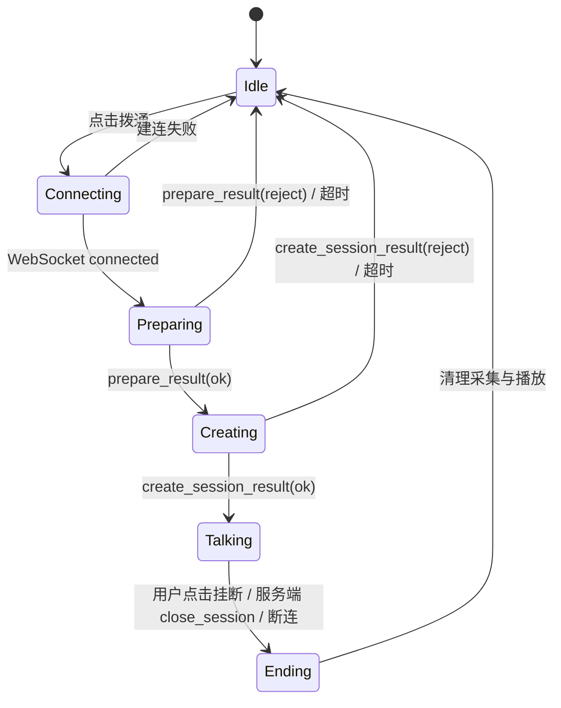

# 实时语音虚拟人：前端设计

## 1. 目标与边界

前端是一个单页实时通话页面。用户进入页面时，看到一张“猫和老鼠”中猫风格的卡通形象和“拨通”按钮；点击后才建立与本机后端的 WebSocket 连接。建会成功后，页面展示通话界面、渲染后端下发的猫的卡通动画、播放声音，并将麦克风音频每 100 ms 上送。

前端不承载 ASR、LLM、TTS、VAD 或动画生成推理；它只负责用户交互、音频采集、音视频播放与渲染。所有 WebSocket 消息格式以[整体架构与 WebSocket 协议](01-architecture-and-protocol.md)为准。

## 2. 页面设计

当前实现为诊断优先的三列演示台：左列显示猫、拨通/挂断、真实状态、麦克风音量和播放缓冲；中列显示 ASR partial/final 与 LLM 流式回复；右列显示五段延迟、队列深度和能力配置。底部统一时间线支持按组件、级别和 `turnId` 筛选，高频 100 ms 包默认隐藏。

### 2.1 初始页（未通话）

页面中央展示猫的卡通静态图片，默认是闭嘴、待机状态。图片下方提供一个主按钮“拨通”。本阶段不请求麦克风权限、不建立 WebSocket、不占用后端资源。

```text
┌──────────────────────────────┐
│                              │
│       [猫的卡通待机图]        │
│                              │
│          ○ 拨通              │
│                              │
└──────────────────────────────┘
```

### 2.2 通话页

建会成功后，页面切换到通话界面。舞台区域持续渲染后端每 100 ms 下发的猫的卡通动画帧，并与同批音频同步播放。页面底部保留醒目的“挂断”按钮。

```text
┌──────────────────────────────┐
│          正在通话             │
│                              │
│     [猫的卡通动画 / 视频帧]   │
│                              │
│       播放后端下发声音         │
│                              │
│          ● 挂断              │
└──────────────────────────────┘
```

首期可用同尺寸、同背景、同对齐的 `mouth_closed` 与 `mouth_open` 两张猫的图片模拟动画；后端下发的图片状态决定切换哪一张。协议上仍按 100 ms 音视频播放包处理，后续替换为更丰富的动画帧不改变页面主流程。

## 3. 页面状态



| 状态 | UI 与行为 |
| --- | --- |
| `Idle` | 显示猫的待机图和“拨通”；不建立连接、不占用麦克风。 |
| `Connecting` | 点击“拨通”后建立 WebSocket，显示“正在连接”。 |
| `Preparing` | WebSocket 建立后发送 `prepare`，5 秒内等待资源结果。 |
| `Creating` | 收到资源可用后发送 `create_session`；不发送麦克风音频。 |
| `Talking` | 显示猫的通话动画和“挂断”；采集、每 100 ms 上送、接收并渲染下行音视频包。 |
| `Ending` | 立即停止采集、清空未播放音频、切换闭嘴图、关闭本地会话状态。 |

## 4. 建连、资源探测与建会

点击“拨通”后严格按以下顺序处理：

1. 建立到本地服务的 WebSocket，并设置 `binaryType = "arraybuffer"`。
2. 连接建立后发送 `prepare`，按 `requestId` 等待 `prepare_result`。
3. 若 `prepare_result.ok` 为 `false`，展示“资源不足，暂时无法通话”，关闭 WebSocket，回到 `Idle`。
4. 若资源可用，发送 `create_session`，按 `requestId` 等待 `create_session_result`。
5. 若建会被拒绝，展示“会话建立失败”，关闭 WebSocket，回到 `Idle`。
6. 仅在 `create_session_result.ok` 为 `true` 后进入 `Talking`：启动麦克风监听、启动上行音频任务，并开始处理下行音视频包。

对同一连接按发送队列串行调用 `send`；控制消息和音频帧都必须保持逻辑顺序。建连、资源探测和建会均应设置 5 秒超时，超时后关闭连接并允许用户重试。

## 5. 麦克风采集与上行音频

使用 `getUserMedia` 获取麦克风，并以 `AudioWorklet` 采样和重采样；不使用 `MediaRecorder` 的压缩分片。将样本转换为 16 kHz、单声道、`pcm_s16le`，累计精确 100 ms（3200 字节）后，按整体协议的二进制头部封装并发送。

- 每个上行帧的 `direction` 为 `0`，`sequence` 从 0 单调递增。
- 浏览器采样率不等于 16 kHz 时必须重采样。
- 采集失败、权限被拒绝或 WebSocket 已不在 `Talking` 状态时，停止音频工作线程并提示用户。
- 发送队列应设置 1 秒上限。网络或后端处理慢时丢弃最旧帧，不能累积出越来越大的说话延迟。

## 6. 下行音视频播放与猫动画渲染

前端缓存后端发来的 100 ms 下行音视频播放包，并以 `sequence` 对齐音频和动画帧。首期播放包包含下行 PCM 与 `avatar_frame` 图片状态；建议准备 200–300 ms 音频缓冲后连续调度到 `AudioContext` 播放，以减小浏览器调度抖动。

每个音频帧开始播放时：

1. 查找相同 `sequence` 的 `avatar_frame`。
2. 将舞台图片切换为 `mouth_open` 或 `mouth_closed`。
3. 播放对应的 100 ms PCM。

若图片状态尚未到达，使用上一帧图片；若某帧音频缺失或间断，插入 100 ms 静音以保持时间轴。收到 `playback_interrupt` 时，立即取消尚未开始的音频调度、清空图片状态缓存并切换闭嘴图。

## 7. 挂断与错误处理

用户点击“挂断”时，页面按以下步骤处理：

1. 停止麦克风监听和 100 ms 上行音频任务，防止继续发送语音。
2. 向后端发送 `close_session(initiator=user)`。
3. 清空未播放的音视频包、将猫的图片恢复为闭嘴待机图。
4. 等待后端结束 session 并关闭 WebSocket；连接关闭后回到 `Idle`。

服务端识别到用户说“再见”“拜拜”等意图时，会下发 `close_session(initiator=server)`。前端收到后执行同样清理，主动关闭 WebSocket，并显示“通话已结束”。

错误提示应区分：麦克风权限、服务资源不足、建会失败、协议错误和连接中断；错误详情可使用服务端 `message`，但不向用户暴露内部堆栈或模型错误。

## 8. 前端验收

1. 初始页只显示猫的待机图和“拨通”，不会建立 WebSocket 或请求麦克风。
2. 点击“拨通”后按 `WebSocket → prepare → create_session` 顺序执行；资源不足或建会失败时给出提示并关闭连接。
3. 仅在建会成功后启动麦克风，并稳定上送 100 ms 音频帧。
4. 通话页可连续播放下行音频，同时渲染同序号的猫动画/开闭口状态。
5. 用户点击“挂断”会发送 `close_session` 并关闭通道；服务端主动 `close_session` 时页面也能停止通话并恢复待机状态。
6. 被打断的机器人残缺回复保留在对话区并标记“已打断”，但旧 `replyId` 的迟到音频不会进入播放队列。
7. `/health` 与浏览器能力检查在麦克风授权前完成；错误按连接、权限、协议、ASR、LLM、TTS、队列和播放分类，并给出下一步操作。
