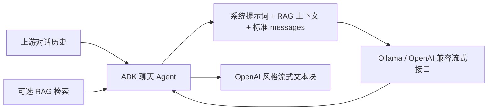
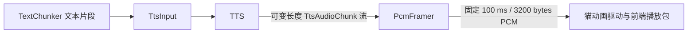
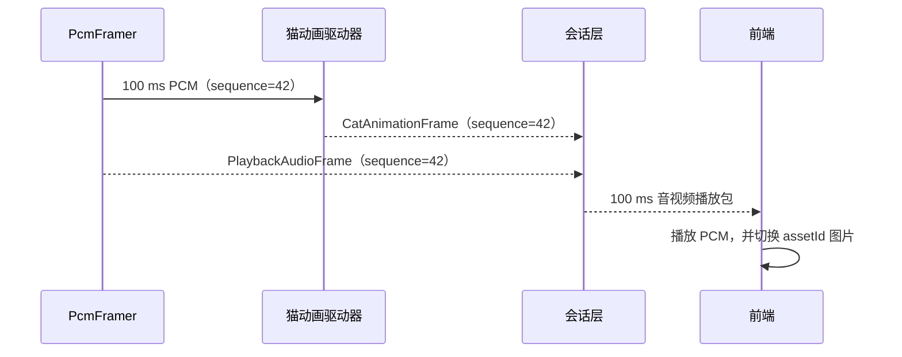
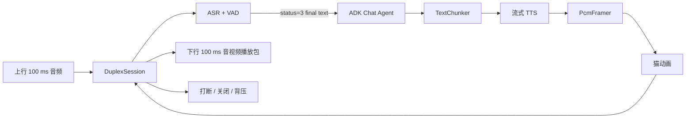
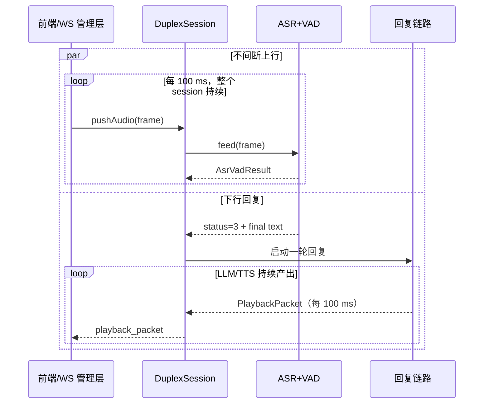

# 实时语音虚拟人：后端原子能力设计

## 1. 当前范围

后端第一阶段不先实现完整的会话编排和并发调度，而是先实现、验证四项可独立运行的原子能力：中文 ASR、流式中文 TTS、流式 LLM、音频驱动的猫开闭口动画。它们都以 Python 异步接口暴露，后续再由 WebSocket 会话服务串联。


`ASR → LLM → TTS → 猫动画` 是未来会话的一条处理链；本阶段每个方块都可单独传入文件或模拟输入进行验证。WebSocket 控制协议见[整体架构与 WebSocket 协议](01-architecture-and-protocol.md)，此文档不重复定义网络消息。

## 2. 模型选择

| 原子能力 | 当前实现 | 选择原因 | 第一阶段约束 |
| --- | --- | --- |
| 中文 ASR | 默认混合模式为本地 [fsmn-vad（0.4M）](https://github.com/modelscope/FunASR) + 阿里云智能语音交互 NLS；本地离线回退为 Paraformer-zh-streaming（220M）+ fsmn-vad | 本地 VAD 保持逐包状态和端点可控，NLS 降低本机资源占用；无云服务时仍可完全离线。 | 两种后端共享同一 `AsrVadResult`；输入 16 kHz 单声道 PCM，输出中间和最终中文结果。 |
| 中文 TTS | [Piper](https://github.com/OHF-Voice/piper1-gpl) + `zh_CN-huayan-medium` | 约 63MB ONNX 中文模型，在本机 CPU 上可流式输出且实测 RTF 约 0.38。 | 不追求定制音色；Piper 的音频流会转为 16kHz PCM 并按 100ms 下发。 |
| 对话 LLM | [Qwen2.5-0.5B](https://huggingface.co/Qwen/Qwen2.5-0.5B-Instruct)，由 Ollama 本地量化部署 | 0.5B 参数适配本机 16GB Intel CPU 内存预算；Ollama 提供 OpenAI 兼容的流式接口。 | 固定使用 `qwen2.5:0.5b`，不启用 3B/4B 默认模型，优先首 token 延迟。 |
| 猫动画 | 自研 RMS 能量驱动器 | 首期只需开口/闭口，不需要人脸驱动或视频生成模型；无需 GPU，稳定且延迟极低。 | 两张对齐的猫图片：`mouth_closed`、`mouth_open`。 |

模型版本在落地时必须固定到具体 tag / commit / 模型 revision，并记录许可证。选择依据：FunASR 官方仓库列出 Paraformer-zh-streaming（220M）与 fsmn-vad（0.4M），并提供逐音频块送入 Paraformer 的流式示例；CosyVoice 官方仓库列明 bi-streaming 及低延迟音频输出；Qwen2.5-0.5B 模型卡标明 Apache-2.0 许可和适合本机的 0.5B 参数量。[FunASR](https://github.com/modelscope/FunASR) [CosyVoice](https://github.com/FunAudioLLM/CosyVoice) [Qwen2.5-0.5B](https://huggingface.co/Qwen/Qwen2.5-0.5B-Instruct)

## 3. 原子能力接口

四项能力都不依赖 WebSocket，对外只接收和产出 Python 对象。音频统一为 16 kHz、单声道、16-bit `pcm_s16le`，帧长 100 ms（3200 字节）。

```python
class AsrEngine:
    async def feed(self, frame: "AsrVadInput") -> "AsrVadResult": ...
    async def reset(self) -> None: ...

class LlmEngine:
    async def stream_reply(self, conversation: "ConversationInput") -> "AsyncIterator[LlmStreamChunk]": ...

class TtsEngine:
    async def stream_pcm(self, request: "TtsInput") -> "AsyncIterator[TtsAudioChunk]": ...

class CatAnimationDriver:
    def drive(self, pcm_100ms: bytes) -> "CatFrame": ...
```

| 能力 | 输入 | 输出 | 单元测试方式 |
| --- | --- | --- | --- |
| ASR | 连续 100 ms 用户 PCM | `partial`、`final`、`speech_start/end` 事件 | 对固定中文音频断帧输入，检查最终文本与端点事件。 |
| LLM | 一段最终用户文本 | 按 token/文本增量产出的异步流 | 对固定提示词检查能先产出首段，再完整结束。 |
| TTS | 一段中文文本 | 持续产出的 PCM 字节流 | 输入“你好”，检查首段音频无需等待整段合成且格式正确。 |
| 猫动画 | 一个 100 ms 下行 PCM | 同序号的开/闭口图片状态 | 输入静音和有声测试帧，检查分别得到闭嘴和开嘴。 |

## 4. ASR + VAD 原子能力

ASR 与 VAD 对编排层表现为一个模块。默认混合模式使用本地 `fsmn-vad` 判定
说话区间，再把有效片段发送给阿里云 NLS；`ASR_BACKEND=funasr` 时改用本地
`Paraformer-zh-streaming` 识别。模块从会话开始到会话结束**持续不断**地消费
前端传来的 100 ms 音频包，不能因一句话结束而停止输入流。两种实现每输入一个
音频包都必须返回同构结果，包括静默包。

### 4.1 输入

```python
AsrVadInput = {
  "sequence": 4,                 # 从 0 递增；第五个音频包为 4
  "speechTime": 500,             # 当前包的结束时间，单位 ms，相对本次通话音频时间轴
  "pcm": b"..."                  # 100 ms、3200 bytes、16 kHz / 单声道 / pcm_s16le
}
```

`speechTime` 从通话音频流起点开始累计。第 1 个包覆盖 `[0, 100)`，第 5 个包覆盖 `[400, 500)`，因此其 `speechTime` 为 `500`。这与 WebSocket 二进制帧的 Unix `timestampMs` 不同：前者用于本次通话内的识别时间轴，后者用于传输诊断。

在 WebSocket 接入时不要求前端额外传递 `speechTime`；管理器根据上行 `sequence` 计算 `speechTime = (sequence + 1) × 100`，再构造本模块的 `AsrVadInput`。

### 4.2 输出

```python
AsrVadResult = {
  "speechTime": 500,             # 当前音频包的结束时间，单位 ms
  "startTime": 430,              # 当前这次说话的开始时间；仅 status=1/2/3 时存在
  "endTime": 500,                # 已确认的说话结束/当前说话进度；仅 status=1/2/3 时存在
  "status": 1,                   # 0=静音，1=开始说话，2=正在说话，3=结束说话
  "text": ""                     # 仅 status=1/2/3 时可选；结束说话时为本次说话的最终完整文本
}
```

`speechTime` 与 `status` 是**每个结果都必须存在**的字段。`startTime`、`endTime` 与 `text` 只在 `status=1/2/3` 时出现。`startTime` 与 `endTime` 均相对于通话音频时间轴，单位毫秒。VAD 应在 100 ms 包内给出边界位置，而不是只精确到整包。`text` 采用 UTF-8 字符串；没有可用文本时返回空字符串，不能返回上一次说话的旧文本。

| `status` | 含义 | `startTime` | `endTime` | `text` |
| ---: | --- | --- | --- | --- |
| `0` | 当前包为静音，且不属于结束包 | 不返回 | 不返回 | 不返回 |
| `1` | 当前包检测到一次新说话 | 这次说话的实际开始时间 | 当前包结束 `speechTime` | 可为空；首期允许为空 |
| `2` | 当前说话仍在继续 | 保持本次说话的开始时间 | 当前包结束 `speechTime` | 可为空或当前中间识别文本 |
| `3` | 当前包检测到本次说话结束 | 保持本次说话的开始时间 | 实际结束时间 | 本次说话的**最终完整文本** |

`status=3` 表示“结束说话”，不表示关闭整个 WebSocket 会话。只有该状态的最终文本才提交给 LLM；`status=1/2` 的中间文本仅用于前端字幕或调试，不能触发 LLM 回复。

### 4.3 示例：第五包开始说话、第十包结束

每包 100 ms。第 5 个包覆盖 `[400, 500)`，用户在该包内第 30 ms 开始说话，即时间轴 `430 ms`。此包的结果为：

```json
{
  "speechTime": 500,
  "startTime": 430,
  "endTime": 500,
  "status": 1,
  "text": ""
}
```

第 10 个包覆盖 `[900, 1000)`，用户在该包内第 50 ms 结束说话，即时间轴 `950 ms`。若本次完整识别为“您好”，此包的结果为：

```json
{
  "speechTime": 1000,
  "startTime": 430,
  "endTime": 950,
  "status": 3,
  "text": "您好"
}
```

该结束包之后，下一包若仍为静音，应返回：

```json
{"speechTime":1100,"status":0}
```

### 4.4 多轮间断说话

音频包流在整段通话期间持续输入；用户静默往往是正在听机器人说话，但这些静默包仍必须逐包返回 `status=0`。当用户再次开口时，模块从新的 `status=1` 开始一轮独立的 utterance，不能沿用上一次的 `startTime`、`endTime`、`text` 或 ASR 缓存。

例如第 30 个包覆盖 `[2900, 3000)`，用户在此包内再次开始说话，且开始点为 `2930 ms`：

```json
{
  "speechTime": 3000,
  "startTime": 2930,
  "endTime": 3000,
  "status": 1,
  "text": ""
}
```

后续语音包应依次返回 `status=2`，直到该轮说话结束的包返回 `status=3` 与这次新说话的最终文本；两轮说话之间的所有包都只返回 `{ "speechTime": N, "status": 0 }`。

### 4.5 实现要求

- VAD 对每个 100 ms 包立即返回状态；本地 `Paraformer-zh-streaming` 在内部按
  600 ms 推理块累积，结束时 flush 剩余缓存。NLS 适配器保持外部 100 ms
  协议不变，在 SDK 边界拆成五个 20 ms PCM 写入，并在本地端点结束时同步
  `stop` 获取最终结果。
- FSMN-VAD 若已开始说话但未发出结束事件，连续 800 ms 低 RMS 静音触发安全
  收尾，避免一次 utterance 永久卡在 `status=2`。
- 第一阶段优先在普通话场景验证识别准确度，再考虑方言、热词和说话人分离。
- `reset` 必须丢弃当前未完成说话及模型缓存，供用户打断或会话关闭使用。

## 5. ADK 聊天 Agent 与流式 LLM

当前服务边界采用 [TextBot v2](12-text-bot-interface.md)：Bot 服务拥有会话历史、状态恢复、幂等结果与存储；双工只提交输入及播放事实。以下 messages 和供应商请求描述 Bot 内部无状态模型适配层，不是双工到 Bot 的服务接口。生产使用已配置的远程兼容模型，本地 Ollama 仅为可选适配器。

Bot 服务从自己的事实记录投影有序历史，再交给内部模型适配器。旧适配器兼容 machine 并转换为 assistant；新英语实现使用 user 和 assistant。双工不接触这一步，也不决定哪些生成内容算作已经说过的话。

### 5.1 输入

```json
{
  "messages": [
    {"role": "user", "content": "你好"},
    {"role": "machine", "content": "你好，请问有什么可以帮你？"},
    {"role": "user", "content": "今天天气怎么样？"}
  ]
}
```

输入约束：

- `messages` 至少有一条消息，最后一条必须为 `user`。
- `role` 只接受 `user`、`machine`；`machine` 在发往 Ollama 前转换为 `assistant`。
- 模型适配器不持久化状态；顺序、投影和上下文预算由 Bot 服务负责，不由双工负责。

### 5.2 Agent 职责



1. 校验并规范化上游历史：`machine → assistant`。
2. 拼接固定系统提示词，例如要求角色以简短、自然的中文语音口吻回复。
3. 若配置 RAG，使用最后一条用户消息检索资料，将结果作为受长度限制的上下文放入系统消息；未配置或检索为空时直接跳过。
4. 调用 Ollama 的 OpenAI 兼容流式 Chat Completions 接口，模型固定为 `qwen2.5:0.5b`。
5. 只将回复文本增量输出给下游；工具调用、RAG 检索过程、思考内容和 ADK 内部事件不得送入 TTS。

发往 Ollama 的核心请求为：

```json
{
  "model": "qwen2.5:0.5b",
  "messages": ["规范化后的 system / assistant / user 消息"],
  "stream": true
}
```

### 5.3 输出：OpenAI 风格流式文本块

Agent 输出保持 Chat Completions 的流式结构。每收到一个有文本内容的模型块即原样转发；下游只读取 `choices[0].delta.content`。

```json
{
  "id": "chatcmpl_local_001",
  "object": "chat.completion.chunk",
  "created": 1760000000,
  "model": "qwen2.5:0.5b",
  "choices": [
    {
      "index": 0,
      "delta": {"content": "今天"},
      "finish_reason": null
    }
  ]
}
```

流结束块不含文本，且 `finish_reason` 不为 `null`：

```json
{
  "id": "chatcmpl_local_001",
  "object": "chat.completion.chunk",
  "created": 1760000001,
  "model": "qwen2.5:0.5b",
  "choices": [{"index": 0, "delta": {}, "finish_reason": "stop"}]
}
```

异常时，Agent 停止流并向会话编排层抛出结构化错误；不得把错误文本当成虚拟人回复交给 TTS。

### 5.4 5 字切分

`TextChunker` 位于 Agent 输出与 TTS 之间，不是模型：只拼接 `choices[0].delta.content` 的非空文本。累计约 5 个汉字后将文本交给 TTS；遇到 `，。！？；` 等标点可在 2–5 个汉字间提前提交；没有标点时最多累计 12 个汉字必须提交；收到 `finish_reason` 后立刻提交剩余字符。按 Unicode 字符处理，禁止按 UTF-8 字节截断。

```text
流式块：“你好，” → TTS: “你好，”
流式块：“很高兴认识你” → TTS: “很高兴认识”
流结束 → TTS: “你”
```

## 6. 流式中文 TTS

TTS 是独立原子能力：输入一段完整、可朗读的中文文本和基础语音配置，立即持续输出 PCM 音频流。它不负责 LLM 文本切分、不负责 100 ms 分帧，也不管理会话历史；`TextChunker` 将短文本片段逐个提交给它。

### 6.1 输入

```json
{
  "requestId": "reply_1_segment_0",
  "text": "你好，很高兴认识你。",
  "config": {
    "speed": 1.0,
    "volume": 1.0,
    "voice": "default"
  }
}
```

| 字段 | 类型 | 说明 |
| --- | --- | --- |
| `requestId` | string | 调用方生成的唯一标识；用于关联该段文本和返回音频流。 |
| `text` | string | 要合成的中文文本；不能为空，建议由 `TextChunker` 控制为短句。 |
| `config.speed` | number | 语速倍率，首期范围 `0.8–1.2`，默认 `1.0`。 |
| `config.volume` | number | 线性音量倍率，首期范围 `0.0–2.0`，默认 `1.0`。`0` 产生静音但保持正确的时长。 |
| `config.voice` | string | 内置音色 ID，默认 `default`。服务端维护允许列表；不接受用户参考音频，不支持音色克隆。 |

配置缺失时使用默认值；范围非法或音色不在允许列表时，在开始音频流之前返回 `INVALID_TTS_CONFIG` 错误。第一阶段至少提供 `default`，其余内置音色可以后续按模型实际支持情况加入列表。

### 6.2 输出

TTS 输出是按生成顺序持续产生的 PCM 块，块大小不固定，不能假设一个输出块正好是 100 ms。统一输出格式为 16 kHz、单声道、16-bit `pcm_s16le`。

```python
TtsAudioChunk = {
  "requestId": "reply_1_segment_0",
  "chunkIndex": 0,               # 从 0 递增
  "sampleRate": 16000,
  "channels": 1,
  "sampleFormat": "pcm_s16le",
  "audio": b"...",              # 非空 PCM 字节；长度可变
  "isFinal": false
}
```

最后一个块可以携带剩余音频并设为 `isFinal: true`；若没有剩余音频，则发送一个 `audio: b""`、`isFinal: true` 的结束块。相同 `requestId` 的 `chunkIndex` 必须连续且严格递增。TTS 不得为了等待完整文本而延迟首个音频块。

### 6.3 与 100 ms 播放包的衔接

`PcmFramer` 位于 TTS 下游而非 TTS 内部。它按 `requestId` 顺序拼接所有 `TtsAudioChunk.audio`：累计满 3200 字节即输出一个 100 ms `PlaybackAudioFrame`；收到 `isFinal` 后，剩余不足 3200 字节的尾部补静音并输出最后一帧。每帧有会话级单调递增 `sequence`，供猫动画驱动和前端同步使用。



### 6.4 取消与异常

调用方可按 `requestId` 取消正在合成的文本段。TTS 收到取消后必须停止后续输出，且不会发送 `isFinal: true`；`PcmFramer` 丢弃该段尚未组成完整 100 ms 帧的尾部数据。模型异常、文本为空或配置非法时，返回结构化错误，不能把错误信息转成音频。

```python
PlaybackAudioFrame = {
  "reply_id": 1,
  "sequence": 42,
  "pcm_100ms": b"..."  # 恰好 3200 bytes
}
```

## 7. 音频驱动猫开闭口动画

猫动画是确定性音频驱动模块，不使用生成式视频、数字人或表情模型。它对每个 100 ms 下行音频包计算 RMS 音量，并产生一条同序号的猫图片状态。首期只有两张静态资源：`mouth_closed`（闭嘴待机）和 `mouth_open`（张嘴说话）；两张图片必须分辨率、背景、位置完全对齐。

### 7.1 输入

动画模块只接受已经由 `PcmFramer` 对齐好的 100 ms 音频帧：

```python
CatAnimationInput = {
  "replyId": 1,
  "sequence": 42,               # 会话下行音频帧序号
  "speechTime": 4200,            # 当前帧结束时间，单位 ms，相对本次下行播放时间轴
  "pcm": b"..."                  # 恰好 3200 bytes，16 kHz / 单声道 / pcm_s16le
}
```

输入 PCM 长度必须为 3200 字节；格式或长度错误直接返回 `INVALID_AUDIO_FRAME`，不生成图片状态。每次调用只处理一个音频帧，调用顺序必须按 `sequence` 递增。

### 7.2 RMS 与开闭口规则

先将 PCM 解析为有符号 16-bit 整数并归一化到 `[-1, 1)`，计算：

```text
RMS = sqrt(sum(sample²) / sample_count)
```

模块保存上一帧的口型和连续低能量帧数，按以下滞回规则决定当前状态：

| 条件 | 输出状态 | 说明 |
| --- | --- | --- |
| `RMS >= openThreshold` | `mouth_open` | 有明显语音能量，立即张嘴并将低能量计数清零。 |
| 上一状态为开口且 `RMS >= closeThreshold` | `mouth_open` | 位于两个阈值之间时保持张嘴，避免频繁切换。 |
| `RMS < closeThreshold`，连续不足 200 ms | 保持上一状态 | 100 ms 的短暂停顿不立即闭嘴。 |
| `RMS < closeThreshold`，连续达到 200 ms | `mouth_closed` | 连续两个低能量音频帧后闭嘴。 |
| 上一状态为闭口且介于两个阈值之间 | `mouth_closed` | 未达到张嘴阈值时保持闭嘴。 |

第一阶段配置默认值为 `openThreshold = 0.020`、`closeThreshold = 0.012`；二者均为归一化 RMS，且必须满足 `0 <= closeThreshold < openThreshold < 1`。实际部署时应使用预录 TTS 音频校准这两个值，但不得在运行时为每个会话随意改变。

### 7.3 输出

每个合法输入帧**恰好输出一条** `CatAnimationFrame`，即使输入是静音帧也必须输出闭嘴或保持后的状态：

```json
{
  "replyId": 1,
  "sequence": 42,
  "speechTime": 4200,
  "avatarState": "mouth_open",
  "assetId": "mouth_open",
  "durationMs": 100
}
```

| 字段 | 说明 |
| --- | --- |
| `replyId` | 对应的 LLM 回复标识，供播放中断时清理。 |
| `sequence` | 必须与输入音频帧、下行音频帧完全相同。 |
| `speechTime` | 必须与输入音频帧完全相同。 |
| `avatarState` | `mouth_open` 或 `mouth_closed`。 |
| `assetId` | 当前应展示的静态图片资源 ID；首期与 `avatarState` 相同。 |
| `durationMs` | 固定为 `100`，表示此状态覆盖的播放时长。 |

### 7.4 与播放包的衔接

会话层将 `PlaybackAudioFrame` 与同序号的 `CatAnimationFrame` 组成一个下行 100 ms 音视频播放包，按整体协议下发。前端开始播放该段音频时，以 `assetId` 切换猫图片；因此声音与开闭口共享 `sequence` 和 `speechTime`，无需额外的视频生成或编码。



### 7.5 验收

1. 输入任意合法的 100 ms PCM 帧都会产生一条同序号动画帧。
2. 静音连续 200 ms 后一定输出 `mouth_closed`。
3. 连续有声帧输出 `mouth_open`；阈值附近不应每 100 ms 来回闪烁。
4. 两张猫图片切换时不发生尺寸、背景或位置跳动。

## 8. 双工会话编排器概览（非规范性）

双工模块的完整、唯一规范已拆分至[双工对话模块设计](04-duplex-dialogue-design.md)。该文档中的 Session、ConversationHistory 与四层 DuplexDialogue 设计优先于本节的概览说明。

### 8.1 职责与边界

双工会话编排器（`DuplexSession`）是后端最核心的原子能力。一个活跃的 `sessionId` 对应一个 `DuplexSession`；它同时维持两条彼此独立的实时链路：

- **上行链路**：持续接收前端每 100 ms 的用户音频，交给 ASR+VAD；无论虚拟人是否正在说话，都不能停止接收或识别。
- **下行链路**：在收到一次用户说话的最终 ASR 文本后，运行 ADK Agent → TextChunker → TTS → PcmFramer → 猫动画，持续输出每 100 ms 的音视频播放包。

编排器不实现模型推理，也不直接读写 WebSocket；WebSocket 管理层只负责将上行包调用 `pushAudio`，并持续读取 `events()` 下发给前端。这样同一编排器也可用预录音频进行离线测试。



### 8.2 输入与输出

```python
class DuplexSession:
    async def push_audio(self, frame: "UplinkAudioFrame") -> None: ...
    async def close(self, reason: str) -> None: ...
    async def events(self) -> "AsyncIterator[DuplexEvent]": ...
```

输入是来自 WebSocket 管理层的完整 100 ms 上行音频帧：

```python
UplinkAudioFrame = {
  "sessionId": "sess_01J...",
  "sequence": 42,
  "speechTime": 4200,
  "pcm": b"..."  # 3200 bytes, 16 kHz / 单声道 / pcm_s16le
}
```

输出是一个有序异步事件流：

| `DuplexEvent.type` | 触发时机 | 载荷 |
| --- | --- | --- |
| `asr_result` | 每消费一个上行音频包 | `AsrVadResult`；用于日志、字幕或上游观察，不必下发给前端。 |
| `playback_packet` | 生成一个完整下行 100 ms 包 | 同序号 `PlaybackAudioFrame + CatAnimationFrame`。 |
| `playback_interrupt` | 用户打断当前虚拟人回复 | 被中断的 `replyId` 与原因 `barge_in`。 |
| `close_session` | 用户告别、服务异常或外部关闭 | 关闭原因；由 WebSocket 管理层编码为协议消息。 |
| `error` | 不可恢复的模型或编排错误 | 稳定错误码与诊断信息，不包含模型堆栈。 |

`playback_packet` 的内部对象如下。`sequence` 必须按下行音频时间轴单调递增；`replyId` 用于识别属于哪一次虚拟人回复。

```python
PlaybackPacket = {
  "sessionId": "sess_01J...",
  "replyId": 3,
  "sequence": 108,
  "speechTime": 10800,
  "audio": b"...",              # 100 ms / 3200 bytes PCM
  "avatar": {
    "avatarState": "mouth_open",
    "assetId": "mouth_open",
    "durationMs": 100
  }
}
```

### 8.3 并发任务与队列

一个 `DuplexSession` 在同一 `asyncio` 事件循环中启动以下长期任务。每个任务只处理自己的队列，模型推理若为阻塞调用必须在专用线程/进程或本地模型服务中运行，不能阻塞音频接收。

| 任务 | 输入 | 输出 | 规则 |
| --- | --- | --- | --- |
| `ingress` | `pushAudio` 调用 | `uplinkQueue` | 校验序号和 3200 字节长度；连续异常时报告错误。 |
| `asrLoop` | `uplinkQueue` | `asr_result`、`turnQueue` | 每包调用 ASR+VAD，始终运行，不因下行回复而暂停。 |
| `replyLoop` | `turnQueue` | `ttsTextQueue` | 对 `status=3` 的最终文本创建一次回复；运行 ADK Agent 和 TextChunker。 |
| `ttsLoop` | `ttsTextQueue` | `playbackQueue` | 依次合成短文本、分帧、驱动猫动画，得到播放包。 |
| `egress` | `playbackQueue` | `playback_packet` | 按下行 `sequence` 有序产生事件。 |

队列限制按实时音频时长而非条数计算：`uplinkQueue` 最大 1 秒，`playbackQueue` 最大 2 秒。上行队列满时丢弃最旧音频包并记录指标，以控制用户说话延迟；下行播放队列满时必须暂停 TTS/动画生产并等待可用空间，不能丢弃已生成的机器人媒体包，否则会造成回复缺字。`turnQueue` 和关闭/错误等控制事件不得因媒体背压而丢失。



### 8.4 回合、打断与回声

#### 回合创建

ASR+VAD 返回 status=3 且 text 非空时，创建稳定 turnId、requestId 和 replyId，经 TextBot v2 提交当前输入与近期交互事实。Bot 自己保存输入和会话状态。replyId 贯穿 TextChunker、TTS、播放包与打断回执，不由双工裁剪或回滚内容历史。

在调用 Agent 前执行轻量告别检测：若最终文本匹配“再见”“拜拜”等结束意图，编排器不启动 LLM/TTS，直接产生 `close_session(reason=user_goodbye)`。

#### 用户打断（barge-in）

当虚拟人仍有未播放/正在生成的 `replyId`，并且 ASR+VAD 首次返回新用户话语的 `status=1` 时，编排器立刻：

1. 取消该 `replyId` 的 Agent 与所有未完成 TTS 请求。
2. 从 `playbackQueue` 删除该 `replyId` 尚未播放的音视频包。
3. 产生 `playback_interrupt(replyId, reason=barge_in)`；WebSocket 管理层下发给前端，前端停止已调度但尚未开始的旧音频并让猫恢复闭嘴。
4. **继续**把所有上行包送给 ASR+VAD，直至这次新用户话语返回 `status=3`，再正常创建新回复。

浏览器麦克风必须启用回声消除（`echoCancellation: true`）。编排器仍以 VAD 的 `status=1` 为打断依据，但应记录打断频率；若播放声音被麦克风回采导致误打断，应优先校准前端回声消除，而不是在后端盲目丢弃用户音频。

### 8.5 关闭、异常与顺序保证

| 场景 | DuplexSession 动作 | 对外事件 |
| --- | --- | --- |
| 前端 `close_session` | 停止接收、取消全部任务、清空媒体队列并释放模型会话缓存。 | 无需额外媒体；WebSocket 管理层关闭连接。 |
| 用户告别 | 取消回复链路并清空播放队列。 | `close_session(reason=user_goodbye)`。 |
| 上游 WebSocket 断开 | 与前端主动挂断相同，但不再尝试发送事件。 | 无。 |
| ASR 单包异常 | 记录并产生 `asr_result` 诊断；下一包继续。 | 仅在连续异常达到阈值后 `error`。 |
| LLM/TTS 异常 | 取消当前回复，不影响上行 ASR。 | `error`；可保持会话以等待用户下一次说话。 |

顺序要求：上行 `sequence` 必须严格递增；下行播放包也必须严格递增。每个播放包的音频与猫动画必须使用同一 `sequence` 和 `speechTime`。被取消 `replyId` 的包不得在 `playback_interrupt` 之后继续从 `events()` 输出。

### 8.6 双工模块验收

1. 虚拟人下行播放期间，上行 ASR+VAD 仍连续处理每一个 100 ms 用户包，包括静默包。
2. 一次用户话语结束后，能在 LLM 尚未结束前输出首个 100 ms 播放包。
3. 用户在虚拟人说话时开口，旧回复被取消，前端收到 `playback_interrupt`，新用户话语仍能得到完整 ASR 结果。
4. 下行音频与猫动画的 `sequence`、`speechTime` 始终一致，且无乱序播放。
5. 用户/服务端关闭、断连和模型错误不会遗留运行中的任务、模型缓存或无界队列。

## 9. 交付顺序与验收

1. **猫动画驱动器**：准备两张对齐的猫图片；对静音与人声 PCM 生成正确开闭口状态。
2. **TTS**：固定输入中文文本，持续得到标准 PCM；分帧后每个包恰好 3200 字节。
3. **LLM + TextChunker**：对输入文字流式产生回复，验证约 5 字即可把首段交给 TTS。
4. **ASR**：输入已切分的中文音频，验证 VAD 起止事件和最终中文文本。
5. **链路冒烟测试**：用一条预录中文语音依次跑通 ASR → LLM → TTS → 猫动画，生成顺序正确的 100 ms 音视频播放包。
6. **DuplexSession**：接入连续上行音频，验证上行不间断、下行流式生成、用户打断、关闭和队列背压。

完成以上能力后，再将 `DuplexSession` 接入 WebSocket 管理层，并实现资源配额和多会话并发。

## 10. ECS RAM 角色认证（2026-10-22）

远端认证不再依赖手工维护的临时 Token 或长期 AccessKey。`nls_auth.py` 显式选择
Credentials SDK 的 `ecs_ram_role` provider（版本 1.0.12），仅用加固模式 IMDSv2
取得实例角色的 STS 凭证，再通过 HTTPS `CreateToken` 获取 NLS Token。
SDK 管理 STS 更新，应用按 NLS `ExpireTime` 缓存、提前 300 秒按需刷新，并合并
同进程并发刷新。不会在每个音频包上获取身份，不改变 VAD 或媒体排程。

### 阿里云控制台配置

1. 在与 NLS 项目/Appkey 相同的阿里云账号中，打开 RAM 控制台 → 身份管理 →
   角色 → 创建角色。可信实体类型选“阿里云服务”，服务选“云服务器 ECS”。
   例如命名为 `CatVoiceNlsRole`。
2. 给角色授予 `AliyunNLSSpeechServiceAccess`（包含 `nls:CreateToken`），不要授予
   `AdministratorAccess`。如果管理员要求自定义最小策略，可仅允许
   `nls:CreateToken`、Resource `*`；实际权限以隔离环境的 CreateToken 调用验证为准。
   权限不足应由账号管理员处理，部署程序不得自行提升权限。
3. ECS 控制台选择中国香港，进入实例 `i-j6ci77fwjtiopeqqxctu` → 全部操作 →
   实例设置 → 授予/收回 RAM 角色，绑定上述角色。若已有其他业务角色，不要直接
   替换，先确认其用途并评估所需权限。
4. 保持实例元数据服务可供本机应用通过 IMDSv2 访问。无需开放公网端口或放宽
   安全组；本实现不降级 IMDSv1，也不绕过元数据访问控制。
5. 通知部署人员角色名称即可，无需创建/传送 AccessKey 或 Token。

官方参考：[绑定实例角色](https://help.aliyun.com/zh/ecs/user-guide/attach-an-instance-ram-role-to-an-ecs-instance)、
[NLS Token 与权限](https://help.aliyun.com/zh/isi/user-guide/obtain-an-access-token-1/)、
[凭证 SDK / IMDSv2](https://help.aliyun.com/en/sdk/developer-reference/v2-manage-python-access-credentials)。

### 应用配置

```dotenv
ALIYUN_NLS_AUTH_MODE=ecs_ram_role
ALIYUN_ECS_RAM_ROLE_NAME=CatVoiceNlsRole
# 保留原有 NLS 项目 Appkey；它必须与角色所属账号匹配。
ALIYUN_NLS_APP_KEY=<原有项目Appkey>
```

角色名可省略，由 SDK 从 IMDSv2 发现。角色模式绝不回退 `ALIYUN_NLS_TOKEN`、
`ALIYUN_AK_ID` 或 `ALIYUN_AK_SECRET`；正式切换时从运行配置移除不再使用的旧凭证。
`.env.example` 默认 `auto` 仅为兼容已有本地测试，不会自动探测本地 IMDS。
安装 `.[nls-asr]` 会包含 NLS SDK、公共 RPC SDK 和 Credentials SDK。隔离测试目录
可使用独立依赖路径，但正式环境也必须安装相同已验证版本，不能仅上传 Python 源码。

当前远端发布 `rtv-20261022-ram-timing-r1` 使用自动发现的已绑定角色。生产虚拟环境
没有 pip，故将隔离环境通过 HTTPS PyPI 安装、真实链路验证过的依赖随发布包放入
`runtime_deps/nls_role`，以受控 `PYTHONPATH` 加载；不临时修改原虚拟环境。
发布程序备份应用/配置/SQLite，检查活动会话及文件摘要后切换，失败恢复旧应用与配置。
后续常规构建应将该依赖纳入统一制品流程，避免独立路径长期漂移。

### 明确报错与状态边界

业务协议保留 `code: ASR_FAILED`，可选 `reasonCode` 包括：

| reasonCode | 含义 |
| --- | --- |
| `NLS_ROLE_CREDENTIALS_UNAVAILABLE` | 角色未绑定、角色名错误或 IMDSv2 获取失败 |
| `NLS_TOKEN_REFRESH_FAILED` | CreateToken 调用失败，需核对权限/账号/网络 |
| `NLS_AUTH_FAILED` | 握手 HTTP 401/403，或 NLS 明确拒绝鉴权 |
| `NLS_NOT_READY` | SDK start 返回但没有就绪回调，禁止发送音频 |
| `NLS_CONNECTION_CLOSED` | 未完成识别就关闭连接，不伪造空定稿 |
| `NLS_CONNECTION_FAILED` | 底层连接/TLS 失败 |

固定到现有 NLS SDK v1.0.2 的实例级 transport bridge 将被 SDK 吞掉的底层错误
转为上述安全错误，不改第三方全局函数、不回显 Token 或签名。Credentials SDK
原始日志可能包含缓存凭证对象，故抑制其 `credentials` logger，仅输出应用安全原因码。
每轮 NLS 回调使用本地 epoch 围栏，避免已重置连接的迟到回调污染下一轮。
原来的后台发送线程、100ms→20ms 分片、FIFO flush 和 stop-once 机制保留。

### 发布门禁

先验证角色发现 → CreateToken → 真正 NLS 就绪 → 真实音频非空定稿，再在独立
远端服务中测试开场白、多轮对话、打断、旧音频泄漏、队列/40010005 和时序埋点。
未通过则不替换线上服务。浏览器回执若使用模拟，报告必须明确标注，不能声称物理
出声验收通过。本地仅运行轻量回归，不启动语音服务或加载本地语音模型。

## 11. 首字/首句与提示词优化（2026-10-22，已发布）

本节描述上一轮已发布版本，不代表后续短首段改造已发布。该轮先在远端隔离进程验证，后经用户确认发布。优化限制为：精简重复系统规则、
不注入零相关的任意年级主题、将主题投影为单元/词义/完整例句，并仅在有未完整交付
内容时附加恢复说明。资料原包与来源不变；完整用户历史、已听前缀和未听草稿均不
截断、不摘要，继续由 BotService 投影。保留年级、安全、中文帮助、AI 身份及完整句
守卫。VAD、打断阈值、120ms 安静门槛、exact 接管和 TTS 路径均未调整。

### 计时语义

- `providerRequestMs`、`providerHeadersMs`、`providerFirstTokenMs`、
  `firstSentenceReadyMs` 都是相对于同一 Timing 起点的里程碑，不能直接相加。
  网络等待可看 headers−request，头到首字可看 firstToken−headers，首句等待可看
  firstSentenceReady−firstToken。`firstSentenceReadyMs` 是完整、可朗读首句，不是
  模型原始首字，也不含浏览器设备播放。
- `promptChars` 是系统加历史的字符数，不是 token 数。另记录 `systemPromptChars`、
  `historyChars`、`historyMessages`，避免将整个输入长度误称为系统提示词长度。
- 预生成使用自己的 Timing；命中时以 `candidateProviderRequestMs`、
  `candidateProviderHeadersMs`、`candidateProviderFirstTokenMs`、
  `candidateFirstSentenceReadyMs`、`candidatePromptChars` 等可选字段报告。
  候选里程碑相对候选起点，不与正式请求起点混用；不存在的字段不补零。

### 为什么本轮不预合成 TTS 或缩短 VAD

设服务端定稿时刻为 F、候选完整首句就绪时刻为 L、首包合成耗时为 T，忽略其他
调度成本时，现有路径首媒体就绪约为 `max(F,L)+T`，提前合成路径约为 `max(F,L+T)`。
只有 `L<F` 才有 TTS 可隐藏窗口；如果所有命中 `adoptedReady=false`，首句尚未就绪，
不能在等待模型首句期间提前合成未知文本，更不能按每轮命中固定节省 250ms。
预合成还会增加取消、缓存身份和 CPU 竞争，需要独立门禁，不在本轮贸然加入。

120ms 是从安静开始计的门槛，后续 partial 更新不会重新计时；若最终一致文本在
安静已持续数百毫秒后才来，120→60 并不能保证额外提前 60ms。端点调整也不能绝对
概括为“只帮助 miss”：收益取决于实际关键路径，且可能损害句中停顿/抢话效果。
因此本轮不改变 VAD 与打断策略，先改善命中和未命中都要付出的模型首字/首句成本。

### 真实 LLM 配对试验

`scripts/check_prompt_latency.py` 在 ECS 读取生产旧版 prompt/material 构造作为基线，
与候选版共享供应商、模型、HTTP 池、完整消息及年级。预热一次未计分请求，然后对
问候、23+45、中文 guitar 词义和 Curry 历史记忆四场景各做三次交替顺序配对。
12 组均通过答案检查；无 ASR/TTS Mock，但此试验本身只有文本 LLM，不是语音出声测试。

| 指标 | 基线中位数 | 候选中位数 | 逐组配对差中位数 |
| --- | ---: | ---: | ---: |
| 输入字符数 | 4399.5 | 2355.5 | 减少 2044 |
| 模型首字 | 731.6ms | 595.5ms | 减少 149.7ms |
| Bot 完整首句 | 849.6ms | 730.1ms | 减少 162.0ms |

原始报告：`.local/prompt-opt-20261022/prompt-ab.json`。全部样本计入，包含变慢的
中文帮助样本及基线约 3.45s 首字的离群样本；因此不使用被离群值抬高的均值作为
主要收益声明。两臂各自中位数之差不是配对差中位数；小样本仍有云端波动，不能
承诺固定节省 150–162ms，更不能直接换算为物理出声收益。

候选后续通过四轮真实 WAV→NLS→LLM→Piper、未播放/部分播放两次打断（旧音频泄漏
0）、命令与空闲不挂断、Bot 幂等和未听/部分听后的恢复；日志队列溢出、40010005、
ASR_FAILED 均为 0。客户端播放回执为模拟，`physicalOutput=null`。
候选样本中新增计时如首字 515.01ms、完整首句 630.63ms、提前量 23.74ms、剩余
等待 606.92ms，可以明确看出首字与可朗读首句之间仍有约 116ms，不能当作 TTS 耗时。
轻量回归最终 267 passed、3 deselected；前端时间轴与 9 项播放/停止场景通过。
候选服务 `rtv-prompt-voice-verify` 已停止，本地语音服务未启动。

隔离验收结束时生产仍为 `rtv-20261022-prefetch-on-r2`；随后经用户确认部署，当前为
`rtv-20261022-prompt-opt-r3`，预生成保持开启。生产源码与已测试候选的 56 个文件
摘要一致，仅发布 4 个变更的后端文件；前端和依赖未替换。运行配置除 `GIT_COMMIT`
外全部保持原值，包括角色认证、模型、VAD 和打断参数。
发布包 SHA256：`95597c72a8a673bfc54df3d0dba27520511c876e66ca5bf011caa4a1548f23b7`。
应用、配置和 SQLite 的受限备份目录为
`/var/backups/real-time-voice/rtv-20261022-prompt-opt-r3`；配置含敏感凭证，不可公开。
发布脚本先检查活动会话、源码变化，启动健康失败时恢复原应用和配置。
发布后经 `wss://aimaoren.com/ws` 四轮真实 WAV→NLS→LLM→Piper 复测通过，含
Paris、23+45=68；errors=[]，缓存结果 hit/miss/hit/hit。另复测 0ms/550ms
播放进度的两次打断，errors=[]、旧音频泄漏 0。播放回执为模拟，不代表物理出声
测量；公网报告为 `deployed-public-voice.json` 与 `deployed-public-interrupt.json`。
原始报告都在 `.local/prompt-opt-20261022/`：`prompt-ab.json`、`voice.json`、
`interrupt.json`、`commands.json`、`recovery.json`。提示词配对报告 SHA256：
`da9e094406320afec2faadd173a0f419fee02fa029d5da83c153b893cd9c3a02`。

用户提供的旧版 3 条关闭样本均值为 1968.33ms，本次列出的 7 条有效开启样本均值为
1853.29ms，观察差约 115.05ms，不是 150ms；第八条缺失不能按 0 计入。
这不是同批交替配对对照，也未取得其浏览器录音时间轴原始文件，故这里只校正算术，
不据此认证物理出声口径、开关的因果收益或“方差变大”的稳定结论。

## 12. 短首段与自适应语音分段（2026-10-22，已发布）

不调整 NLS、VAD、打断门槛、exact 接管条件，不做定稿前音频预合成。

### 职责与流水线

- BotService 将现有 v2 channel 投影到内部 BotRequest.channel，不新增公共请求字段。
  EnglishChatBot 在 voice 通道交付稳定完整单词的增量，text 通道仍整句交付。
  具体多长送一次 TTS 属于双工，不由 Bot 决定。
- ReplyPipeline.read_text 持续接收 Bot 增量写入回复级 SpeechBuffer，synthesize 顺序合成。
  两者并行，模型接收不再因 TTS 暂停；文本缓冲上限 4096 字符，媒体仍用原有有界队列。
- 首段目标 4 个完整单词；较短词组最多累计 100ms 后尝试提交。标点可提前结束，
  不切未完成单词、小数、相邻数字词；为避免悬空介词等，目标可适当延长。
- 后续按剩余音频估计选择 6 / 10 / 16 词目标：小于 600ms / 600–1500ms /
  至少 1500ms。自然标点可以提前结束一段。TTS 不等待当前音频实际播完再工作。
- 音频时长取实际 PCM 字节数（32 bytes/ms），结合当前 replyId 的 playback_progress
  和经过时间估计消耗；无回执时用首帧发送时间估计。此估计只控制分段，绝不写作已听历史。

### 取消与内容边界

两个子任务由同一回复任务持有。任一失败先使 replyId/epoch 失效，再取消并回收另一任务。
打断、换轮、挂断也回收两者，旧 epoch 迟到文本、PCM、动作不得进入新回复。
TTS 保留原有锁/单线程执行器。只有产生 PCM 的段才记录 speech_segment；仅整条回复结束
时补齐末帧，不在段间填充静音。Bot 仍按确认播放位置投影已播分段，可能得到短语前缀。

提前播放不等于整句事前校验。结构化输出屏蔽、年级/安全提示和完整回复预算继续保留，
但语音允许先交付单词前缀。若后续句子校验拒绝此前缀、模型失败或断在悬空尾巴，则本轮
失败并清理待播音频，不撤回已播内容、不拼接 fallback、不报告正常 done。
需要整句事前校验的部署应关闭短首段。

云端门禁另外覆盖短语级交付后的继续请求：仅在明确请求“继续/把刚才的话说完”且有
已确认交付前缀时，Bot 的 continuation 模块去除模型开头完整重复的已播前缀（匹配时归一化空白和大小写）。
只去重一次，不做相似度或语义复用；新话题、前缀不匹配、相似但不同的单词保持原文。
若模型只重复已播部分而没有新内容，则返回错误，不伪造成功。该处理在 Bot 内进行，
不增加双工状态，不改播放事实或请求幂等；仅匹配明确的继续指令，其他表达仍由模型处理。

### 配置、计时与门禁

- VOICE_SHORT_START_ENABLED=1 默认启用；0 恢复整句 Bot 输出及此前语音分段，
  接收/合成并行和围栏保留。TTS_SEGMENT_MAX_WAIT_MS=100 控制可用词组累计等待。
- providerFirstTokenMs 是模型首字；firstSpeechTextReadyMs / firstSpeechTextPersistedMs
  是短文本；firstSentenceReadyMs / firstSentencePersistedMs 是完整首句。
  预生成使用 candidate 前缀和独立起点，稍后出现的完整首句指标继续更新，缺失不补零。
  adoptedReady / remainingWaitMs 仍表示首个可交付 text_delta 的就绪与等待；开启短首段后
  此终点可以是词组而非完整句，不能直接拿它与旧版完整首句等待当作同一指标比较。
- firstSegmentReadyMs、ttsStartedMs、ttsFirstPcmMs 区分分段、合成启动及首 PCM。
  tts_segment_started 增加 textWords、bufferEstimateMs；不记录原文。
- 本地仅做轻量确定性回归，不启动语音服务或加载模型。远端真实链路多轮和打断为功能
  发布门禁；真实设备短段语调、接缝、断音及实际出声收益另行验收，不承诺 400ms 出声或固定节省值。

### 本次发布结果

发布版本 `rtv-20261022-short-stream-r5`。300 项轻量回归通过、3 项真实模型标记用例
未在本地执行；前端播放九场景及录音/时钟检查通过。本地语音服务未启动。
云端隔离进程通过四轮真实 WAV→NLS→Bot→Piper、两次打断（旧音频泄漏 0）、
五次空闲不挂断、告别回执、播放恢复以及幂等/游标重放/冲突/重复回执检查。
发布后公网复测三轮真实 WAV、两次打断和恢复/幂等检查再次通过。

运行代码与验收包 58 文件 SHA256 一致；相对发布前配置只变更 GIT_COMMIT，
短首段和预生成均开启，VAD、打断、模型与角色鉴权配置保留。备份位于
`/var/backups/real-time-voice/rtv-20261022-short-stream-r5`，隔离验证进程已停止。
验收报告保存在 `.local/short-stream-release-20261022/`，包含 candidate-*-r5.json
和 deployed-public-*-r5.json。发布包 SHA256：
`5871b5836e2c0c4698eeae22cac47dba1c89377273ae7fac3c68e69eb4cc675d`。

这些测试使用真实云端语音链路，但播放完成/进度回执为模拟，physicalOutput=null。
它们是本次功能发布门禁，不代表物理出声延迟、真实设备接缝/语调或稳定延迟收益已验收。
首段真人听感与同口径录音开关对照仍需后续评估；有需要可用配置关闭短首段回退。
