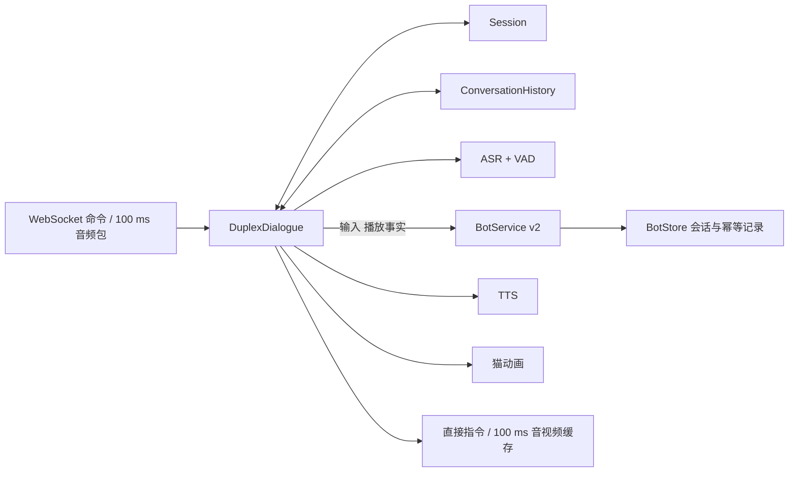
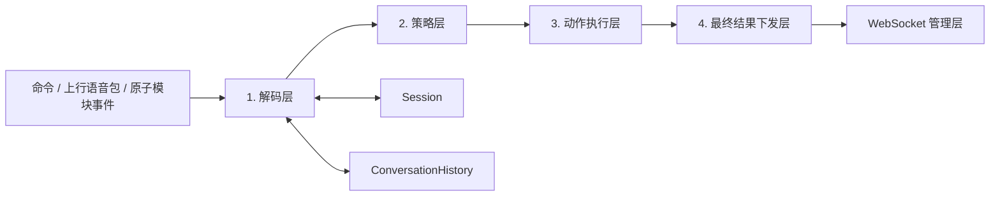
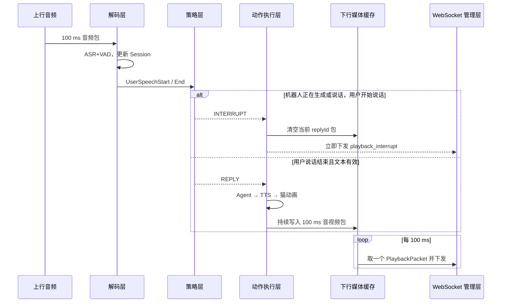

# 实时语音虚拟人：双工对话模块设计

## 1. 目标与边界

双工对话模块是会话内的实时控制器，负责持续收音、生成与播放的并行，以及打断、告别和挂断。它通过 [TextBot v2](12-text-bot-interface.md) 报告输入和交互事实，消费流式文本；不裁剪语义历史、不保存 Bot 状态、不决定内容状态回滚。Bot 服务负责回复内容、历史投影、请求幂等和持久化。

模块按会话状态、主编排、回复流水线、打断控制和 Bot 服务划分职责：



| 模块 | 唯一职责 | 不负责 |
| --- | --- | --- |
| `Session` | 保存本次通话当前状态、用户当前状态、机器人当前状态和当前时间。 | 保存完整对话记录、模型推理、网络发送。 |
| `ConversationHistory` | 保存用户、机器人和信号的不可变对话事实列表。 | 当前实时状态、策略决策、媒体缓存。 |
| `DuplexDialogue` | 主编排、上行 ASR、命令与事实转交、会话生命周期；统一持有 replyId/epoch 和共享队列。 | 回复流水线实现、打断门控策略、模型内部算法。 |
| `ReplyPipeline` | 回复启动、Bot 流消费、TTS 分段、PCM 分帧、播放完成与失败收敛。 | 上行识别、打断确认策略、Bot 内容状态。 |
| `InterruptionController` | 每会话打断门控、持续语音/文本确认、冷却期、任务取消与旧媒体清理。 | 回复内容、模型历史、Bot 状态回滚。 |
| `BotService` | 保存会话与请求结果，解释交付事实，构造模型上下文并恢复内容状态。 | 打断门控、音频队列、设备播放。 |

Session 与 ConversationHistory 是每个 sessionId 独占的实时状态和审计对象；审计历史不再作为模型输入。BotStore 属于 Bot 服务，独立保存内容和交互事实，双工只保留近期原始事实用于可靠转交，不保存 Bot 业务状态。

### 1.1 回复与打断的代码边界

- `backend/duplex.py`：保留 `DuplexDialogue` 入口与原有方法签名，旧内部调用点以薄委托转交组件。
- `backend/reply_pipeline.py`：`ReplyPipeline.start/run/fail/flush_pcm_frames/enqueue_playback/maybe_complete/finalize` 实现回复流水线；分段规则仍复用 `speech_text.py`。
- `backend/interruption.py`：`InterruptionController.maybe_barge_in/confirm/cancel_pending/interrupt/drop_queued_media` 实现打断策略与执行。确认窗口、文本宽限、最小回复年龄和冷却配置全部保持原默认值；门控状态归控制器独占，每会话一个实例。
- `backend/duplex_events.py`：共享 `DuplexEvent`，避免组件反向运行时导入主编排器；`backend.duplex.DuplexEvent` 保持兼容导出。

这是同进程、同事件循环内的组合拆分，不是三个独立服务。两个组件显式引用所属 dialogue，仍访问同一份回复身份、epoch、任务句柄、播放状态和控制/媒体队列；不复制这些状态，不增加消息队列或额外调度任务。取消时先使 epoch 失效，再取消生成和清理旧媒体；发送栅栏继续使用同一个 `_is_current`。主编排器保留停止/播放回执、会话关闭入口，内容历史解释和幂等仍归 BotService。

后续回复优化集中在 ReplyPipeline，打断策略优化集中在 InterruptionController；本次不调整阈值、预生成规则、100ms 音频帧、事件字段或播放确认条件。`tests/test_duplex_components.py` 补充委托兼容、跨会话门控隔离、取消后迟到 PCM 丢弃和旧失败/回执不影响新回复的测试；现有双工行为测试继续通过主入口验证。

### 1.2 独立边听边想模块

后续 v0.7 将预生成从 Bot 包装器移至 `backend/vad_prefetch.py` 的 `VadPrefetch`，挂在每个 DuplexDialogue 实例上。ASR 中间文本通过非阻塞 offer 提交；安静帧后默认稳定 120ms 才启动候选，后续文本更新不重新等待这个窗口，主要重叠 VAD 收尾与模型等待。定稿 seal 记录结束边界并停止启动新候选，ReplyPipeline 消费正式请求时由 BotService 正常幂等接受并重新投影上下文，精确一致才接管。打断清理候选、挂断回收后台任务；不改变 InterruptionController 的确认窗、文本宽限或冷却规则。

`DUPLEX_PREFETCH_ENABLED=0/1` 控制开关；稳定时间、每轮预算和安静门限分别由 `DUPLEX_PREFETCH_STABLE_MS`、`DUPLEX_PREFETCH_MAX_PER_TURN`、`DUPLEX_PREFETCH_QUIET_RMS` 配置。预生成不使用语义相似度、礼貌词等价或覆盖率，不允许在 VAD 确认前播报。有效提前量 effectiveLeadMs 与剩余等待 remainingWaitMs 分开记录；命中不等于零等待，也不等于已经证明有收益。

#### 开关对照与配置发布

`scripts/check_prefetch_ws_ab.py --remote-ecs` 仅允许在具有部署配置的 Linux ECS
运行，不在开发电脑启动语音服务。它在独立进程中加载生产后端并绑定随机 loopback
端口，使用独立 SQLite；模型和 HTTP 池只预热一次，之后按样本/重复轮交替 off→on
与 on→off，每臂重新建立相同年级/历史的会话。唯一实验变量是进程内预生成布尔开关，
不新增对公网开放的测试参数或控制接口，不改线上配置。

所有完成的配对用户轮次均进入分母，包括 miss 和开启后变慢的样本；开场白不进入
延迟统计。每个 replyId 对齐源音频非静音末尾、ASR 定稿、Bot 首文本和首媒体帧；
`fixtureSignalEndToFirstPacketMs` 是节拍发送 WAV 到测试客户端收到首包，
`finalToFirstPacketMs` 在该脚本中特指服务端定稿到开始发送首包（同一服务器时钟），
不是浏览器出声。单独汇总 exact 命中率、有效提前量、剩余等待和配对差的分布；
不能将两臂延迟中位数之差冒充配对差中位数，也不能将云端响应波动全部归因于预生成。

性能配对后，两臂都验证四轮真实语音与未播放/部分播放两种打断；开启侧补测命令重试、
空闲不挂断、Bot 状态恢复和幂等。真实 NLS/LLM/Piper 不替换为 Mock，但客户端播放回执
由测试声明，`physicalOutput=null`，不替代真实浏览器的声学出声验收。

`deploy/configure_prefetch.py` 是仅配置发布工具：检查通过的验收证据、收益方向、
源码摘要、当前发布版本及空闲资源，备份原运行配置后只修改发布标识与开关。保留
模型、角色认证、VAD 和打断阈值；启动健康检查失败则恢复原配置。该工具不会自行
放宽 exact 策略或替换回复/打断流水线。

#### 2026-10-22 实测与开启

在 `rtv-20261022-ram-timing-r1` 相同的 56 个 backend/web 文件上，使用真实 NLS、
DeepSeek、Piper，于 05:40:43–05:48:27 UTC 完成远端隔离验收。
4 条语音 × 3 次重复 × 开关两臂，共 12 组配对；两臂定稿 12/12 一致。
数据源为 `.local/prefetch-ab-20261022/report.json`，SHA256 为
`fdc2852913b6fa5c0855668f23284f6784b280fe59c7e8326e6b9d15e0e1bad9`。

| 指标（不含开场白） | 关闭 | 开启 |
| --- | ---: | ---: |
| 源音频结束到客户端首包，中位数 | 2359.2ms | 2139.1ms |
| 同项均值 | 2396.4ms | 2226.5ms |
| 服务端定稿到开始发送首包，中位数 | 1432.6ms | 1240.5ms |
| Bot 请求到首文本，中位数 | 1094.0ms | 942.8ms |
| 精确命中（全部配对用户轮次） | 0/12 | 8/12 |
| 有效提前量中位数（miss 计 0） | 0ms | 12.4ms |
| 定稿后首文本剩余等待，中位数 | 1090.7ms | 938.1ms |

对每组先计算 off−on 再聚合：首包延迟的**配对差中位数为 196.6ms**，均值 169.8ms，
8/12 组更快；范围为 −1024.6ms 至 +1122.9ms。两臂各自中位数的差 220.2ms
不是配对差中位数。命中样本自身的有效提前量中位数仅 20.3ms，范围 7.6–32.6ms，
所以不能把观测到的约 197ms 全部归因为预生成，更不能认定稳定节省整个 500ms VAD
窗口。云端 TTFT 波动明显；这是试用级小样本证据，不是生产 SLA 或显著因果效果。
开启臂记录 26 次候选生成尝试和 4 次正式 miss 路径，关闭臂为 12 次正式生成；
该计数不是供应商计费请求或 token 用量。后续优化需同时衡量有效提前量与额外开销。

两臂分别通过四轮聊天（含法国首都 Paris、23+45=68）和 0ms/550ms 播放进度的
两种真实语音打断，旧音频泄漏均为 0。开启臂另通过 Bot 幂等、状态恢复、开场白、
连续五次空闲不挂断和明确告别确认后挂断。全程日志队列溢出、40010005、ASR_FAILED
均为 0。客户端播放回执为模拟事实，不构成真实扬声器出声证明。

已通过仅配置发布开启 `DUPLEX_PREFETCH_ENABLED=1`，发布标识为
`rtv-20261022-prefetch-on-r2`。没有修改生产 backend/web、认证凭证、模型、VAD、
打断阈值或接管规则。原配置及验收证据备份位于
`/var/backups/real-time-voice/rtv-20261022-prefetch-on-r2`（受限目录，配置含敏感信息，
不可公开）。恢复开关时同样应检查无活动会话并进行健康检查，不强制终止试用者。

发布后再经 `wss://aimaoren.com/ws` 完成四轮真实语音，定稿非空、errors=[]，缓存结果
为 miss/miss/hit/hit；随后完成两次公网打断，errors=[]、旧音频泄漏为 0。
本地轻量回归最终为 262 passed、3 deselected；前端时间轴与 9 项播放/停止回归通过。
一项采用固定睡眠模拟“生成仍在途”的单测出现调度敏感失败，已改为显式事件门控，
未修改生产实现。远端隔离进程已退出，本地未启动语音服务。

## 2. Session 模块

### 2.1 Session 数据结构

```json
{
  "sessionId": "sess_01J...",
  "state": "On_Service",
  "currentTime": 4200,
  "user": {
    "status": 2,
    "text": "今天天气",
    "startTime": 3300,
    "endTime": 4200,
    "speechTime": 4200
  },
  "robot": {
    "status": 2,
    "text": "今天的天气",
    "startTime": 4000,
    "endTime": null,
    "speechTime": 4200,
    "replyId": "reply_3"
  }
}
```

`currentTime` 为当前已处理的**上行**会话媒体时间，单位毫秒。它只由解码层根据上行 `sequence` 推导的 `speechTime` 更新，必须单调递增；不使用 Unix 时间戳，也不与下行播放时间混用。机器人 `speechTime` 是下行方向独立时间轴，用于媒体同步；机器人 `startTime/endTime` 记录其在 `currentTime` 上发生生成/播放事件的时刻。

### 2.2 Session 状态

状态值严格采用以下名称：

| 状态 | 含义 | 进入条件 | 允许的下一状态 |
| --- | --- | --- | --- |
| `Prepare` | 已收到 `prepare`，正在检查资源。 | WebSocket 管理器收到 `prepare`。 | `PickUp`、`HangUp` |
| `PickUp` | 资源可用且正在创建会话。 | WebSocket 管理器处理 `create_session`。 | `On_Service`、`PRE_HangUP` |
| `On_Service` | 正常双工服务中，可收音、识别、生成与播放。 | 启动双工任务。 | `PRE_HangUP` |
| `PRE_HangUP` | 收到挂断、告别或不可恢复错误，正在取消任务和清理缓存。 | 触发关闭动作。 | `HangUp` |
| `HangUp` | 已结束，资源已释放。 | 清理完成、WebSocket 可关闭。 | 无 |

非法状态迁移必须拒绝：例如 `HangUp` 后收到音频包不能重新进入 `On_Service`；必须重新 `prepare` 和 `create_session`。

### 2.3 用户当前信息

用户状态与 ASR+VAD 的逐包结果一一对应：

```python
SessionUser = {
  "status": 0,       # 0=静默，1=开始说话，2=说话中，3=结束说话
  "text": "",       # status=3 时为本轮完整文本；1/2 可为中间文本
  "startTime": None,
  "endTime": None,
  "speechTime": 4200
}
```

每个上行 100 ms 音频包都会更新 `user.status` 与 `user.speechTime`。静默包对应 `status=0`，只保留本包 `speechTime`，其余字段清空；新一轮说话的 `status=1` 覆盖上一轮用户文本和时间。详见[ASR + VAD 原子能力](03-backend-design.md#4-asr--vad-原子能力)。

### 2.4 机器人当前信息

```python
SessionRobot = {
  "status": 0,       # 0=静默，1=生成中，2=说话中
  "text": "",       # 当前 replyId 已生成的完整/累积回复文本
  "startTime": None,
  "endTime": None,
  "speechTime": None,
  "replyId": None
}
```

机器人保存三个稳定状态：0 静默、1 生成中、2 说话中。首包入缓存时进入说话中；末包发送后只发 reply_complete，收到客户端播放完成回执后才归为静默。speechTime 为下行发送时间轴，不用于推断已播放文本。

## 3. ConversationHistory 模块

### 3.1 结构

对话历史是按发生顺序只追加的列表。它记录事实而不是当前状态，因此用户的实时中间识别、TTS 每 100 ms 包等高频数据不写入历史。

```json
{
  "message": "您好",
  "messageType": "text",
  "startTime": 430,
  "endTime": 950,
  "role": "user",
  "turnId": "turn_1",
  "replyId": null
}
```

| 字段 | 说明 |
| --- | --- |
| `message` | 文本消息或信号内容。文本如“您好”；信号如 `create_session_ok`、`barge_in`、`close_session`。 |
| `messageType` | `text`、`signal` 或 `error`。 |
| `startTime` | 本事件开始时间，单位毫秒；信号可等于 `endTime`。 |
| `endTime` | 本事件结束时间，单位毫秒。 |
| `role` | `user`、`robot` 或 `signal`。 |
| `turnId` | 用户回合 ID。用户最终文本及其对应机器人回复共享同一个 `turnId`。信号可为 `null`。 |
| `replyId` | 机器人回复 ID；用户记录和信号记录为 `null`。 |

### 3.2 写入规则

1. ASR+VAD 返回 `status=3` 且 `text` 非空时，追加一条 `role=user, messageType=text` 记录，生成新的 `turnId`。
2. Agent 对该 `turnId` 完成回复且未被打断时，追加一条 `role=robot, messageType=text` 记录；`message` 是完整最终回复，携带同一 `turnId` 和新的 `replyId`。
3. 建会、打断、挂断、模型错误等仅追加 `role=signal, messageType=signal/error` 记录。
4. 被打断的机器人回复不追加为正常 `text` 历史；应追加 `barge_in` 信号。若后续需要审计，可增加 `messageType=interrupted`，但第一阶段不把残缺回复送进 LLM 历史。

history.to_agent_messages() 仅保留旧接口兼容，DuplexDialogue 不再调用它。模型 messages 由 Bot 从自己的生成记录与客户端播放事实构造；未播放草稿单独传为 deliveryContext，不混入助手消息。部分播放采用完整 TTS 段的保守对齐，不按服务器发送字节估算。

## 4. DuplexDialogue 四层设计

`DuplexDialogue` 对输入按顺序执行四层。前一层的输出是下一层唯一输入；任何层都不能直接绕过其他层修改 Session、历史或网络。



### 4.1 第一层：解码层

解码层将外部输入统一转换为 `DecodedEvent`，并且是唯一允许更新 `Session` 和追加 `ConversationHistory` 的入口。

| 输入 | 解码与状态更新 | 历史写入 | 输出事件 |
| --- | --- | --- | --- |
| `ServiceStarted` 内部事件 | WebSocket 管理器已完成资源检查和建会，状态置为 `On_Service`。 | `create_session_ok` 信号。 | `ServiceStarted` |
| 上行音频包 | 调用 ASR+VAD；用每包 `AsrVadResult` 更新 `currentTime` 和 `Session.user`。 | 仅 `status=3` 的最终用户文本写入。 | `UserSilence` / `UserSpeechStart` / `UserSpeechContinue` / `UserSpeechEnd` |
| `close_session` | 状态置为 `PRE_HangUP`。 | `close_session` 信号。 | `CloseRequested` |
| Agent/TTS/播放内部事件 | 更新 `Session.robot` 的文本、状态和时间；包括 `RobotGenerating`、`RobotTextDelta`、`RobotSpeaking`、`RobotFinished`、`RobotInterrupted`。 | 只在完整机器人回复完成时写入文本；打断只写 `barge_in` 信号。 | 对应的机器人生命周期事件 |
| 关闭内部事件 | `CloseStarted` 置为 `PRE_HangUP`，`Closed` 置为 `HangUp`。 | 写入关闭信号。 | `CloseRequested` / `Closed` |
| 原子能力错误 | 保留上游状态或进入 `PRE_HangUP`（不可恢复时）。 | `error` 信号。 | `RecoverableError` / `CloseRequested` |

`prepare`、`prepare_result`、`create_session`、`create_session_result` 由 WebSocket 管理器处理，不会作为 `DuplexDialogue` 的网络输入。解码层绝不直接发 WebSocket 包，也不直接调用 LLM/TTS。它处理上行 100 ms 音频包时，即使用户静默也会生成 `UserSilence`，保证 `Session.user.status=0` 与 `currentTime` 不丢失。

### 4.2 第二层：策略层

策略层是纯函数：输入是 `Session` 快照、`ConversationHistory` 只读视图和一个 `DecodedEvent`；输出一个或多个 `Action`。它不调用模型、不写缓存、不修改状态。

```python
Action = "NOOP | INTERRUPT | REPLY | HANG_UP"
```

| 条件 | 策略输出 | 说明 |
| --- | --- | --- |
| `UserSilence`、`UserSpeechContinue`，且无异常 | `NOOP` | 仅更新实时状态，不做业务动作。 |
| `UserSpeechStart` 且 `robot.status in {1, 2}` | `INTERRUPT`（经打断门控确认后） | 用户开口持续超过确认窗（BARGE_IN_CONFIRM_MS，默认 500ms）才打断；短促噪声挂起后取消。 |
| `UserSpeechStart` 且机器人静默 | `NOOP` | 等待该轮用户说话结束。 |
| `UserSpeechEnd` 且文本为空 | `NOOP` | 不向 Agent 发空请求。 |
| `UserSpeechEnd` 且文本为“再见/拜拜”等告别意图 | `HANG_UP` | 不再生成机器人回复。 |
| `UserSpeechEnd` 且文本有效、状态为 `On_Service` | `REPLY` | 针对最新 `turnId` 生成机器人回复。 |
| `CloseRequested` 或不可恢复错误 | `HANG_UP` | 执行关闭。 |

#### 打断门控

`UserSpeechStart` 不再立即映射为 `INTERRUPT`。策略层先将触发挂起（`barge_in_pending`），仅在以下条件全部满足时确认执行（`barge_in_confirmed`），否则取消（`barge_in_cancelled`，携带原因）：

1. **持续说话确认**：用户说话从挂起起持续 `BARGE_IN_CONFIRM_MS`（默认 500ms，环境变量可调，设 `0` 恢复即时打断）。咳嗽、敲击、短噪声在确认窗内结束即被过滤。
2. **文本内容确认（二级）**：会话中 ASR 曾产生过 partial 文本后，仅能量持续但 recognizer 始终无文字的突发会被多等待 `BARGE_IN_TEXT_GRACE_MS`（默认 500ms）的云端追赶窗口，仍无文字则否决（原因 `no_text`）；窗口内任何 partial 文字到达即确认——噪声有能量无内容，真人说话有文字。
3. **回复最小年龄**：机器人回复开始未满 `BARGE_IN_MIN_REPLY_AGE_MS`（默认 400ms）的触发取消（原因 `reply_too_young`），防止回复开头回声误打断；挂起期间回复已更换（`replyId` 变化）同样取消（原因 `reply_changed`）。
4. **打断冷却**：距上次打断不足 `BARGE_IN_COOLDOWN_MS`（默认 1500ms）的触发取消（原因 `cooldown`），防止来回拉扯。

此外 `VAD_SPEECH_NOISE_THRESHOLD` 可将 FSMN-VAD 的 `speech_noise_threshold` 参数透传给模型，供现场调节 VAD 灵敏度。所有门控决策以时间线事件（`strategy` 组件）输出，页面可直接观察每次触发被放行或否决的原因。

云端上行与消费循环解耦：NLS 适配器把说话段音频放入内部发送队列，由独立发送线程执行 `send_audio`，VAD 消费路径只负责本地推理，不因云端写入抖动而积压输入队列。

当单个事件触发多个动作时，固定顺序为 `INTERRUPT → REPLY`。例如机器人说话时用户开口：挂起的 `UserSpeechStart` 确认后才触发 `INTERRUPT`；当这轮用户之后返回 `UserSpeechEnd` 才触发 `REPLY`，不会在一个音频包内同时生成新回复。

### 4.3 第三层：动作执行层

动作执行层串行处理策略返回的 `Action`，是唯一允许调用原子能力、取消任务、写媒体缓存的层。每个机器人回复创建唯一 `replyId`，并绑定其对应 `turnId` 与取消令牌。动作层不直接修改 `Session` 或 `ConversationHistory`：它产生 `RobotGenerating`、`RobotSpeaking`、`RobotFinished`、`RobotInterrupted`、`CloseStarted`、`Closed` 等内部事件，重新进入解码层，由解码层完成状态与历史更新。

#### `NOOP`

不调用模型，不修改媒体缓存。解码层已经完成 Session 和历史更新。

#### `INTERRUPT`

1. 取消当前 `replyId` 的 ADK Agent 流、TextChunker 与所有未完成的 TTS 请求。
2. 清空下行媒体缓存中属于该 `replyId` 的所有未下发音视频包。
3. 产生 `RobotInterrupted` 内部事件；解码层将机器人更新为静默、写入 `barge_in` 信号，并且不写入被打断的机器人文本历史。
4. 产生一个直接下发的 `playback_interrupt` 指令；它不进入媒体缓存。

#### `REPLY`

1. 向 Bot 发送 ConversationRequest v2，携带当前输入、关联 ID 和近期交互事实，不读取或整理语义历史。Bot 负责幂等与会话加载。
2. 创建 `replyId` 并产生 `RobotGenerating` 内部事件；解码层更新 `Session.robot` 为 `status=1`（生成中）、`text=""`、`startTime=null`、`endTime=null`。
3. 消费供应商无关的 text_delta 事件，累积字幕并送入 TextChunker，不读取模型 API 原始字段。
4. TextChunker 按可朗读标点和单词边界分段，每段依次送入 TTS，不等待全文；向 Bot 报告 speech_segment 文本与累计 PCM 段末位置。
5. TTS 产生的 PCM 流经 `PcmFramer` 切为 100 ms / 3200 字节的音频帧，再调用猫动画驱动器，组成 `PlaybackPacket` 加入下行媒体缓存。
6. 首包入缓存时设置机器人说话中。生成、TTS、最后一包发送都完成后发 reply_complete；客户端确认播放完成后才结束当前回复并追加完整文本审计记录。播放和打断回执独立交给 Bot，是否进入模型历史由 Bot 决定。

#### `HANG_UP`

1. 产生 `CloseStarted` 内部事件，由解码层将 Session 状态置为 `PRE_HangUP`。
2. 取消当前 Agent、TTS、PcmFramer 等所有 `replyId` 任务，清空下行媒体缓存。
3. 重置 ASR+VAD 缓存，停止接收新业务输入。
4. 产生直接下发的 `close_session` 指令；带上发起方和原因。
5. 指令成功下发或连接已断开后，释放资源并产生 `Closed` 内部事件，由解码层将 Session 状态置为 `HangUp`。

### 4.4 第四层：最终结果下发层

下发层有两条完全不同的通道：**直接指令通道**与**100 ms 媒体通道**。

| 内容 | 传输方式 | 规则 |
| --- | --- | --- |
| `prepare_result`、`create_session_result`、`playback_interrupt`、`reply_failed`、`close_session`、`error` | 直接指令通道 | 前两项由 WebSocket 管理器产生，其余由双工动作层产生；均立即交给 WebSocket 管理层，不进入媒体缓存，不等待 100 ms 定时器。 |
| `PlaybackPacket` | 媒体通道 | 进入 FIFO 下行媒体缓存；定时器每 100 ms 取出一个包下发。 |

媒体定时器在 `Session.state=On_Service` 时运行。每个 tick：

1. 从下行媒体缓存头部取出一个 `PlaybackPacket`。
2. 若存在，校验其音频和猫动画的 `sequence/speechTime` 相同，交给 WebSocket 管理层下发。
3. 若缓存为空，不补造机器人语音，也不阻塞上行；等待下一次 tick。
4. 最后一包发送后发流结束通知，不以此提交语义历史；继续等待客户端播放回执，期间仍能打断。

媒体缓存最大为 2 秒（20 个包）。缓存满时，新的 TTS/动画输出暂停或等待可用空间，**不能丢弃已按时间顺序生成的机器人音频包**；否则音频会缺字。上行音频则独立处理，最大缓存 1 秒，满时记录异常并优先丢弃最旧上行媒体包以控制交互延迟。



### 4.5 事件串行化、回复栅栏与完成标记

上行音频和输入按序处理；控制、媒体与时间线分别使用独立有界队列。模型和 TTS 输出通过回复栅栏校验，不等待麦克风输入队列；挂断不排在音频积压之后。Bot 的数据库写入在线程中执行，双工转交事实不等待存储完成，正式请求同时附带近期事实保证因果关系。

每次 `REPLY` 创建递增的 `generationEpoch`，并将它与 `replyId` 一起传给 Agent、TextChunker、TTS、PcmFramer、猫动画和所有回调。动作层接收异步输出时，必须先验证：

```text
event.replyId == activeReplyId && event.generationEpoch == activeGenerationEpoch
```

校验失败即丢弃该事件，不得写入 Session、History 或媒体缓存。`INTERRUPT` 和 `HANG_UP` 在取消任务前先递增 `generationEpoch`、清空对应缓存，再产生直接指令；因此在其后到达的旧模型回调全部失效。

每个 `replyId` 还维护 `ReplyCompletion`：

```python
ReplyCompletion = {
  "agentFinished": False,
  "pendingTtsSegments": 0,
  "lastPacketEnqueued": False,
  "lastPacketSent": False
}
```

上述条件只说明流已生成并发送完，随后下发 reply_complete。客户端确认播放完成才结束当前回复；Bot done、服务器发送完成和客户端播放完成是三个不同事实。浏览器停止时先按音频时钟记录 playedMs，再立即停音源；Bot 侧最多 150ms 的停止回执等待只影响下一轮内容投影，不阻塞停止指令。

## 5. 一致性与验收

### 端点参数实验与录音口径（2026-10-23）

端点实验只成对修改 `VAD_MAX_END_SILENCE_MS`、`NLS_MAX_SENTENCE_SILENCE_MS`，比较 550/400ms；预生成、短首段 TTS、100ms 音频帧、播放缓冲、抢话参数与模型配置保持不变。使用香港 ECS 上独立进程、独立数据库和仅回环监听的测试实例，不启动本地语音服务，不修改生产配置。实验按相同音频交替执行两组，失败及变慢样本均保留。

统一信号口径为 16kHz 单声道 PCM16，`abs(sample) >= 300`（包含边界），不用各轨峰值的百分比阈值。录音 WAV、前端信号埋点和离线脚本使用相同口径；它是可复现的信号阈值，不等于语义上的说话结束。原始素材名中的 pause 数字不直接当作声学停顿；受控素材只增减静音零采样，保留全部非零语音采样，并记录实际阈值间隔和文件哈希。

计时按同一 `replyId` 对齐，区分首包到达、计划信号播放、音频图信号开始与物理扬声器出声。导出的 `robot-scheduled.wav` 是计划 PCM，不是设备回录；headless Chrome 不用于推断人的实际听感。提前回复必须作为抢话失败，不能选择说话结束后的下一个音频 burst 来掩盖它。缺失时间记为 null，不能补零。

分段相加仅使用互斥区间：服务端链路止于首次发送开始，传输余量也以此为边界，不能重复加 `sendAwaitMs`；客户端使用 `receiveToPlannedSignalMs + plannedToGraphSignalMs`，不能再叠加其中已覆盖的 `receiveToScheduleCallMs`。用 WAV 与图时钟结果对账并保留残差。

上线门禁优先于延迟均值：句中停顿不能新增拆轮/缺失分句、提前回复或未完成回复；多轮、未播放即打断、部分播放打断、旧媒体栅栏和 Bot 重试幂等均需验证。延迟同时提供全部尝试及双方门禁通过的配对子集，禁止用抢答造成的低延迟宣称提速。若 400ms 有正确性回退，保留线上 550ms，不因测试脚本通过单元测试就上线。

本轮云端实验结论：**拒绝上线 400ms，保留 550ms**。使用现网相同的 58 个 backend/web 文件（实验前后 SHA256 相同），5 种素材、2 次交替重复，共 10 对、20 次请求。两组分别完成真实 ASR/LLM/TTS 三轮聊天、未播放/部分播放打断，以及 Bot 恢复与重试幂等回归；这些一般场景通过，不代表句中停顿安全。

| 受控声学停顿 | 550ms（两次） | 400ms（两次） |
| --- | --- | --- |
| 300ms | 均保留 help 与 joke 两个分句，单次完整回复 | 均拆为两次 final；出现提前/多次回复、取消后的未完成文本 |
| 400ms | 均丢失前半句 help（已有问题） | 均拆轮，出现提前/多次回复 |
| 500ms | 均拆轮且丢失前半句（已有问题） | 均拆轮并提前回复 |

全部尝试中，550ms 正确性失败 4/10，400ms 失败 6/10。双方门禁通过的延迟子集仅为 hello/numbers 的 4 对，不包含停顿失败样本：服务端收到固定阈值尾采样所在帧至 final 为 785.6 → 688.6ms（约省 96.9ms）；输入素材信号结束至 ECS 回环客户端收到首包为 1587.1 → 1695.3ms（本轮反而慢约 108.2ms）。final 至首包 766.2 → 972.0ms 的波动抵消了端点收益；样本小、LLM 存在波动，不能据此认定 400ms 固有地让模型变慢，也不能宣称已改善用户物理出声延迟。抢答导致的负延迟/缺失值保留在原始证据，不纳入“有效提速”子集。

证据保存在任务工作区 `.local/endpoint-ab-20261023/endpoint-ab.json`、`reviewed.json` 与浏览器录音子目录。生产未重启、未修改端点；后续需单独排查现有长停顿时 ASR 分句与双工回合边界，不能仅继续缩短静音参数。

浏览器客户端追加 4 次验证（独立 headless Chrome，经相同 SSH 隧道访问云端隔离实例）：hello 的两组录音均为单次完整回复；300ms 停顿在 400ms 下复现 2 次 final / 2 个用户回复，在 550ms 下为 1 次 final / 1 个完整回复。4 份录音使用统一阈值后的 WAV 与图时钟差均不超过 0.05ms。拆轮场景额外保留 `perReplyGraphLatencyMs` 与 `sourceBoundaryDifferenceMs`，避免把较早分句的 source-end 与整段录音的最终 source-end 混算；即使两条时间轴对齐、首次语音仅 435ms，也因拆轮失败而不可作为提速结果。隧道、headless 调度与小样本使这些数值不能替代公网真实设备听感。测试后临时云端语音进程与本地转发均已停止，原始录音及数据库保留便于复核。

### 5.1 必须保持的一致性

1. `Session` 只表示当前状态，`ConversationHistory` 只追加事实；两者不能混用。
2. 所有 Session 和 History 更新只能从解码层进入；策略层是纯函数。
3. 每条用户最终文本有一个 `turnId`；它对应的完整机器人回复有一个 `replyId`。
4. 被 `INTERRUPT` 取消的 `replyId` 不得在 `playback_interrupt` 之后继续下发任何媒体包，也不写入正常机器人文本历史。
5. 直接指令永远绕过媒体缓存；媒体包只能通过 100 ms 定时器按 FIFO 下发。
6. 上行音频包持续进入 ASR+VAD，与下行是否在播放完全无关。
7. 所有异步模型输出必须通过 `replyId + generationEpoch` 栅栏；旧回复在打断或挂断后不得再次写入媒体缓存。
8. 控制输出、媒体输出和时间线输出使用三个独立有界队列；时间线拥塞只能丢弃旧诊断事件，不能反向阻塞打断或挂断。
9. 上行输入队列满时默认丢弃最旧音频、保留最新音频并产生 `queue_overflow`，避免对话延迟持续增长。

### 5.2 验收场景

| 场景 | 预期结果 |
| --- | --- |
| 资源拒绝 | Session 从 `Prepare` 进入 `PRE_HangUP → HangUp`；直接下发 `prepare_result(reject)`，无媒体缓存。 |
| 正常一问一答 | 用户 `status=3` 文本写入历史；策略返回 `REPLY`；机器人流式生成并每 100 ms 下发音视频包，完整回复后写入历史。 |
| 机器人说话时用户开口 | 新用户 `status=1` 触发 `INTERRUPT`；直接下发 `playback_interrupt`；旧回复缓存清空，新用户 ASR 不中断。 |
| 用户说“再见” | `status=3` 后策略返回 `HANG_UP`；不调用 Agent；直接下发 `close_session`，最终状态为 `HangUp`。 |
| 静默听机器人 | 每个上行静默包持续更新用户 `speechTime/status=0`；机器人媒体照常每 100 ms 下发。 |
