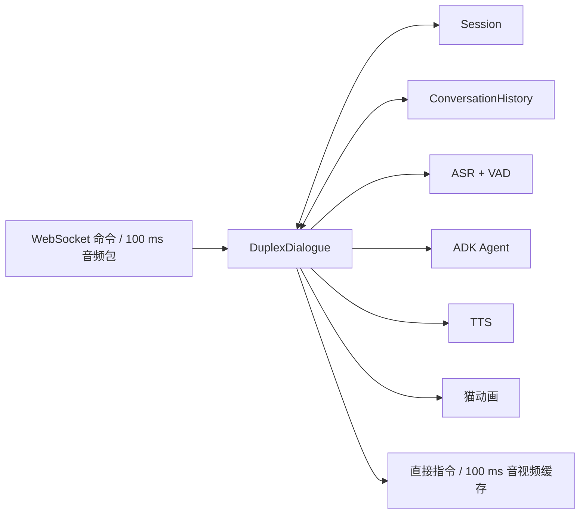
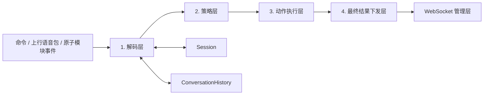
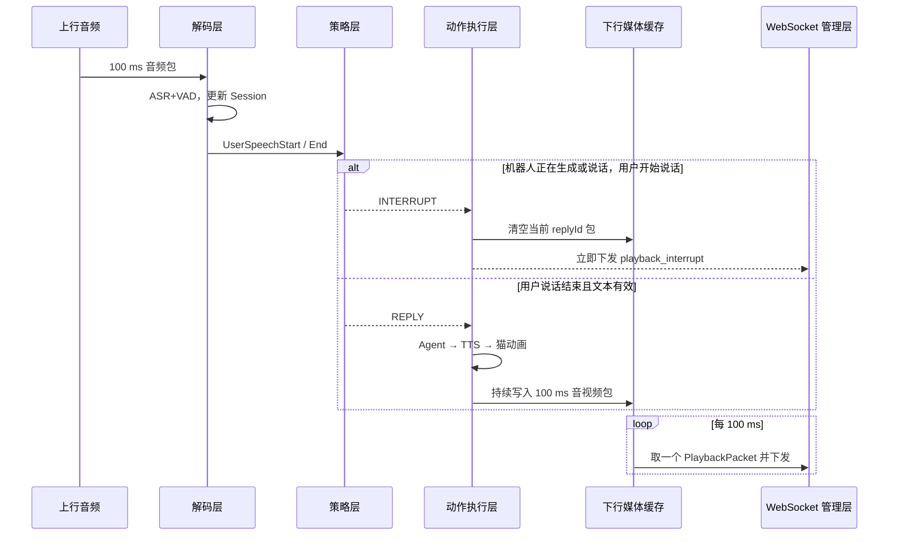

# 实时语音虚拟人：双工对话模块设计

## 1. 目标与边界

双工对话模块是一个会话内的实时控制器，负责让“用户持续说话”和“机器人持续生成、播放”同时发生，并处理打断、正常回复、告别和挂断。它不实现 ASR+VAD、ADK Agent、TTS 或猫动画算法；它调用这些原子能力并管理它们的输入、输出、缓存和生命周期。

模块由三个相互独立的对象构成：



| 模块 | 唯一职责 | 不负责 |
| --- | --- | --- |
| `Session` | 保存本次通话当前状态、用户当前状态、机器人当前状态和当前时间。 | 保存完整对话记录、模型推理、网络发送。 |
| `ConversationHistory` | 保存用户、机器人和信号的不可变对话事实列表。 | 当前实时状态、策略决策、媒体缓存。 |
| `DuplexDialogue` | 依次执行解码层、策略层、动作执行层和最终下发层。 | ASR/LLM/TTS/动画模型的内部算法。 |

`Session` 与 `ConversationHistory` 是每个 `sessionId` 独占的内存对象；通话结束后可异步持久化 `ConversationHistory`，但不会在热路径等待数据库。

## 2. Session 模块

### 2.1 Session 数据结构

```json
{
  "sessionId": "sess_01J...",
  "state": "On_Service",
  "currentTime": 4200,
  "user": {
    "status": 2,
    "text": "今天天气",
    "startTime": 3300,
    "endTime": 4200,
    "speechTime": 4200
  },
  "robot": {
    "status": 2,
    "text": "今天的天气",
    "startTime": 4000,
    "endTime": null,
    "speechTime": 4200,
    "replyId": "reply_3"
  }
}
```

`currentTime` 为当前已处理的**上行**会话媒体时间，单位毫秒。它只由解码层根据上行 `sequence` 推导的 `speechTime` 更新，必须单调递增；不使用 Unix 时间戳，也不与下行播放时间混用。机器人 `speechTime` 是下行方向独立时间轴，用于媒体同步；机器人 `startTime/endTime` 记录其在 `currentTime` 上发生生成/播放事件的时刻。

### 2.2 Session 状态

状态值严格采用以下名称：

| 状态 | 含义 | 进入条件 | 允许的下一状态 |
| --- | --- | --- | --- |
| `Prepare` | 已收到 `prepare`，正在检查资源。 | WebSocket 管理器收到 `prepare`。 | `PickUp`、`HangUp` |
| `PickUp` | 资源可用且正在创建会话。 | WebSocket 管理器处理 `create_session`。 | `On_Service`、`PRE_HangUP` |
| `On_Service` | 正常双工服务中，可收音、识别、生成与播放。 | 启动双工任务。 | `PRE_HangUP` |
| `PRE_HangUP` | 收到挂断、告别或不可恢复错误，正在取消任务和清理缓存。 | 触发关闭动作。 | `HangUp` |
| `HangUp` | 已结束，资源已释放。 | 清理完成、WebSocket 可关闭。 | 无 |

非法状态迁移必须拒绝：例如 `HangUp` 后收到音频包不能重新进入 `On_Service`；必须重新 `prepare` 和 `create_session`。

### 2.3 用户当前信息

用户状态与 ASR+VAD 的逐包结果一一对应：

```python
SessionUser = {
  "status": 0,       # 0=静默，1=开始说话，2=说话中，3=结束说话
  "text": "",       # status=3 时为本轮完整文本；1/2 可为中间文本
  "startTime": None,
  "endTime": None,
  "speechTime": 4200
}
```

每个上行 100 ms 音频包都会更新 `user.status` 与 `user.speechTime`。静默包对应 `status=0`，只保留本包 `speechTime`，其余字段清空；新一轮说话的 `status=1` 覆盖上一轮用户文本和时间。详见[ASR + VAD 原子能力](03-backend-design.md#4-asr--vad-原子能力)。

### 2.4 机器人当前信息

```python
SessionRobot = {
  "status": 0,       # 0=静默，1=生成中，2=说话中
  "text": "",       # 当前 replyId 已生成的完整/累积回复文本
  "startTime": None,
  "endTime": None,
  "speechTime": None,
  "replyId": None
}
```

机器人只保存三个稳定状态：`0` 静默、`1` 生成中、`2` 说话中。开始说话和结束说话是瞬时事件，不新增状态：首个音视频包进入下发缓存时，将 `1 → 2` 并设置 `startTime`；当前 `replyId` 的最后一个音视频包实际下发完毕后，将 `2 → 0` 并写入 `endTime`。`speechTime` 为当前/最近下发机器人音频包的结束时间，由下行 `sequence` 推导。

## 3. ConversationHistory 模块

### 3.1 结构

对话历史是按发生顺序只追加的列表。它记录事实而不是当前状态，因此用户的实时中间识别、TTS 每 100 ms 包等高频数据不写入历史。

```json
{
  "message": "您好",
  "messageType": "text",
  "startTime": 430,
  "endTime": 950,
  "role": "user",
  "turnId": "turn_1",
  "replyId": null
}
```

| 字段 | 说明 |
| --- | --- |
| `message` | 文本消息或信号内容。文本如“您好”；信号如 `create_session_ok`、`barge_in`、`close_session`。 |
| `messageType` | `text`、`signal` 或 `error`。 |
| `startTime` | 本事件开始时间，单位毫秒；信号可等于 `endTime`。 |
| `endTime` | 本事件结束时间，单位毫秒。 |
| `role` | `user`、`robot` 或 `signal`。 |
| `turnId` | 用户回合 ID。用户最终文本及其对应机器人回复共享同一个 `turnId`。信号可为 `null`。 |
| `replyId` | 机器人回复 ID；用户记录和信号记录为 `null`。 |

### 3.2 写入规则

1. ASR+VAD 返回 `status=3` 且 `text` 非空时，追加一条 `role=user, messageType=text` 记录，生成新的 `turnId`。
2. Agent 对该 `turnId` 完成回复且未被打断时，追加一条 `role=robot, messageType=text` 记录；`message` 是完整最终回复，携带同一 `turnId` 和新的 `replyId`。
3. 建会、打断、挂断、模型错误等仅追加 `role=signal, messageType=signal/error` 记录。
4. 被打断的机器人回复不追加为正常 `text` 历史；应追加 `barge_in` 信号。若后续需要审计，可增加 `messageType=interrupted`，但第一阶段不把残缺回复送进 LLM 历史。

`history.to_agent_messages()` 仅转换 `messageType=text` 的 `user` 与完整 `robot` 记录，分别输出 ADK 所需的 `user` 和 `machine` 历史；信号和错误绝不进入 LLM 提示词。

## 4. DuplexDialogue 四层设计

`DuplexDialogue` 对输入按顺序执行四层。前一层的输出是下一层唯一输入；任何层都不能直接绕过其他层修改 Session、历史或网络。



### 4.1 第一层：解码层

解码层将外部输入统一转换为 `DecodedEvent`，并且是唯一允许更新 `Session` 和追加 `ConversationHistory` 的入口。

| 输入 | 解码与状态更新 | 历史写入 | 输出事件 |
| --- | --- | --- | --- |
| `ServiceStarted` 内部事件 | WebSocket 管理器已完成资源检查和建会，状态置为 `On_Service`。 | `create_session_ok` 信号。 | `ServiceStarted` |
| 上行音频包 | 调用 ASR+VAD；用每包 `AsrVadResult` 更新 `currentTime` 和 `Session.user`。 | 仅 `status=3` 的最终用户文本写入。 | `UserSilence` / `UserSpeechStart` / `UserSpeechContinue` / `UserSpeechEnd` |
| `close_session` | 状态置为 `PRE_HangUP`。 | `close_session` 信号。 | `CloseRequested` |
| Agent/TTS/播放内部事件 | 更新 `Session.robot` 的文本、状态和时间；包括 `RobotGenerating`、`RobotTextDelta`、`RobotSpeaking`、`RobotFinished`、`RobotInterrupted`。 | 只在完整机器人回复完成时写入文本；打断只写 `barge_in` 信号。 | 对应的机器人生命周期事件 |
| 关闭内部事件 | `CloseStarted` 置为 `PRE_HangUP`，`Closed` 置为 `HangUp`。 | 写入关闭信号。 | `CloseRequested` / `Closed` |
| 原子能力错误 | 保留上游状态或进入 `PRE_HangUP`（不可恢复时）。 | `error` 信号。 | `RecoverableError` / `CloseRequested` |

`prepare`、`prepare_result`、`create_session`、`create_session_result` 由 WebSocket 管理器处理，不会作为 `DuplexDialogue` 的网络输入。解码层绝不直接发 WebSocket 包，也不直接调用 LLM/TTS。它处理上行 100 ms 音频包时，即使用户静默也会生成 `UserSilence`，保证 `Session.user.status=0` 与 `currentTime` 不丢失。

### 4.2 第二层：策略层

策略层是纯函数：输入是 `Session` 快照、`ConversationHistory` 只读视图和一个 `DecodedEvent`；输出一个或多个 `Action`。它不调用模型、不写缓存、不修改状态。

```python
Action = "NOOP | INTERRUPT | REPLY | HANG_UP"
```

| 条件 | 策略输出 | 说明 |
| --- | --- | --- |
| `UserSilence`、`UserSpeechContinue`，且无异常 | `NOOP` | 仅更新实时状态，不做业务动作。 |
| `UserSpeechStart` 且 `robot.status in {1, 2}` | `INTERRUPT` | 用户开口立即打断机器人生成或说话。 |
| `UserSpeechStart` 且机器人静默 | `NOOP` | 等待该轮用户说话结束。 |
| `UserSpeechEnd` 且文本为空 | `NOOP` | 不向 Agent 发空请求。 |
| `UserSpeechEnd` 且文本为“再见/拜拜”等告别意图 | `HANG_UP` | 不再生成机器人回复。 |
| `UserSpeechEnd` 且文本有效、状态为 `On_Service` | `REPLY` | 针对最新 `turnId` 生成机器人回复。 |
| `CloseRequested` 或不可恢复错误 | `HANG_UP` | 执行关闭。 |

当单个事件触发多个动作时，固定顺序为 `INTERRUPT → REPLY`。例如机器人说话时用户开口：`UserSpeechStart` 只触发 `INTERRUPT`；当这轮用户之后返回 `UserSpeechEnd` 才触发 `REPLY`，不会在一个音频包内同时生成新回复。

### 4.3 第三层：动作执行层

动作执行层串行处理策略返回的 `Action`，是唯一允许调用原子能力、取消任务、写媒体缓存的层。每个机器人回复创建唯一 `replyId`，并绑定其对应 `turnId` 与取消令牌。动作层不直接修改 `Session` 或 `ConversationHistory`：它产生 `RobotGenerating`、`RobotSpeaking`、`RobotFinished`、`RobotInterrupted`、`CloseStarted`、`Closed` 等内部事件，重新进入解码层，由解码层完成状态与历史更新。

#### `NOOP`

不调用模型，不修改媒体缓存。解码层已经完成 Session 和历史更新。

#### `INTERRUPT`

1. 取消当前 `replyId` 的 ADK Agent 流、TextChunker 与所有未完成的 TTS 请求。
2. 清空下行媒体缓存中属于该 `replyId` 的所有未下发音视频包。
3. 产生 `RobotInterrupted` 内部事件；解码层将机器人更新为静默、写入 `barge_in` 信号，并且不写入被打断的机器人文本历史。
4. 产生一个直接下发的 `playback_interrupt` 指令；它不进入媒体缓存。

#### `REPLY`

1. 读取 `ConversationHistory.to_agent_messages()`，并调用 ADK Agent；对话历史由上游提供给 Agent，Agent 本身不维护历史。
2. 创建 `replyId` 并产生 `RobotGenerating` 内部事件；解码层更新 `Session.robot` 为 `status=1`（生成中）、`text=""`、`startTime=null`、`endTime=null`。
3. 每收到 OpenAI 风格流式块的 `choices[0].delta.content`，产生 `RobotTextDelta` 内部事件，由解码层累积到 `Session.robot.text`，同时送入 `TextChunker`。
4. `TextChunker` 累积五个汉字或遇到第一个标点，即创建一个 `TtsInput`。每个文本段按顺序送入 TTS；不等待整段 Agent 回复。
5. TTS 产生的 PCM 流经 `PcmFramer` 切为 100 ms / 3200 字节的音频帧，再调用猫动画驱动器，组成 `PlaybackPacket` 加入下行媒体缓存。
6. 第一个 `PlaybackPacket` 入缓存时，产生 `RobotSpeaking` 内部事件，解码层将机器人 `status=1 → 2` 并设置 `startTime`。当 Agent、TTS 和该 `replyId` 的媒体缓存全部耗尽且最后一个包实际下发后，产生 `RobotFinished`，由解码层设置 `status=2 → 0`、`endTime`，并向历史追加完整机器人文本记录。

#### `HANG_UP`

1. 产生 `CloseStarted` 内部事件，由解码层将 Session 状态置为 `PRE_HangUP`。
2. 取消当前 Agent、TTS、PcmFramer 等所有 `replyId` 任务，清空下行媒体缓存。
3. 重置 ASR+VAD 缓存，停止接收新业务输入。
4. 产生直接下发的 `close_session` 指令；带上发起方和原因。
5. 指令成功下发或连接已断开后，释放资源并产生 `Closed` 内部事件，由解码层将 Session 状态置为 `HangUp`。

### 4.4 第四层：最终结果下发层

下发层有两条完全不同的通道：**直接指令通道**与**100 ms 媒体通道**。

| 内容 | 传输方式 | 规则 |
| --- | --- | --- |
| `prepare_result`、`create_session_result`、`playback_interrupt`、`close_session`、`error` | 直接指令通道 | 前两项由 WebSocket 管理器产生，其余由双工动作层产生；均立即交给 WebSocket 管理层，不进入媒体缓存，不等待 100 ms 定时器。 |
| `PlaybackPacket` | 媒体通道 | 进入 FIFO 下行媒体缓存；定时器每 100 ms 取出一个包下发。 |

媒体定时器在 `Session.state=On_Service` 时运行。每个 tick：

1. 从下行媒体缓存头部取出一个 `PlaybackPacket`。
2. 若存在，校验其音频和猫动画的 `sequence/speechTime` 相同，交给 WebSocket 管理层下发。
3. 若缓存为空，不补造机器人语音，也不阻塞上行；等待下一次 tick。
4. 若下发的是当前 `replyId` 的最后一包，通知解码层产生 `RobotFinished`，由解码层更新 Session 并写入完整机器人历史。

媒体缓存最大为 2 秒（20 个包）。缓存满时，新的 TTS/动画输出暂停或等待可用空间，**不能丢弃已按时间顺序生成的机器人音频包**；否则音频会缺字。上行音频则独立处理，最大缓存 1 秒，满时记录异常并优先丢弃最旧上行媒体包以控制交互延迟。



### 4.5 事件串行化、回复栅栏与完成标记

`DuplexDialogue` 必须有一个单一 `eventQueue`。上行音频、ASR 结果、Agent/TTS 回调、媒体定时器 tick、挂断和内部生命周期事件全部先进入该队列；解码 → 策略 → 动作的状态转换一次只处理一个事件。这样 `INTERRUPT`、`RobotFinished` 和 100 ms 下发 tick 不会并发修改同一个 `Session` 或缓存。

每次 `REPLY` 创建递增的 `generationEpoch`，并将它与 `replyId` 一起传给 Agent、TextChunker、TTS、PcmFramer、猫动画和所有回调。动作层接收异步输出时，必须先验证：

```text
event.replyId == activeReplyId && event.generationEpoch == activeGenerationEpoch
```

校验失败即丢弃该事件，不得写入 Session、History 或媒体缓存。`INTERRUPT` 和 `HANG_UP` 在取消任务前先递增 `generationEpoch`、清空对应缓存，再产生直接指令；因此在其后到达的旧模型回调全部失效。

每个 `replyId` 还维护 `ReplyCompletion`：

```python
ReplyCompletion = {
  "agentFinished": False,
  "pendingTtsSegments": 0,
  "lastPacketEnqueued": False,
  "lastPacketSent": False
}
```

只有同时满足 `agentFinished=true`、`pendingTtsSegments=0`、`lastPacketEnqueued=true`、`lastPacketSent=true`，动作层才产生 `RobotFinished` 内部事件。这样不会在 Agent 已结束但末尾 TTS 音频仍在缓存时，过早把机器人状态置为静默或写入历史。

## 5. 一致性与验收

### 5.1 必须保持的一致性

1. `Session` 只表示当前状态，`ConversationHistory` 只追加事实；两者不能混用。
2. 所有 Session 和 History 更新只能从解码层进入；策略层是纯函数。
3. 每条用户最终文本有一个 `turnId`；它对应的完整机器人回复有一个 `replyId`。
4. 被 `INTERRUPT` 取消的 `replyId` 不得在 `playback_interrupt` 之后继续下发任何媒体包，也不写入正常机器人文本历史。
5. 直接指令永远绕过媒体缓存；媒体包只能通过 100 ms 定时器按 FIFO 下发。
6. 上行音频包持续进入 ASR+VAD，与下行是否在播放完全无关。
7. 所有异步模型输出必须通过 `replyId + generationEpoch` 栅栏；旧回复在打断或挂断后不得再次写入媒体缓存。

### 5.2 验收场景

| 场景 | 预期结果 |
| --- | --- |
| 资源拒绝 | Session 从 `Prepare` 进入 `PRE_HangUP → HangUp`；直接下发 `prepare_result(reject)`，无媒体缓存。 |
| 正常一问一答 | 用户 `status=3` 文本写入历史；策略返回 `REPLY`；机器人流式生成并每 100 ms 下发音视频包，完整回复后写入历史。 |
| 机器人说话时用户开口 | 新用户 `status=1` 触发 `INTERRUPT`；直接下发 `playback_interrupt`；旧回复缓存清空，新用户 ASR 不中断。 |
| 用户说“再见” | `status=3` 后策略返回 `HANG_UP`；不调用 Agent；直接下发 `close_session`，最终状态为 `HangUp`。 |
| 静默听机器人 | 每个上行静默包持续更新用户 `speechTime/status=0`；机器人媒体照常每 100 ms 下发。 |
