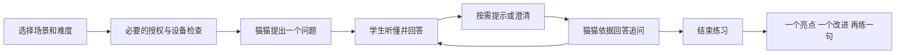

# 猫猫英语微信小程序产品需求

| 项目 | 内容 |
| --- | --- |
| 版本 | v0.1 Draft |
| 更新日期 | 2026-10-20 |
| 产品对象 | 初中阶段学生，约 12 至 15 岁；能力分级独立于年龄和年级 |
| 产品目标 | 用短时、有任务的英语对话练习口语表达和听力理解 |
| 客户端 | 微信原生小程序；现有 Web 保留为研发和对照测试入口 |
| 服务端 | 复用现有 Python 实时对话引擎，新增学习业务和身份隔离 |
| 当前阶段 | 产品设计与技术预研，尚未实现小程序，也未完成微信审核或真机音频验证 |

猫猫是面向初中生的 AI 英语练习助手。每次练习围绕一个生活场景，学生先听懂问题，再用英语表达，猫猫依据回答继续追问，结束时给出一个值得保留的表达和一个可改进点。产品成功标准是学生获得更多有效开口和听懂的机会，而非聊天时长或虚拟陪伴关系。

本需求作为后续学生产品开发的依据。原 [技术演示 PRD](00-product-requirements.md) 保留为底层实时语音能力的历史设计，不能代替本产品需求。实现路径、平台证据和公开运营条件见 [微信小程序迁移调研](10-wechat-miniprogram-migration-research.md)。

## 产品范围与发布阶段

开发顺序与对外开放资格分别管理。完成代码和音频验证，不代表可以直接向学生提供服务。

| 阶段 | 体验对象与交付 | 放行条件 |
| --- | --- | --- |
| 技术验证 | 成人研发测试员、授权或合成英语语料；开发版或可用的体验版 | 目标 AppID、基础库、隐私接口配置和真机链路可用；验证环境不向公众招生或传播 |
| 学生小规模试点 | 受控招募的学生及其监护人；不收费、不公开推广 | 监护人同意与数据流程落地，业务分类及主体条件得到确认；人数少或免费不构成自动豁免 |
| 公开 MVP | 可搜索和访问的小程序 | 完成适用的备案、登记、类目和资质、隐私、内容安全及微信提审要求 |
| 增强版 | 自然连续对话、长期学习计划 | 全双工真机门禁通过；教学反馈和数据权限经验证 |

首个技术版本采用“点击说话／我说完了”的轮流对话。录音可以持续流式上传，学生显式结束本轮后，系统回复。该交互用于给初学者留思考空间，也降低小程序回声误触发的风险。自动断句及自然语音打断作为后续增强能力，不能用未经验证的浏览器表现承诺小程序效果。

## 用户与学习目标

| 用户 | 主要诉求 | 产品回应 |
| --- | --- | --- |
| 不敢开口的学生 | 不被嘲笑，能说出完整意思 | 简单开场、关键词提示、允许停顿、先回应意思再纠错 |
| 能说但听力薄弱的学生 | 听懂问题，不依赖看字幕 | 听力模式默认隐藏英文字幕，提供重听、慢速和分级提示 |
| 已有基础的学生 | 多说几句，有连续追问 | 依据上一轮内容追问原因、细节和经历，限制猫猫长篇输出 |
| 家长或监护人 | 知道练习内容与数据用途 | 练习摘要、授权与撤回、数据删除入口；不默认公开全部对话 |

初期设置入门、基础、进阶三档，内容设计可参考 A1 至 B1；不宣称完成正式 CEFR 测级。体验前由学生自选，系统只给出调整建议，不自动把学生永久归入某一等级。分级设计可参考 [British Council 青少年口语材料](https://learnenglishteens.britishcouncil.org/skills/speaking)。

## 核心使用流程

用户可以先浏览场景，不必先交付手机号、真实姓名、学校或精确位置。启用录音前依次满足业务授权、平台隐私要求和设备录音权限；这些授权不能互相替代。首次只采集必要的年龄段声明；未满 14 岁的学生进入可核验的监护人同意流程，流程未完成前不能录音或上传学生语音。

### 首页与场景页

新增教材同步入口：先选教材版本、年级、册次与版次、章节，再选跟读／听力／口语。三个模块共用章节，不要求分别找材料；自由场景练习保留。跟读包含单词与课文／文章，优先播放对应教材录音，缺录音时展示来源或待补齐状态。文章逐句练习以经过核对的文本及录音时间点为前提。当前 Web 首版范围与后续补齐项见 [教材章节练习](16-chapter-practice.md)；小程序仍需单独实现。

首页展示猫猫、上次练习的下一步和场景卡片。首期有 10 个经人工审核的场景：介绍自己、我的学校、兴趣爱好、周末计划、一次旅行、餐厅点餐、购物、问路、邀请朋友、描述图片。

每个场景包含：适用难度、沟通任务、目标表达、已审核的开场问题、允许的追问方向、提示梯度和结束条件。场景内容保留版本号。图片、示范音频和文字必须有使用权；不把教材整册复制进内容库。

默认练习约 5 分钟，可以主动提前结束。可见的任务例如“介绍一种爱好，并回答两个追问”，而不是要求学生凑够固定消息条数。时间到时提示收尾，避免直接切断正在表达的学生。

### 口语练习页

主界面保留猫猫、当前问题、任务进度、录音控制和必要帮助。工程指标、模型名、队列和 Session ID 不向学生展示。

| 操作 | 行为与边界 |
| --- | --- |
| 开始说话 | 学生主动开启录音，明确显示正在录音 |
| 我说完了 | 结束本轮输入并提交一次 final，防止重复触发回复 |
| 再说一遍 | 重播上一条可用示范；不创建新的用户 Turn |
| 慢一点 | 重新生成或调用慢速示范，优先保持音调自然；不暗中改变练习难度 |
| 给个提示 | 关键词 → 句式开头 → 简短示范，逐步展开 |
| 中文解释 | 对当前问题提供简短中文辅助，不替学生完成整轮 |
| 暂停／结束 | 立即停止录音和播放；确认退出后结束服务端会话 |

MVP 播放期间显示“轮到猫猫说”；学生点击“开始说话”时先取消当前回复和旧音频，再启动新一轮录音。自然语音打断只有通过设备能力测试后才开放，不以播放期间持续录音作为所有机型的默认方式。

系统对没有听清的句子进行澄清，例如 “Did you say you like swimming?”，不把疑似转写直接认定为学生的语法或知识错误。学生中英混说时保留其意思，提供一个可尝试的英语表达，不羞辱口音。

### 听力练习页

以审核过的短问题或短对话为材料，先播放，再让学生口头或选择作答。答案可接受同义表达；不要求逐字复述标准答案。

默认不显示英文原文；主动点“看英文”或“中文解释”后标记本题使用了辅助。报告区分首次独立答对、重听后答对、提示后答对，不能统一计为无辅助听懂。保留重听次数，但不把多次重听作为惩罚。

### 结束反馈页

只给少量、可行动的反馈：一个表达亮点、至多一个主要改进点、一句可以马上重练的表达。反馈必须引用本次真实的学生话语，不能编造错误或虚构表现。

例如学生说 “Yesterday I go to the park”，猫猫先接话并追问，在结束时解释 “go → went”，再播放 “I went to the park yesterday.”。学生可跟说或跳过。

没有经过专项语音评测验证前，不给“发音 92 分”“英语达到 B1”等精确结论。ASR 转写准确率、语法反馈和发音质量是不同维度。音素、重音、节奏评分列入增强版，并单独评估对学生口音的公平性。

## 教学对话要求

教学策略需要由服务端显式状态控制，不能只依靠一段通用 system prompt。

| 编号 | 规则 | 可验收表现 |
| --- | --- | --- |
| T01 | 一次一个主要问题 | 猫猫默认 1 至 2 句，避免连续抛出多个问题；目标回复长度通常 10 至 35 个英文词，允许按场景调整 |
| T02 | 使用真实多轮上下文 | 记住本次会话中的兴趣、经历与已问问题；不反复重问，取消的旧回复不污染历史 |
| T03 | 纠错克制 | 以沟通为先；每轮至多一个主要纠错，训练重点可在课后解释 |
| T04 | 包容思考停顿 | 默认显式结束本轮；自动断句模式使用可调等待时间并经慢速学生语料验证 |
| T05 | 允许求助 | “I don't know”“什么意思”、长时间沉默都可转入分级帮助 |
| T06 | 识别不确定性不转嫁学生 | 允许确认转写，低可信片段不产生硬性扣分 |
| T07 | 有结束条件 | 达到沟通任务或主动结束后输出总结，停止继续追问 |
| T08 | 练习与亲密陪伴边界明确 | 猫猫可鼓励和友善交流，不诱导排他依赖、不自称真人、不索要秘密 |

预生成和投机回复应在初期关闭或仅作为受控实验。学生的半句、犹豫与自我纠正尚未完成时，不得抢答或播放基于错误 partial 的内容。

## MVP 功能优先级

| 优先级 | 功能 |
| --- | --- |
| P0 | 真正支持英语的 ASR、LLM、TTS；录音和播放；原生小程序状态机；服务端身份校验 |
| P0 | 10 个场景、三档内容难度、口语与听力模式、显式结束本轮、重听／慢速／提示 |
| P0 | 会话内上下文、短回复、错误澄清、一次练习反馈、必要的练习摘要 |
| P0 | 监护人同意、平台隐私授权、AI 身份和生成内容提示、内容安全、删除和投诉入口 |
| P0 | 真机弱网／中断恢复、记录真实链路延迟、调用成本限额、全局停止新会话开关 |
| P1 | 全双工自然打断、轻量能力自适应、薄弱表达复习、监护人摘要页 |
| P2 | 经验证的发音评测、教师任务、班级功能、商业化、长期课程 |

首版不做公开学生社区、排行榜、语音克隆、无限自由聊天、公开分享原始对话、广告和付费课程。避免在核心学习流程中引入无关复杂度；暂缓收费并不意味着公开免费服务免于相关要求。

## 数据与权限

| 数据 | 最小用途 | 默认策略 |
| --- | --- | --- |
| 应用用户 ID 与微信映射 | 登录、隔离会话 | 映射只在服务端；不把 OpenID 传给模型 |
| 年龄段与同意状态 | 判断授权流程 | 不为分级额外索取身份证、生日、学校；同意证据与学生摘要隔离保存 |
| 实时音频与临时文件 | ASR、回放 | 默认不留存原始录音；清理小程序临时文件、服务端缓存，并核实供应商保留规则 |
| 对话转写 | 会话上下文与即时纠错 | 默认当前会话使用；跨会话保留须有明确必要性和授权 |
| 学习摘要 | 下次推荐和复习 | 开启保存后按产品说明保留；建议初期 90 天可配置，作为产品方案而非法定期限 |
| 运行日志 | 故障、成本、滥用追踪 | 脱敏，默认不记录原文或原始音频；安全日志法定留存要求另行确定 |

真实学生试点前确定监护人同意的核验方式、同意版本与时间、撤回和绑定解除流程。不能仅用“我是家长”复选框宣称完成全部核验。微信录音许可也不能代替监护人同意。不满 14 周岁信息处理要求见 [个人信息保护法第 28 至 31 条](https://www.cac.gov.cn/2021-08/20/c_1631050028355286.htm)。

学习摘要、音频下载权限与账号权限由后端校验。一个家长使用同一手机时，也应支持退出或切换练习档案，避免多名学生的水平和历史混在一起。MVP 先限制一个账号一个学生档案，展示清楚这一限制。

## 验收与度量

以下数值是初期工程目标，不是现有实测结果。真实链路报告必须注明设备、网络、ASR/LLM/TTS 版本、样本数、冷启动／预热状态；Mock 结果单独标注，不能用于验收真实延迟。

| 维度 | 初期门槛或方法 |
| --- | --- |
| 连续对话 | 每台目标设备连续完成 10 轮，Turn、音频和字幕一致，无重复回复或旧音频复播 |
| 响应时间 | 学生点击“我说完了”至首段实际发声，预热且正常网络下目标 P50 ≤ 2 秒、P95 ≤ 4 秒；按设备与网络分组 |
| 停止 | 点击暂停或开始新一轮，当前设备播放停止目标 P95 ≤ 300 ms；与自然语音起点至停止的耗时分开记录 |
| 后台与中断 | 切后台、锁屏、来电／微信通话后不继续隐蔽采音；返回时由学生明确恢复 |
| 录音上限 | 覆盖平台单次录音上限及临近上限处理，提示保存或分段，不截断而无提示 |
| 音频质量 | iOS、Android 的真机设备矩阵通过；扬声器、有线／蓝牙耳机分别记录回声与录放音冲突 |
| 识别质量 | 授权英语语料覆盖口音、停顿、混说、噪声；教师标注任务是否正确理解，另记 WER，不以 ASR 置信度替代教学判断 |
| 教学质量 | 对至少 50 组多轮测试逐项核对 T01 至 T08，记录错纠、抢话、离题；涉及安全的阻断失败逐例修复 |
| 练习有效性 | 统计有效学生轮次、学生开口秒数、任务完成率；仅计 VAD 不等于有效表达 |
| 听力 | 区分无辅助、重听、看字幕、中文提示后的表现，不以少量样本推断长期能力提升 |
| 数据权限 | 未同意不采音；跨账号访问失败；撤回后停止处理；删除任务涵盖缓存、存储和供应商约定范围 |
| 成本 | 按真实 ASR 时长、LLM token、TTS 计费单位和基础设施支出核算每次练习；达到预算限额时可控终止 |

## 开发里程碑

1. 音频 PoC：原生录音 → 重分帧 → WSS → 真实英语 ASR；真实 TTS 下行 → 小程序播放，验证停止和回放回执。成人测试员先完成真机矩阵。
2. 学习 MVP：补齐场景、教学状态、帮助动作和反馈；迁移猫猫形象并在 iOS／Android 检查动画性能。
3. 学生试点准备：补齐监护人和数据流程，确认业务分类、主体和供应商条件，再开展受控学生验证。
4. 公开版准备：按迁移调研列出的发布条件准备材料并提审；不能把研发工期当作备案或审核时长承诺。

待业务负责人确定：运营主体与属地、首批试点方式、可用 AppID、可用英语语音服务、每次练习成本预算，以及是否确需长期保存学习摘要。未确定项不阻止使用成人语料完成技术 PoC。
