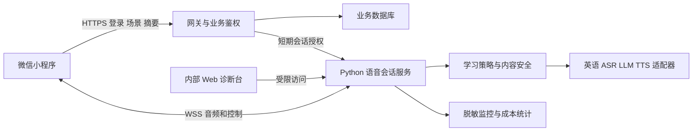

# 猫猫英语微信小程序迁移调研

| 项目 | 内容 |
| --- | --- |
| 调研日期 | 2026-10-20 |
| 对应产品 | [初中生英语小程序 PRD](09-student-english-miniprogram-prd.md) |
| 结论 | 小程序重写客户端并复用 Python 后端；先验证原生录音加 WSS 方案，再决定全双工或 RTC |
| 当前交付 | 仓库代码核查、官方资料核对、迁移设计和发布路线；不包含已完成的小程序或真机 PoC |

## 推荐决策

首期采用原生小程序 TypeScript、WXML、WXSS。Python 保留实时对话、ASR、LLM、TTS 和取消语义，新增身份、学习任务、反馈、授权和存储接口。现有 Web 保留为开发诊断台，并与小程序使用同一后端协议。

学生端先提供轮流说话：点击开始录音、点击“我说完了”提交；点击说话可以停止当前播放。连续监听和自然打断为增强模式，必须以真机录放音与回声测试结果决定是否开放。此选择是实现与教学体验的取舍，不是微信平台强制要求。

低负担推进方式是先完成成人测试员参与的内部技术验证，业务确认与开发并行；引入学生或公开服务前完成适用条件。免费、邀请码、体验版、境外服务器都不等于免除适用义务。

## 现有代码复用边界

| 模块 | 当前证据 | 迁移动作 |
| --- | --- | --- |
| `backend/protocol.py` | 24 字节包头、3200 字节 PCM；16 kHz、PCM16、单声道、100 ms | 保留协议；小程序对录音回调数据重新分帧 |
| `backend/duplex.py` | Turn、reply、epoch、取消、历史和输出队列 | 保留并加入教学状态；全双工机制可继续在研发环境验证 |
| `backend/history.py` | 内存历史过滤内部控制信号 | 保留会话内历史；增加有授权的学习摘要，不默认持久化全部转写 |
| `backend/atomic.py` | 多 ASR 适配器、兼容接口 LLM、Piper 双语音色逻辑 | 参数化英语能力；按真实服务与学生语料测试，不能把中文默认配置当成英语已就绪 |
| `backend/app.py` | aiohttp HTTP/WSS 可部署入口；当前资源门控为进程内集合 | 增加鉴权、学习 REST 接口、会话归属与额度；多实例时重新设计配额与路由 |
| `web/app.js` | DOM、浏览器 WebSocket、Web Audio 和 getUserMedia | 只能提取纯逻辑与协议，不能原样放进小程序 |
| `web/audio-worklet.js` | 浏览器 AudioWorklet 按 100 ms 采音 | 换成 RecorderManager；不能要求小程序提供相同采集节点 |
| 猫咪动画 | 内联 SVG 与 CSS，依赖口型 class 和音频元数据 | 导出 SVG 作为矢量源；小程序用 Canvas 2D 或分层素材＋WXSS，验证状态动画和加载成本 |
| 诊断 UI | 内部时间线、运行队列与模型信息 | 留在内部 Web；学生端只展示可行动错误和学习状态 |

以上来自当前仓库读取，不代表现有后端已经满足公网、多用户或学生教学要求。此前浏览器 Mock 或中文样本测试不能用于证明小程序英语能力。

## 微信音频能力核查

微信官方 `api-typings` 当前定义包含 RecorderManager 的 PCM 格式、按字节大小回调、WebSocket 二进制收发、WebAudioContext 原始音频 buffer 播放和录音中断事件；单次录音时长上限列为 10 分钟。类型声明证明接口表面存在，不证明目标手机上的音频表现。[微信官方 API 类型声明](https://raw.githubusercontent.com/wechat-miniprogram/api-typings/master/types/wx/lib.wx.api.d.ts)

本次微信开发文档站部分页面无法直接读取，因此不把站点打不开解释为接口不存在，也不拿其他小程序平台的同名 API 代替微信事实。研发开始时须以微信开发者工具安装的基础库、当前官方文档和真机结果锁定兼容范围。下文链路、缓冲和降级策略属于本项目设计。

### 上行采集和分帧

拟用 `wx.getRecorderManager()`，申请目标为 16 kHz、单声道、PCM 格式，注册 `onFrameRecorded` 和中断事件。配置中的 PCM 格式拼写、支持版本与设备返回数据须逐项验证，不能凭格式名称假设一定返回无头的 PCM16LE。

`frameSize` 是 KB，不能把一次回调当成固定 100 ms。客户端音频适配器维护字节余数缓冲，将实测的原始采样流转换为约定格式后，每取出 3200 字节再封装成协议包。末尾不足一帧应按协议约定补零并记录有效时长；停止、取消、下一轮开始时不能把旧余数带入新一轮。

如果设备只能可靠提供压缩流，则需新增服务端解码入口、编解码协商和测试；不能把 MP3／AAC 字节直接写进当前 PCM 协议。平台返回的采样率、字节序、声道、文件头、回调节奏均属于 PoC 的检查项。

建议先比较几个回调大小，用实际等待时间和抖动选择参数。不要为了凑 3200 字节直接指定未经验证的小数 KB 值。编码音频格式、网络包大小和音频时长是三个独立概念。

### WSS 传输

采用单个 `SocketTask` 承担当前会话的 JSON 控制消息和 ArrayBuffer 音频。既有 `prepare`、`create_session`、音频下行和 `playback_completed` 流程继续兼容，在 `prepare` 中协商客户端、协议、编码、采样率、声道、交互模式和能力。

音频数据不要通过高频 `setData` 中转，只在逻辑层处理二进制数据；状态、字幕和任务进度再合并更新 UI。背压按发送完成回调、本地待发字节数和服务端 ACK／队列消息实现，不能直接照搬浏览器 `WebSocket.bufferedAmount`。

沿用网络大端包头与小端 PCM payload。客户端生成 session hash 需用经验证的小程序可用 SHA256 实现；如目标引擎缺少 BigInt／DataView 64 位方法，使用两个 uint32 写入同一 8 字节字段，验证与 Python 编解码逐字节一致。hash 是路由校验值，不是鉴权令牌。

### 下行播放

实时路线使用 `wx.createWebAudioContext()`：将下行 PCM16 还原为浮点 AudioBuffer，通过 buffer source 调度播放。不能将原始 PCM 直接当作完整 MP3／WAV 文件交给 `InnerAudioContext.src`，也不能对每个 100 ms 小包进行独立的文件解码。

播放器需保留按 replyId／epoch 过滤旧包、顺序校验、预缓冲、欠载统计、停止全部 source 和尾部播放确认。`reply_complete` 表示服务端已经发完，不等于扬声器已经播完。回执在实际播放完成后发送，避免学生下一轮上下文引用未听到的回复。

如果目标设备的 PCM 调度或录放音不稳定，降级为完整句段的可播放文件，由 `InnerAudioContext` 播放，保留文本与任务交互。为该路线定义独立的服务端封装／编码和带有效期下载接口，并配置对应域名；接受首音频更慢及句间间隙，不承诺同样的流式体验。

### 前后台和音频焦点

收到小程序 `onHide`、录音中断、失去会话或主动退出时停止采音与播放，释放监听器并通知后端暂停或关闭。回到前台显示“继续练习”，由学生主动恢复；不能静默重新采集。锁屏、系统来电、微信通话、耳机拔出和蓝牙切换均要验证。

练习默认约 5 分钟，但需要验证接近平台单次录音时长上限的行为。超过限制时分段或引导结束，不能无提示截断，也不能用录音重启规避前后台权限。

### 回声和打断

小程序接口存在不代表所有手机都具备可用的全双工回声消除。扬声器播放可能被 ASR 当成学生发言；当前基于 VAD 与 partial 的门控不能当成通用 AEC 的替代品。

首版通过录放分离和显式按键减少误触发。自然连续模式要覆盖耳机与外放的互测、弱网回声、不同系统音量、机器人长回复和学生短词插话。门控确认窗口计入“语音起点至停止”的总延迟；不能只报告收到 interrupt 消息后的播放器停止时间。

## 技术路线比较

| 路线 | 复用与收益 | 主要限制 | 建议 |
| --- | --- | --- | --- |
| 原生小程序＋WSS＋PCM | 最大程度复用现有协议和 Python；便于调试 | 录放音、调度、回声和分帧由项目负责 | 首选 PoC；MVP 提供轮流说话 |
| 原生小程序＋句段音频文件 | 播放逻辑较简单，适合听力示范与重播 | 首包等待更长，取消与缓存仍需管理 | 作为明确降级路线 |
| TRTC／RTC＋服务端机器人接入 | 可利用成熟实时媒体链路 | 小程序组件权限、SDK、费用与服务端媒体桥接，非原 WSS 的直接替换 | 全双工质量不足时再比较 |
| web-view 包现有 H5 | 可用于部分展示页面 | 不能据此保证浏览器采音、AudioWorklet、授权和手机环境兼容 | 不作为核心语音入口 |
| Taro／uni-app | 多端页面可共享 | 原生音频兼容仍需独立适配和调试 | 首期只有微信端，不额外引入一层 |

腾讯云 TRTC 文档明确，小程序方案依赖 `live-pusher`／`live-player`，相关能力受类目和开通条件限制。因而 RTC 不是无需资格的默认捷径。[腾讯云小程序 TRTC 文档](https://cloud.tencent.com/document/product/647/17018)

## 目标部署与接口

这里的“前移”指把交互客户端迁入小程序，不是把模型、密钥或服务端计算搬到学生手机。

### 登录与会话授权

设计新增 `POST /api/auth/wechat`，客户端提交 `wx.login` 的临时 code，由后端与微信服务交互建立应用会话。AppSecret、session_key 和模型厂商 Key 只保存在服务端。OpenID 用于服务端身份映射，不作为裸露的登录凭证，也不发送给 LLM。

创建练习后，由后端核验用户、年龄与授权状态、额度、资源，发放短时、单次可用的语音连接 ticket。连接时和每次恢复时核验归属、有效期与一次性消费；ticket 若放 URL 必须避免日志记录并缩短有效期，优先验证目标平台可用的握手认证方案。只检查 Referer、session hash 或前端隐藏按钮都不足以实现鉴权。

### 业务接口草案

| 新接口 | 用途 |
| --- | --- |
| `GET /api/scenarios` | 读取可用场景、级别和内容版本 |
| `POST /api/practices` | 创建学习任务与目标，指定口语／听力及交互模式 |
| `POST /api/practices/{id}/voice-ticket` | 校验权限并申请短期语音授权 |
| `POST /api/practices/{id}/actions` | 显式提交本轮、重听、提示、慢速等动作；幂等键防重复 |
| `POST /api/practices/{id}/finish` | 停止练习并启动一次总结 |
| `GET /api/practices/{id}/summary` | 返回结构化学习反馈，检查账号归属 |
| `POST /api/consents` | 记录可核验的授权及版本；禁止客户端伪造服务端核验结果 |
| `POST /api/data-deletion-requests` | 撤回／删除请求与结果跟踪 |

这些为待实现接口，当前仓库不能直接调用。首期可在现有 aiohttp 中以独立模块实现，不必为了小规模试点先拆成多个微服务。

### 服务部署

生产候选使用容器化 Python 服务、TLS 反向代理和持久化业务数据库。WebSocket 所在进程保有音频状态；扩容前明确连接路由、共享额度和单用户并发策略。普通短时云函数不能直接假定可承载长连接和长时音频任务，若使用云托管需核实 WSS、超时、并发和常驻实例条件。

服务器需具备手机可访问的 HTTPS／WSS 地址和有效证书，并在小程序管理后台配置实际请求、socket 和文件域名。腾讯云的微信小程序 SDK 接入文档也要求配置相应域名白名单。[腾讯云微信小程序域名配置示例](https://cloud.tencent.com/document/product/269/117335)

手机中的 `localhost:8765` 指手机自身，不是开发者电脑。开发者工具本地调试、局域网真机联调、体验环境和正式环境应分别配置。开发环境的调试开关只用于授权开发测试，不能作为公开版网络配置方案。

模型优先选用适合英语、服务条款允许目标用户与用途的已有服务，参数通过环境配置注入。当前中文 FunASR 和固定 `zh` 提示必须替换或参数化；现有兼容接口 LLM 可以继续评估，但小模型能否正确追问与纠错需要专项验证。厂商选型和报价在取得目标并发、预算与调用条件后再锁定，不能只凭品牌声称可用。

### 学习状态与安全

新增 practiceId、scenarioId、level、mode、taskProgress、helpUsed、contentVersion 与 guardianConsentState；实时链路保留 sessionId、turnId、replyId、epoch。学习任务状态与传输连接分开，短暂掉线不能重复计课或重复生成总结。

输入和输出均有内容策略。学生的敏感内容不继续追问、进入安全响应；英语和中文均覆盖。输出应按句段或可审查片段验证后再交给 TTS，避免音频先播出、内容审核后到。记录该步骤延迟，不将安全时延从端到端指标中删去。

默认只保存必要学习摘要，不主动保存录音。必须核实 ASR／LLM／TTS 供应商的数据使用、保留、训练用途和删除能力，不能用“我们本机不落盘”代表全链路零留存。普通录音数据不一概等同于声纹识别数据，但不满 14 岁用户的个人信息仍需按适用要求保护。

## 早期验证和公开运营边界

### 可先推进的工作

原生页面、音频 PoC、教学引擎、成人内部测试与授权语料回放可以先做。使用开发版或当账号条件允许时使用体验版，不公开招募、不收费、不扩大分发。保留真实功能描述和测试访问控制。

《生成式人工智能服务管理暂行办法》第 2 条对未向境内公众提供服务的相关研发、应用活动规定了适用范围边界。因此，真实内部研发可与公开上线准备分阶段；但“邀请制”不自动证明非公众，具体范围仍看实际对象与提供方式。[网信办正式文本](https://www.cac.gov.cn/2023-07/13/c_1690898327029107.htm)

该范围边界不取消其他数据、未成年人、网络或平台要求。涉及真实学生的试点仍须完成必要流程；仅把用户数控制在某个数字没有普遍豁免效力。

### 公开前需要确认的事项

| 事项 | 对当前产品的影响 | 合理推进方式 |
| --- | --- | --- |
| 小程序备案与网络资源 | 小程序分发属于工信部 APP 备案工作覆盖范围；主体、域名与服务内容需一致 | 确定主体和属地，通过平台或接入方办理；网站备案、APP 备案、许可证不能混为一个手续 |
| 微信类目、认证与审核 | 教育相关类目与接口开放条件受账号主体和实际功能影响 | 用真实 PRD 向微信平台核对；本次未登录账号，不给出已获准的具体类目结论 |
| 教育业务认定 | 初中英语听说训练存在学科类培训认定问题 | 带任务、评价方式和完整产品演示取得属地专业判断；需要时与具备相应资格的主体合作 |
| 生成式 AI 应用登记 | 调用已备案模型不等于应用免于登记或其他手续 | 核对模型的具体服务记录，与属地网信部门确认应用的适用路径 |
| 隐私与未成年人 | 平台隐私配置、录音权限、监护人同意属于不同层次 | 真实告知、必要采集、核验同意、可撤回与删除 |
| AI 内容标识 | 文字、合成语音和交互界面涉及标识要求 | 学生端明显展示 AI 身份／生成提示，按适用规则处理导出文件及元数据 |
| 经营、支付和对外传播 | 收费、学校合作、公开分享可能改变业务条件 | 首版暂缓这些功能；实际开放前重新核对适用要求 |

备案方面，工信部通知要求先履行备案手续再开展相应业务，并明确教育等服务的相关材料要求。该通知不能被解读为每个教育工具需要同一份资质，也不能被解读为“免费即可免备案”。[工信部 APP 备案通知](https://www.miit.gov.cn/jgsj/xgj/wjfb/art/2023/art_dd783a581c9644a4aee10afa582811db.html)

教育分类方面，教育部指南从目的、内容、方式和评价综合鉴别，包含外语以及 AI 讲授、示范和互动等情形；“口语陪练”“学习工具”等名称本身不能决定分类。当前目标用户和功能需要先评估，不宜直接判为非学科类，也不宜仅凭指南断言一定属于培训机构。[教育部分类鉴别指南](https://www.moe.gov.cn/srcsite/A29/202111/t20211112_579358.html)

生成式 AI 方面，网信办 2026 年 9 月公告说明，通过 API 等直接调用已备案模型的应用或功能由地方开展登记，并要求已上线应用在显著位置或详情页展示相关服务信息。采用已有模型可减少自建基础模型的工作，不替代运营方的适用义务。[网信办 2026 年 7 至 8 月公告](https://www.cac.gov.cn/2026-09/14/c_1791136833136332.htm)

隐私方面，微信隐私接口需要声明并完成相应授权，体验版也要检查配置；这与未满 14 周岁信息处理所需的监护人同意不同。[腾讯云隐私指引适配说明](https://cloud.tencent.com/document/product/1301/97930)、[个人信息保护法](https://www.cac.gov.cn/2021-08/20/c_1631050028355286.htm)

AI 标识方面，2025 年 9 月 1 日起实施的办法覆盖文本、音频等内容，规定了交互场景显式提示以及适用的文件标识要求；做简单“AI 生成”标签不代表已满足全部技术规范。首版默认不提供合成音频导出，可减少这部分实现范围，但不取消交互界面和适用隐式标识要求。[人工智能生成合成内容标识办法](https://www.cac.gov.cn/2025-03/14/c_1743654684782215.htm)

### 对猫咪人格的具体边界

2026 年 7 月 15 日起实施的《人工智能拟人化互动服务管理暂行办法》第 2 条明确：学习教育等服务不涉及持续情感互动的，不适用该办法。这意味着有头像和友好语气本身不决定是否纳入；需要看是否实际提供持续情感陪伴。[网信办正式文本](https://www.cac.gov.cn/2026-04/10/c_1777558395078289.htm)

产品据此保持任务型练习：有限时长、明确学习目标、按需反馈、不设计排他关系与诱导依赖的留存机制。若以后加入持续情感照护、专属亲密关系或类似功能，必须重做适用性判断。此处是基于已确定功能边界的产品选择，不能靠文案改名掩盖实际功能；即使不适用这部特定办法，其他规则仍可能适用。

### 不采用的所谓捷径

不通过审核时隐藏真实功能、正式版后远程开放未申报能力，不借用不匹配的类目或他人资质，不把境外部署当作服务境内学生的当然豁免，不以不存录音、英语内容或免费为理由省略全部流程。目标是分阶段完成真实研发与适用手续，不以隐瞒换取暂时上线。

## 真机 PoC 与放行证据

| 项目 | 验证方式 | 放行证据 |
| --- | --- | --- |
| 采音 | 目标 iOS、Android 设备，正常／小声／停顿输入 | 真实字节格式、采样率、回调大小分布、持续时长与错误码 |
| 协议 | 小程序编码与 Python 解码对照；边界分片与尾部 | 音频连续、帧长正确、无跨轮余数、sequence 一致 |
| 真正英语服务 | 授权录音从小程序输入，经真实 ASR、LLM、TTS 回到手机 | 真实转写、回复、实际首播事件与模型版本；明确标注合成语料与真人语料 |
| 多轮语义 | 介绍信息、下一轮询问、后续总结；有教师答案 | 同一会话至少 10 轮，能引用前文；不能使用预设回答的 Agent 冒充真实能力 |
| 播放 | 首包、尾包、欠载、重复消息、长回复 | 连续可听、尾部确认正确，取消后无旧音频恢复 |
| 自然全双工 | 外放与耳机下播放时说短词和长句，改变音量与网络 | 回声误打断率与漏打断率、语音起点至停止分布；不通过则保留轮流模式 |
| 中断恢复 | 锁屏、来电、微信通话、切后台、断网 | 明确停止采音与播放，不静默续录，返回后可恢复或重建 |
| 学习反馈 | 检查语法、表达、听力帮助记录 | 不编造错误，不把 ASR 错误硬归因学生，不虚构发音分数 |
| 权限与身份 | 拒绝隐私／录音、监护人未通过、跨用户会话 | 未授权无采集，跨账号读取失败，过期 ticket 无法重用 |

先用开发者工具调试协议，再在真机分别验证音频；模拟器、浏览器和手机是不同证据。当前文档没有真机测试数据，不给出“已经支持全双工”或云服务已可用的结论。

## 工作拆分与成本

| 工作包 | 实现范围 | 完成定义 |
| --- | --- | --- |
| A 音频适配 | Recorder、PCM 重分帧、Socket、播放、停止、后台处理 | 完成两类系统真机 PoC，产出兼容矩阵 |
| B 学生界面 | 场景、猫咪动画、录音按钮、字幕与帮助、结束反馈 | 与 PRD 逐项对应，手机可独立完成练习 |
| C 学习服务 | 场景配置、教学状态、真实英语适配、总结 | 多轮语义与教师抽检通过 |
| D 账号和数据 | 微信登录、授权核验、ticket、隔离、摘要与删除 | 权限测试和供应商数据核对通过 |
| E 部署运营 | 容器、TLS、WSS 网关、监控、预算和限流 | 可回滚、可停止新会话，单用户故障不影响其他用户 |
| F 发布准备 | 主体、业务认定、备案登记、类目、隐私、标识 | 相应材料和平台结果可核验 |

人力与总工期应在 A 的不确定性、人员投入和可用账号确认后估算，平台审批时间独立列出。不承诺“开发几天就能公开运营”。

每次练习成本按真实计费单位计算：ASR 计费时长 × 单价＋LLM 输入／输出 token × 各自单价＋TTS 字数或音频时长 × 单价＋媒体流量和算力摊销＋重试与审核成本。连续监听可能连静音也计费，不能只用学生实际说话秒数估算。RTC 路线另加媒体服务和桥接成本。初期设置单次练习上限、用户日额度、供应商并发与日预算开关。

## 官方资料与使用限制

核查日期均为 2026-10-20。微信 API 资料以官方类型声明交叉核对，微信管理后台的具体类目、资质和开通结果仍需在实际账号确认。厂商 SDK 文档只用于其自身能力或平台接入说明，不能当作主管部门法律结论。

| 资料 | 支持范围 |
| --- | --- |
| [微信官方 API 类型声明](https://github.com/wechat-miniprogram/api-typings/blob/master/types/wx/lib.wx.api.d.ts) | 录音、音频与 Socket 接口定义；不能替代真机性能与版本验证 |
| [微信录音文档入口](https://developers.weixin.qq.com/miniprogram/dev/api/media/recorder/RecorderManager.start.html) | 实施时复核目标基础库；本次正文未能直接访问 |
| [微信 WebAudio 文档入口](https://developers.weixin.qq.com/miniprogram/dev/api/media/audio/wx.createWebAudioContext.html) | 实施时核对播放兼容性；本次正文未能直接访问 |
| [腾讯云 TRTC 小程序文档](https://cloud.tencent.com/document/product/647/17018) | RTC 媒体与组件权限条件 |
| [腾讯云微信小程序 SDK 域名配置](https://cloud.tencent.com/document/product/269/117335) | 平台域名白名单配置示例，不要求项目使用 IM SDK |
| [腾讯云隐私指引适配说明](https://cloud.tencent.com/document/product/1301/97930) | 对微信隐私指引和接口授权的说明 |
| [工信部 APP 备案通知](https://www.miit.gov.cn/jgsj/xgj/wjfb/art/2023/art_dd783a581c9644a4aee10afa582811db.html) | 备案范围、主体和流程 |
| [教育部分类鉴别指南](https://www.moe.gov.cn/srcsite/A29/202111/t20211112_579358.html) | 业务实质的分类依据；不是对本产品的已作出认定 |
| [生成式人工智能服务管理暂行办法](https://www.cac.gov.cn/2023-07/13/c_1690898327029107.htm) | 内部研发与面向境内公众服务的适用边界 |
| [网信办应用登记公告](https://www.cac.gov.cn/2026-09/14/c_1791136833136332.htm) | 调用已备案模型应用的登记及展示信息 |
| [个人信息保护法](https://www.cac.gov.cn/2021-08/20/c_1631050028355286.htm) | 最小必要、敏感信息、监护人同意与数据权利 |
| [AI 生成合成内容标识办法](https://www.cac.gov.cn/2025-03/14/c_1743654684782215.htm) | 界面、音频、导出与文件标识要求 |
| [AI 拟人化互动服务管理暂行办法](https://www.cac.gov.cn/2026-04/10/c_1777558395078289.htm) | 持续情感互动范围及学习教育排除条件 |

公开运营前由实际主体结合属地办理口径复核，本调研用于形成研发与发布决策，不是行政审批结果。
