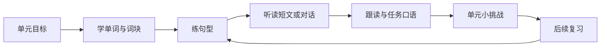

# 猫猫英语：4–9 年级英语学习产品设计

设计日期：2026-10-23。状态：产品方案，供讨论与后续开发；本文描述的新增能力尚未实现，不替代现有实现验收记录。

## 1. 产品定位

帮助 4–9 年级学生围绕学校正在学的内容，完成“认识词句 → 听读理解 → 开口运用 → 间隔复习”。教材同步是日常主线，分级原创故事与生活任务是拓展线。实时聊天是口语运用中的一种练习方式。

学生每天打开产品，应当立即知道“今天学什么、接下来做什么、哪些地方还需要练”。猫猫承担带学、示范、提示和对话角色；首页的主角是学习任务。

设计假设：首先服务使用国内英语教材的学生，沿用项目的 Web 与未来小程序方向。教材版本、实际能力和年级分别记录；年级不能代替能力判断。下述时长、篇幅与任务数量是首轮试点参数，并非课程标准或学习效果承诺。

## 2. 竞品参考及取舍

| 参考 | 已核对的公开产品机制 | 本产品采用方式 |
| --- | --- | --- |
| 多邻国学习路径 | 通过明确路径组织新课和复习，减少学生选择下一步的负担 | 首页推荐下一步，单元内有连续的小任务；保留自主选课和跳级诊断 |
| 多邻国 DuoRadio | 用故事化音频与理解题训练听力，复用近期学习的词句 | 同单元词句进入原创短对话与小故事，验证听懂而非只播放音频 |
| 流利说英语 | 官方介绍包含语音评分、口语训练课程与闯关机制 | 采用示范、跟读、反馈、再练的短循环；发音评分需另行验证后接入 |

参考来源：[多邻国学习路径](https://blog.duolingo.com/new-duolingo-home-screen-design/)、[DuoRadio](https://blog.duolingo.com/duoradio-listening-practice/)、[流利说英语](https://m.liulishuo.com/liulishuo.html)。这里核对的是公开机制，不代表完成了各 APP 所有版本的实机评测；流利说作为口语产品参考，不将其等同于用户提及的“流利学院”。

奖励用于表达学习进展：章节印章、故事解锁、猫猫装扮。答错后给提示与重试，不扣除继续学习的资格。初期不做公开排行榜、复杂虚拟货币与强制连续打卡。

## 3. 年级与能力分层

| 阶段 | 内容和交互重点 | 同主题“周末活动”的任务示例 |
| --- | --- | --- |
| 4–5 年级 | 图像、声音、短词块、单句表达；较多中文引导，较少键盘输入 | 看图识别活动，听懂一句话，用“I can…”说一句 |
| 6–7 年级 | 高频词、基本句型、短对话和短文；逐步撤去提示 | 读一段周末安排，问答“What do you do…?”并补充细节 |
| 8–9 年级 | 篇章理解、信息整合、原因与观点表达；增加自主输出 | 比较两种安排，解释选择，复述一次经历 |

首次选择年级、教材版本、册次与版次、当前单元；可做约 3–5 分钟的可跳过诊断。词汇、听力、阅读和表达分开记录，允许“阅读较强、听力较弱”。后续根据独立完成情况建议调整材料难度，学生仍可更改。无需用一次测试锁定长期等级。

## 4. 导航与首页

底部四个入口：**今日 / 课程 / 练习 / 我的**。

| 页面 | 主要内容 | 首要操作 |
| --- | --- | --- |
| 今日 | 当前单元、继续上次任务、到期复习、今日建议、完成反馈 | 继续学习 |
| 课程 | 教材同步、分级拓展；单元路径与学习目标 | 进入某单元 |
| 练习 | 单词、句子、听力、口语、阅读、综合挑战 | 针对薄弱项练习 |
| 我的 | 学习记录、生词与错题、收藏、教材设置、家长入口 | 查看进展或调整设置 |

首页草图：

```text
猫猫英语                 六年级 · 当前教材

今天的小目标：介绍你的周末安排
Unit · Weekend activities
[继续学习：听懂一段周末对话]      约 3 分钟

今日建议                         可调整
✓ 复习昨天的 4 个词
→ 听一段对话
○ 用自己的话说一说

待复习 6 项                  [开始复习]
想多练一点？  单词 / 听力 / 口语 / 阅读

今日          课程          练习          我的
```

首页只突出一个主要按钮。教材选择在首次设置和课程切换时出现，日常默认沿用，避免每次重复选择。学生在公共场所可选“现在不方便听/说”，改做可完成的阅读或词义任务，未练的听说项目保留待办。

## 5. 统一课程结构



这是组织顺序，不要求每天走完全部环节，也不禁止有基础的学生先做挑战。一个单元拆成多次短学习，每次建议约 10–15 分钟；完整单元的用时由内容量与学生情况决定。拓展阅读可独立进入。

每单元共享：目标词及词义、词块、目标句型、阅读材料、音频、听力问题、口语情境、反馈依据。新学词句要在后续听读与表达中再次出现。词汇专项、章节学习和复习引用同一知识点，避免各模块互不相认。

## 6. 六项训练与复习

### 6.1 单词：从认得走向会用

学习卡包含发音、目标词义、图片或情境、常见词块和一个短例句。练习顺序可为：听音选图 → 词义匹配 → 遮住答案回忆 → 拼写或听写 → 放进句子表达。低年级优先图音匹配，高年级增加搭配、词形和语境辨义。

不把“看过单词”记为“掌握”。同一个词按具体词义分别记录认义、辨音、拼写、运用，允许能力状态不同。单词跟读只是其中一项，不能代替理解和回忆。

### 6.2 句子：理解结构并迁移

短讲解 → 听读示范 → 句子排序 → 替换词造句 → 看图表达 → 在对话中使用。语法随句型出现，例如用“I went…”描述经历，再解释过去时的必要变化。中高年级可从错题打开简短语法卡。

避免只靠词块拖拽判断学生会造句；最终安排一次无完整句子提示的输出。

### 6.3 课文与文章：跟读和阅读理解分别练

教材课文服务课内同步，原创分级文章服务迁移。阅读流程：明确阅读问题 → 首读抓主旨 → 再读找细节 → 回到原文定位依据 → 复述或表达观点。跟读流程：先听示范 → 分句跟读 → 录音对照 → 整段朗读。

支持查词与收藏，但先给语境提示，中文整篇翻译放在需要时展开。理解题覆盖主旨、细节、顺序、指代与简单推断，逐级增加。阅读题应能从指定文本找到依据；不能把朗读完整等同于理解文章。

逐句高亮依赖核对过的文本与音频时间轴。仅有录音的材料继续使用现有整段听读；缺少文本或答案时明确显示资源状态。

### 6.4 听力：区分独立听懂与借助提示

先听任务要求，再播放材料并答题。题型逐步覆盖听音选图、关键词识别、对话理解、信息表填写、短篇理解；较高年级加入简短听写。

首次默认隐藏原文，帮助按“重听 → 慢速 → 关键词 → 英文原文 → 中文解释”展开。分别记录首次独立作答、重听后作答和提示后作答。复习时再用无字幕材料确认听懂。

题后反馈指出漏听的信息及相应音频位置，而非只展示对错。听力题答案、同义答案及解析应经过审核。

### 6.5 口语：由有支架到自主表达

四种入口：单词/句子跟读、课文朗读、情景任务、自由聊天。情景任务使用本单元内容，例如“向猫猫介绍你的爱好，补充一个原因，再反问它一个问题”。实时聊天能力用于角色对话和自由聊天。

初学者可依次展开关键词、句首和完整示范；熟练后逐渐撤去。学生说完后先回应内容，结束时给一个亮点、一个改进点和一次重试，不逐句打断纠错。

区分任务是否完成、意思是否清楚、表达是否合适、发音是否可懂。ASR 文字识别不能直接当作发音评分；现阶段先提供示范回放和录音对照。识别不确定时请学生确认，不能直接记为知识错误。

### 6.6 综合挑战：验证能否迁移

围绕一个小情境组合听、读、说，例如“计划一次周末野餐”：听懂出发时间，读懂物品清单，再表达自己想带的东西。挑战以本单元目标为范围；独立完成才形成相应能力证据。

写作先以拼写、造句与短复述融入现有任务，高年级段落写作和专项应试训练放入后续阶段。

### 6.7 复习：贯穿所有模块

每次学习先做少量到期复习。初版可采用次日、数日后、一周后的可调整规则，再根据独立作答结果提前或延后；这些是产品初始参数，需要试点调整。

错题进入的是对应词义、句型或理解能力，复习换一种题面验证迁移。当天立即重试通过，只标记为“本次订正”；经过间隔再独立答对后，才提高掌握状态。离开页面或单纯播放完成不产生掌握证据。

## 7. 一个可演示的学习闭环

示例为原创六年级拓展内容，并非某教材的准确单元映射。

主题：周末活动。目标词块：visit grandparents、play badminton、read a book；句型：“What do you do on weekends?”、“I usually…”。

| 一次约 12 分钟的任务 | 内容 | 应留下的记录 |
| --- | --- | --- |
| 2 分钟复习 | 昨天学过的 4 个词块，遮住答案回忆 | 独立回忆或使用提示 |
| 3 分钟词句 | 学 3 个活动词块，替换句型表达 | 词义理解与造句表现 |
| 3 分钟听读 | 听一段原创对话，回答活动与时间问题；按需读文本 | 首次答案、重听和文本辅助 |
| 3 分钟口语 | 与猫猫互相介绍周末，完成“活动 + 一个细节” | 任务完成证据和使用的提示 |
| 1 分钟反馈 | 一个亮点、一个待练项、下次复习安排 | 完成状态和复习计划 |

下一次安排同主题短文及信息定位，不把完整文章训练强塞进当天。反馈用“你能介绍周末活动了；下次再练听懂时间”，避免只显示聊天时长和积分。

## 8. 内容与学习记录

内容对象最少包括：课程、教材版次、单元、知识点、词义/词块、句型、文章、音频片段、题目、口语任务。每项内容带来源、版本、适用难度、审核状态及使用范围。

学习记录包含：学生、内容版本、题目、尝试次数、首次答案、辅助行为、完成状态、相应知识点和下次复习时间。口语另记录任务与反馈依据；录音留存遵循项目已有授权和删除方案。完成、订正、独立掌握三个状态分开。

教材同步与原创拓展明确标识。对外可访问的教材录音不自动意味着可复制分发全部课文。文本、图片、音频、题目和解析逐项确认可用范围，未经核对的自动转写不能冒充教材原文。

AI 适合按审核材料组织提示、解释、追问和反馈；标准词义、教材文本、正式题目答案由审核内容提供。先有可用的内容模板和审核流程，再扩大自动生成比例。

## 9. 结合仓库的实现建议

| 现有能力 | 下一步使用方式 | 需要补齐 |
| --- | --- | --- |
| 教材目录、章节与音频接口 | 作为课程目录与示范资源底座 | 词表、句型、文本、题目及来源审核 |
| 跟读页、选段循环、本机录音 | 作为第一版课文听读工具 | 逐句时间轴及学习完成记录 |
| 六至九年级聊天 Agent | 保留自由聊天能力 | 四五年级配置及验证、独立的任务口语流程 |
| 实时语音、取消与打断 | 作为口语音频交互底座 | 将学习任务状态与音频播放状态分开管理 |
| 章节原创主题口语 | 转成可审核的口语任务模板 | 目标、提示梯度、完成证据和结束反馈 |

当前 `backend/english_chat.py` 的提示明确不承担课程、测验和评分。任务口语宜新增教学流程，在应用层共用语音与 Bot 接口；自由聊天继续独立运行。课程进度和复习记录由学习业务保存，不依赖聊天历史推断。

## 10. 分阶段交付与验收

**第一阶段：一个可完整学习的样板单元。** 选择现有资源较完整的一个教材版次和单元，补齐审核词句、文本、听力题及口语任务；做出今日页、单元路径、答题反馈、进度与基础复习。先验证从学到用的闭环，再扩充目录。

验收：学生可完成并中途恢复任务；词句在听读和口语中重复出现；听力辅助行为被正确记录；立即重做不等于长期掌握；缺材料不显示虚假完成；课程成绩不受语音重连或重复提交影响。没有发音评测服务时不展示假分数。

**第二阶段：验证年龄跨度与内容生产。** 覆盖 4–5、6–7、8–9 三个阶段的代表单元，验证低龄引导、不同难度及四五年级口语。补充分级原创阅读、材料审核工具、跨模块复习和简明家长周报。家长报告展示所学、独立完成与待复习项，不默认展示全部对话。

**第三阶段：扩大课程与个性化。** 在内容质量与语音能力验证后，逐步扩展教材册次、动态难度、可靠发音评测、段落写作与专项训练。

第一阶段的验证重点是：学生能否顺利完成一个学习闭环，几天后是否仍能独立运用，内容制作是否可持续。不能以已有目录数量、累计录音播放或聊天时长证明课程已经完整。

## 11. 后续讨论点

后续优先确认：首个样板教材版次与单元、产品先用 Web 验证还是直接推进小程序、可用于正式呈现的文本与题目资源。本文先按 Web 验证产品闭环设计，保留未来小程序适配，不承诺尚未完成的平台能力。
